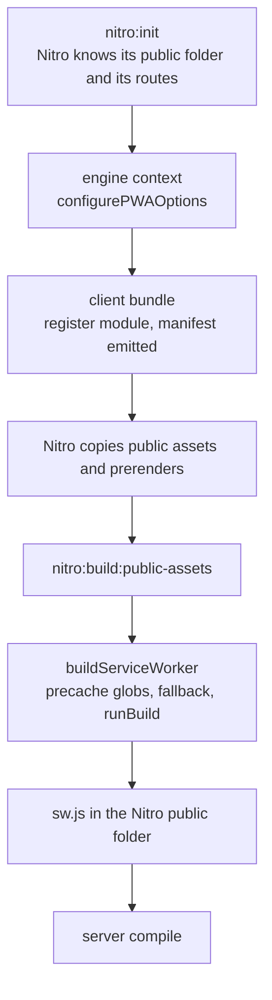

# unplugin-pwa-nuxt

`packages/unplugin-pwa-nuxt` (npm `unplugin-pwa-nuxt`) is the PWA module for Nuxt 5 and Nitro 3 on [`@unplugin-pwa/vite`](https://github.com/vite-pwa/unplugin-pwa), the engine that `vite-plugin-pwa` became. Registered under the `pwa` key, it takes the engine's own options unchanged and adds only what the engine cannot know about a Nuxt app: where Nitro serves the worker from, what the precache holds, which routes the server answers, the manifest link in the page's head, and a client plugin that registers the worker and provides `$pwa`.

It replaces `@vite-pwa/nuxt`, which every version of Nuxt since 3.6 forced to carry. Nothing below Nuxt 5 is supported, so what that module spent most of its code on, the version gates, the Nuxt 4 component folders, the pre-3.8 regeneration path and the webpack guard, was deleted rather than ported. The upstream trackers of both are audited in [upstream](upstream/design.md), and the module is the package the [dependency absorption](../architecture/dependency-admission/design.md) flow produced for the PWA seam.

## How a build runs

- **The engine's own close-bundle run is not registered.** It runs when the client bundle closes, before Nitro has copied the bundle and the public folder into the folder it serves, so a precache listing made then misses what Nitro adds. The module builds the worker at Nuxt's `nitro:build:public-assets` hook instead, which Nuxt 5 fires from Nitro's `vite:compile:before`, after the copy and the prerender and before the server compile.
- **`configurePWAOptions` is where Nuxt speaks.** The engine resolves its options from Vite's config and then asks the context to correct them. The module answers with Nitro's public folder as the output directory, the build-assets folder (`_nuxt`) without its slashes as the immutable-assets folder, and the process's working directory as the folder the engine writes `swSrc` and `globDirectory` relative to, because workbox reads both relative to the process and the engine's helper joins them to whatever folder it is given (`vite-pwa/unplugin-pwa` #44 is that join gone wrong).
- **The precache is settled at the hook, not before it.** Without a glob of its own the worker precaches `**/*.{js,css,html}` and the build's app manifest under `_nuxt/builds/meta/`, and `**/_payload.json` only when the build wrote one: workbox fails a pattern that matches no file, which is vite-pwa/nuxt #169. A prerendered page is keyed by its route (`about/index.html` is `about`, `index.html` is the base URL) and an app manifest, named by its content, has no revision.
- **The server's routes are never answered with the shell.** A navigation route that matches every path answers an API route, a file the server serves and a redirect with the cached page, which is vite-pwa/nuxt #74, #136 and #203. The module turns Nitro's non-catch-all GET routes into anchored patterns, so `/api/trpc/**` denies `/api/trpc` and what is under it and never `/apiary`, and hands them to a worker built from source as `virtual:unplugin-pwa-nuxt/navigation-denylist`. For `generateSW` it sets `navigateFallbackDenylist` from the same list. A route rule that turns server rendering off is not a server route, so the shell keeps answering it.
- **A page is answered network-first, never from a precached entry with no revision.** Workbox never refetches an entry whose revision is null, so a home page precached that way outlives the build it came from: a returning visitor is served a page whose script and style names the next deploy has removed, and the app that would offer them the update cannot load. The app's worker answers each navigation from the network with a short timeout, keeps the page it got in a small `pages` cache for the moments there is no network, and precaches only the build's own files, each named by its content or carrying a revision. A page never visited is not available offline.
- **Workbox's window helpers are the app's own dependency.** The engine's register code is a virtual module, Vite resolves its imports from the app's root, and a package manager that hoists nothing leaves an app without `@vite-pwa/workbox-window`: rolldown then leaves both specifiers as bare imports in the shipped `register.js` and only warns, so the build passes while the registration cannot load. The engine closed [vite-pwa/unplugin-pwa#48](https://github.com/vite-pwa/unplugin-pwa/issues/48) by documenting that each app installs the package itself, and the module follows that rather than resolving the specifiers for the app.
- **Dev is the engine's.** The dev plugins serve the manifest and, with `devOptions.enabled`, the dev worker, and the module gives a worker built from source a denylist drawn from the same Nitro routes, so one worker source runs in both.

## What the app gets

| Surface                                         | What it is                                                                                                                                                                                         |
| :---------------------------------------------- | :------------------------------------------------------------------------------------------------------------------------------------------------------------------------------------------------- |
| `pwa` in `nuxt.config`                          | The engine's options, typed and unchanged, plus `periodicSyncForUpdates`, the seconds between checks for a newer worker                                                                            |
| `<link rel="manifest">`                         | Written into the app's head from the manifest option, under the base URL and with `crossorigin="use-credentials"` when `useCredentials` is set, so no component is placed and no entry is repeated |
| `$pwa`                                          | `needRefresh`, `offlineReady`, `registrationError` and `updateServiceWorker()`, provided by a client plugin that registers the worker as the app starts                                            |
| `virtual:unplugin-pwa-nuxt/navigation-denylist` | The server's routes as patterns, imported by a worker built from source; the types ship as `unplugin-pwa-nuxt/navigation-denylist`                                                                 |

The update check calls `registration.update()` every `periodicSyncForUpdates` seconds while the tab is online and no new worker is installing, and a rejected check is logged rather than left unhandled (vite-pwa/nuxt #182, PR #230).

## Decisions as built

The [audit](upstream/design.md) states targets R1 to R20. Where the build took a simpler shape than a target, the shape is here and the audit's row is read against it.

- **`$pwa` is what a reader of it uses.** R10 listed eleven fields. The app reads `needRefresh` and `updateServiceWorker`, so the object carries those, `offlineReady` and `registrationError`, and nothing for an install prompt, an installed-state flag or the registration. That makes R12, the install prompt's timing, and vite-pwa/nuxt #67 and #229, which concern code that is not there, not applicable. The browser's own install affordance is the one the reader already knows, as the [PWA design](../architecture/pwa/design.md) records.
- **No immediate check on activation.** R11 and vite-pwa/nuxt #221 asked for a check the moment a worker activates. A worker has just been fetched when it registers, so the periodic check is the whole of it.
- **No theme-colour meta.** The old assets component wrote one only from the icon generator's output, and an app with its own SEO module owns that tag.
- **Icons are the app's own** (R13): the module carries no icon option, so the engine's icon generator is never set, and it writes no icon component, icon types or alias. The app's icons come from its own command.
- **The module's options are the engine's, with two set here.** `base` takes Nuxt's `baseURL` where the engine would take Vite's `base`, and `injectRegister` is `false`, because the module's client plugin registers the worker and the engine's `auto` would inject a second register script. Every other option is the engine's default, so a default the engine changes is changed here by the bump; `scope` follows the base.
- **The Vitest allowlist keeps the module out, for the old reason.** Loading it under Vitest on Windows fails with `The argument 'filename' must be a file URL object, file URL string, or absolute path string. Received 'file:///@unplugin-pwa/virtual:pwa-register/vue'`, on the engine's register module, the virtual id the module's client plugin imports as `virtual:pwa-register/vue` (R16 is not met). It is a Vitest and Windows seam, not the module's ([vitest-dev/vitest#11842](https://github.com/vitest-dev/vitest/issues/11842): `createRequire` rejects the driveless URL Vite builds for a `/`-prefixed id), and the probe is in [test harness workarounds](../architecture/test-harness-workarounds/design.md).

## Proof

| Test                                            | What it holds                                                                                                                                                                                                                                                                                                                                           |
| :---------------------------------------------- | :------------------------------------------------------------------------------------------------------------------------------------------------------------------------------------------------------------------------------------------------------------------------------------------------------------------------------------------------------ |
| `test/build.test.ts`                            | One `nuxt build` of `test/fixture`, a page, a server route and a TypeScript worker: the worker is written after Nitro's copy, its precache lists the manifest, the app manifest and the shell, its denylist is the server's route, and the manifest carries the configured colour; the build writes nothing to stderr, so an unresolved import fails it |
| `src/module.test.ts`                            | The manifest link under a base URL, the client plugin template and its registration for the client only, and a disabled module adding nothing                                                                                                                                                                                                           |
| `src/services/getNavigationDenylist.test.ts`    | A catch-all never denies the shell, a prefix route never matches a longer name, parameters and wildcards, literal escaping and the base URL                                                                                                                                                                                                             |
| `src/services/createManifestTransform.test.ts`  | A page keyed by its route, an app manifest without a revision                                                                                                                                                                                                                                                                                           |
| `src/runtime/createPwaPlugin.test.ts`           | A rejected update check is logged (vite-pwa/nuxt #182), and no check is made offline or while a worker installs                                                                                                                                                                                                                                         |
| `scripts/src/workspace/nuxtModuleNames.test.ts` | The module's `MODULE_NAME` is its package's name and its `meta.name`                                                                                                                                                                                                                                                                                    |

## Key files

| File                                                                 | Role                                                                                                                                                   |
| :------------------------------------------------------------------- | :----------------------------------------------------------------------------------------------------------------------------------------------------- |
| `packages/unplugin-pwa-nuxt/src/module.ts`                           | The module: head link, client plugin, type template, and the hooks that build the worker                                                               |
| `packages/unplugin-pwa-nuxt/src/services/configurePwaOptions.ts`     | The engine's `configurePWAOptions`: output folder, immutable assets, working directory, the public folder the icons are read from, the denylist plugin |
| `packages/unplugin-pwa-nuxt/src/services/buildServiceWorker.ts`      | The precache globs, the manifest transform, the `generateSW` fallback and denylist, and the engine's build                                             |
| `packages/unplugin-pwa-nuxt/src/services/getNavigationDenylist.ts`   | Nitro's routes as anchored patterns                                                                                                                    |
| `packages/unplugin-pwa-nuxt/src/services/createManifestTransform.ts` | Pages keyed by route, app manifests without a revision                                                                                                 |
| `packages/unplugin-pwa-nuxt/src/runtime/createPwaPlugin.ts`          | The client plugin: registration, the update check and `$pwa`                                                                                           |
| `packages/unplugin-pwa-nuxt/navigation-denylist.d.ts`                | The types of the denylist's virtual module                                                                                                             |
| `apps/web/configuration/pwa.ts`                                      | The app's options: manifest, `buildSW` source, prompt registration, the hourly check and the precache size policy                                      |

Upstream: [audit of both trackers](upstream/design.md) and [its spec](upstream/spec.md).
