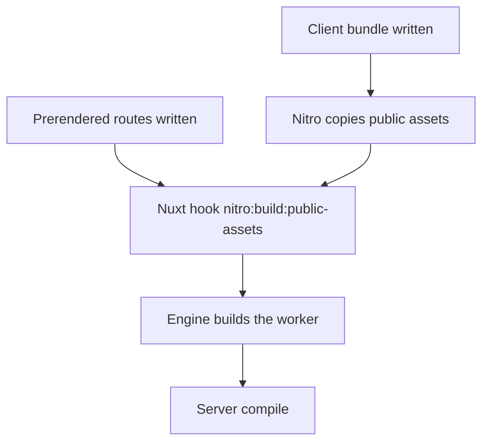
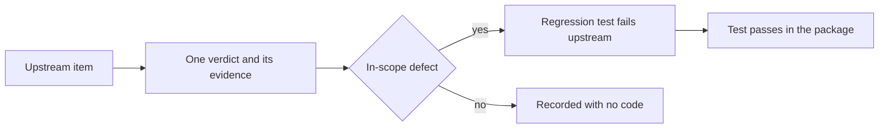

# unplugin-pwa-nuxt upstream audit

This is the audit `unplugin-pwa-nuxt` owes before its code: every issue and pull request on the two trackers below, open and closed, each with one verdict from the [spec](spec.md) and the evidence that decided it. The `dependency-absorption` skill sets the process, and the rule an absorption meets is in [dependency admission](../../architecture/dependency-admission/design.md).

> **As built.** The package took a simpler shape than some targets below; the shape each took, and the reason, is under [Decisions as built](../README.md#decisions-as-built). R10 is a smaller `$pwa`, R11 keeps the update check without the immediate one, R12 and the client-guard defects it names are not applicable, R14 is met by the app's head config, R16 is not met (the Windows crash is Vitest's and reproduces with this module), R4 hands the engine the process's working directory because workbox reads its paths from there, and the drop list's items are all deleted.

## Purpose and scope

The audit covers two upstream trackers. [vite-pwa/nuxt](https://github.com/vite-pwa/nuxt) is the Nuxt module `@vite-pwa/nuxt` that the package replaces, read at its 1.1.1 release. [vite-pwa/unplugin-pwa](https://github.com/vite-pwa/unplugin-pwa) is the engine the package builds on, read at its 0.0.3 release, and the engine is a real dependency at an exact pin (R1). The module is not a dependency: the package absorbs it by reading and rewriting it, never by porting it.

The package targets Nuxt 5, Nitro 3 and Vite 8 only. Its module key is `pwa`, and it is named `unplugin-pwa-nuxt` in its manifest.

Five reference integrations built on the same engine are read for their layering only: [tanstack](https://github.com/vite-pwa/tanstack), [react-router](https://github.com/vite-pwa/react-router), [sveltekit](https://github.com/vite-pwa/sveltekit), [astro](https://github.com/vite-pwa/astro) and [vitepress](https://github.com/vite-pwa/vitepress). Each composes the engine's plugin factories, skips the engine's own closeBundle worker build and builds the worker from a framework hook after the output exists. None adds a navigation denylist. The package takes that layering (R2, R6 and R10) and none of their other choices.

The surface the package supplies is the set of requirements below, each stated against what Nuxt already provides and what the module duplicates.

## Counts

| Tracker and kind                    | Items | Already fixed | Not applicable | In-scope defect | In-scope feature | Out of scope | Feature declined | False positive or support | Unclear |
| :---------------------------------- | ----: | ------------: | -------------: | --------------: | ---------------: | -----------: | ---------------: | ------------------------: | ------: |
| vite-pwa/nuxt issues                |   142 |            30 |              1 |              11 |                1 |           14 |                5 |                        57 |      23 |
| vite-pwa/nuxt pull requests         |    91 |            33 |             48 |               3 |                4 |            0 |                2 |                         1 |       0 |
| vite-pwa/unplugin-pwa issues        |     5 |             2 |              1 |               1 |                0 |            0 |                1 |                         0 |       0 |
| vite-pwa/unplugin-pwa pull requests |    42 |            14 |             28 |               0 |                0 |            0 |                0 |                         0 |       0 |
| Total                               |   280 |            79 |             78 |              15 |                5 |           14 |                8 |                        58 |      23 |

The counts sum to the item count of each tracker and kind, and the verdict tables below carry the same counts row by row. An item split between the package and a neighbour is counted under its adapter-side verdict; its verdict cell names both sides.

## What our configuration triggers

The app's PWA configuration sets the client plugin's hourly update check, the prompt registration type, the worker's file name and manifest, and a TypeScript worker built with the injectManifest strategy. Every other option is the absorbed module's default. Five facts about the app decide which upstream defects reach it:

- The worker answers every navigation with the precached app shell and carries no denylist, so server and server-rendered navigations are answered from the shell as well (R7).
- Nuxt 5 turns on app manifests and payload extraction by default, and the app does not turn them off, so the payload branches run (R9).
- Route rules turn server rendering off for several app routes, which the shell may answer by design. The denylist derives from the route rules, so the shell keeps answering those routes and server routes stay out of its reach (R7).
- The app's icon head component mounts beside the repository's security module, which issues the CSP nonce, so head entries must carry keys (R14).
- The app generates its icons with an external command-line generator rather than through the module, so the icon option is kept for parity, and the app's icons still come from its own command (R13).

The Vitest allowlist keeps the module out, because loading it under Vitest crashes the Nuxt config on Windows (R16): the crash reproduced with `unplugin-pwa-nuxt`, so the allowlist stays.

## Build order

The package builds the worker from the Nuxt hook `nitro:build:public-assets`, which Nuxt 5 fires after Nitro has copied the public assets and prerendered, and before the server compile. The engine's own closeBundle run is earlier, before the client bundle is copied into the Nitro public output, so the package does not register it (R6).

## Verdicts

Every item carries one verdict from the set in the [spec](spec.md) for each side of the package it concerns. Where an item needs a qualifier, it sits in parentheses after the verdict, and the evidence sits in the last column. An in-scope defect's verdict stands on its evidence until its regression test has run, and the evidence says which defects were read from source or from a reporter's report alone.

| Verdict                   | What it records                                                                                                    | Evidence it needs                                                           |
| :------------------------ | :----------------------------------------------------------------------------------------------------------------- | :-------------------------------------------------------------------------- |
| already fixed             | The absorbed module or the engine already does what the item asks                                                  | The fixing pull request, comment or source line                             |
| not applicable            | The item concerns a Nuxt or Nitro release the package does not target, a dependency bump, a chore or documentation | The reason it does not reach the package                                    |
| in-scope defect           | The absorbed module or the engine misbehaves in a way the package must not reproduce                               | The reproduction, or the source line and the regression test that proves it |
| in-scope feature          | The absorbed module offers it or the app needs it, and it is cheap and fits the package                            | The offer in the module or the app's need                                   |
| out of scope              | Another owner holds the behaviour                                                                                  | The owner, named                                                            |
| feature declined          | The package keeps it out                                                                                           | The reason                                                                  |
| false positive or support | A usage question or a configuration error, not a defect                                                            | The comment or source that shows the usage                                  |
| unclear                   | No maintainer answer, or no reproduction                                                                           | The step that would settle it                                               |

### vite-pwa/nuxt issues (142)

| Item                                                | Title                                                                                                                                                                 | State                 | Verdict                                                                                                                                                                      | Evidence                                                                                                                                                                                                                                              |
| :-------------------------------------------------- | :-------------------------------------------------------------------------------------------------------------------------------------------------------------------- | :-------------------- | :--------------------------------------------------------------------------------------------------------------------------------------------------------------------------- | :---------------------------------------------------------------------------------------------------------------------------------------------------------------------------------------------------------------------------------------------------- |
| [#1](https://github.com/vite-pwa/nuxt/issues/1)     | add \$pwa types                                                                                                                                                       | closed (completed)    | already fixed (feature shipped)                                                                                                                                              | PR #4 (nuxt hook registers types) and PR #44/#88/#105; \$pwa typed in runtime/plugins/types.d.ts                                                                                                                                                      |
| [#2](https://github.com/vite-pwa/nuxt/issues/2)     | expose service worker                                                                                                                                                 | closed (completed)    | already fixed (feature shipped, API since deprecated)                                                                                                                        | PR #5 exposed registration; PR #193 deprecated getSWRegistration in favour of runtime hooks (types.d.ts comment)                                                                                                                                      |
| [#6](https://github.com/vite-pwa/nuxt/issues/6)     | Nuxt build error after adding PWA module                                                                                                                              | closed (completed)    | false positive or support (environment)                                                                                                                                      | userquin closed it as not related to the module; reporter's fix was node --max-old-space-size                                                                                                                                                         |
| [#7](https://github.com/vite-pwa/nuxt/issues/7)     | Service workers are not generated with static build                                                                                                                   | closed (completed)    | already fixed                                                                                                                                                                | PR #8 "fix: add nuxt generate support" closes #7; later Netlify outDir case answered by userquin (configure outDir); module now derives outDir from nitro publicDir in configurePWAOptions (PR #26)                                                   |
| [#10](https://github.com/vite-pwa/nuxt/issues/10)   | 200.html / 400.html - without file extension in service worker                                                                                                        | closed (completed)    | unclear                                                                                                                                                                      | reporter closed it saying "now it works... I don't know why"; no repro, no cause recorded                                                                                                                                                             |
| [#13](https://github.com/vite-pwa/nuxt/issues/13)   | non-precached-url: non-precached-url:: [{"url":"index.html"}]                                                                                                         | closed (completed)    | false positive or support (usage)                                                                                                                                            | userquin: prerender a shell route (nitro.prerender.routes ['/']) or navigateFallback null; reporter confirmed "Working Thanks"                                                                                                                        |
| [#14](https://github.com/vite-pwa/nuxt/issues/14)   | ERROR Cannot start nuxt: Cannot find package 'vite-plugin-pwa'                                                                                                        | closed (completed)    | already fixed                                                                                                                                                                | PR #15 "install only pwa module" closes #14; vite-plugin-pwa is a runtime dependency (module package.json)                                                                                                                                            |
| [#16](https://github.com/vite-pwa/nuxt/issues/16)   | Docs not work                                                                                                                                                         | closed (completed)    | unclear (support)                                                                                                                                                            | userquin suggested writePlugin: true; warning text not in the issue body, so whether it reproduces on 1.1.1 is not shown                                                                                                                              |
| [#17](https://github.com/vite-pwa/nuxt/issues/17)   | nuxt 3 build and preview                                                                                                                                              | closed (completed)    | already fixed (Nuxt 3.2 layout, old Nuxt only)                                                                                                                               | PR #19 "support Nuxt 3.2.0" closes #17 and #18; root cause was Nuxt 3.2 emitting the manifest into the server build folder; current module writes it through nitro publicAssets                                                                       |
| [#18](https://github.com/vite-pwa/nuxt/issues/18)   | Doesn't work in nuxt 3.2.0                                                                                                                                            | closed (completed)    | already fixed (Nuxt 3.2 layout, old Nuxt only)                                                                                                                               | PR #19 closes #18                                                                                                                                                                                                                                     |
| [#22](https://github.com/vite-pwa/nuxt/issues/22)   | urlPattern doesn't work as expected                                                                                                                                   | closed (completed)    | false positive or support (usage)                                                                                                                                            | userquin answered with RegExp urlPattern (^…/posts.\*); reporter confirmed "Now it works"                                                                                                                                                             |
| [#23](https://github.com/vite-pwa/nuxt/issues/23)   | pwa install on phone                                                                                                                                                  | open                  | false positive or support (usage question)                                                                                                                                   | userquin: check browser support and use showInstallPrompt/install(); feature is the browser's                                                                                                                                                         |
| [#24](https://github.com/vite-pwa/nuxt/issues/24)   | Glob Pattern Error                                                                                                                                                    | closed (completed)    | false positive or support (intended warning)                                                                                                                                 | userquin: warning only on dev server with devOptions.enabled, navigateFallback allow-list                                                                                                                                                             |
| [#25](https://github.com/vite-pwa/nuxt/issues/25)   | Version 0.0.6 doesn't work in Vercel.                                                                                                                                 | closed (completed)    | already fixed                                                                                                                                                                | userquin fixed wrong nitro hook; PR #26 "use nitro:init hook" merged                                                                                                                                                                                  |
| [#27](https://github.com/vite-pwa/nuxt/issues/27)   | [Bug] The classname of the page does not change based on the route                                                                                                    | open                  | unclear                                                                                                                                                                      | no maintainer answer; reporter says the cached index shell is served for other routes; needs reproduction (check full thread)                                                                                                                         |
| [#28](https://github.com/vite-pwa/nuxt/issues/28)   | \$pwa is of type 'unknown' type error                                                                                                                                 | closed (completed)    | already fixed                                                                                                                                                                | PR #36 "fix(plugin): add missing types" closes #28; types.d.ts augments NuxtApp.\$pwa                                                                                                                                                                 |
| [#29](https://github.com/vite-pwa/nuxt/issues/29)   | sw.js: The script has an unsupported MIME type ('text/html').                                                                                                         | open                  | unclear (partial in-scope requirement)                                                                                                                                       | no maintainer answer; the reported workaround shows the navigation fallback capturing server routes (/api). Pending source check of navigateFallbackDenylist default in vite-plugin-pwa 2.0.0                                                         |
| [#30](https://github.com/vite-pwa/nuxt/issues/30)   | Not working on nuxt 3.3.1                                                                                                                                             | closed (completed)    | false positive or support (usage)                                                                                                                                            | reporter's fix was adding &lt;VitePwaManifest /> in app.vue (closed same day)                                                                                                                                                                         |
| [#31](https://github.com/vite-pwa/nuxt/issues/31)   | No page is added to precache after visit                                                                                                                              | closed (completed)    | false positive or support (usage)                                                                                                                                            | userquin: globPatterns over-broad; VitePwaManifest needed; the reporter closed it pointing at #32                                                                                                                                                     |
| [#32](https://github.com/vite-pwa/nuxt/issues/32)   | bad-precaching-response - url - manifest.webmanifest - 404                                                                                                            | closed (completed)    | false positive or support (usage)                                                                                                                                            | userquin: registerWebManifestInRouteRules: true, or own manifest via app.head with manifest: false                                                                                                                                                    |
| [#33](https://github.com/vite-pwa/nuxt/issues/33)   | Publishable APK                                                                                                                                                       | open                  | out of scope (owner: packaging, e.g. TWA or Capacitor)                                                                                                                       | packaging an APK is not a module feature; install-state detection exists as isPWAInstalled (PR #106)                                                                                                                                                  |
| [#34](https://github.com/vite-pwa/nuxt/issues/34)   | Automatically generates app icons with different sizes.                                                                                                               | open                  | out of scope (owner: @vite-pwa/assets-generator)                                                                                                                             | generation is the assets engine's job; injection shipped via pwaAssets / NuxtPwaAssets (PR #117, experimental); the app generates its icons outside the module (generate-pwa-assets script)                                                           |
| [#39](https://github.com/vite-pwa/nuxt/issues/39)   | Need clarification on \$pwa properties                                                                                                                                | open                  | false positive or support (documentation gap)                                                                                                                                | userquin explained the lifecycle; docs for the client plugin added by PR #209                                                                                                                                                                         |
| [#40](https://github.com/vite-pwa/nuxt/issues/40)   | Sometimes does not register service worker when deployed to Vercel                                                                                                    | open                  | unclear                                                                                                                                                                      | not reproduced: userquin saw it work in normal and private browsing; reporter suspects a Lighthouse UI bug; no cause recorded                                                                                                                         |
| [#41](https://github.com/vite-pwa/nuxt/issues/41)   | AutoUpdate - does not reload page automatically                                                                                                                       | open                  | false positive or support (deployment: cache headers)                                                                                                                        | userquin: check cache headers (deployment guide) and periodicSyncForUpdates; the app uses registerType prompt by design (pwa.ts comment)                                                                                                              |
| [#42](https://github.com/vite-pwa/nuxt/issues/42)   | PWA Module breaks Nuxt Devtools Module                                                                                                                                | closed (completed)    | false positive or support (configuration error)                                                                                                                              | reporter found navigateFallback set to '/' by copy-paste; the dev plugin's allowlist is /^\\/\$/ (userquin)                                                                                                                                           |
| [#43](https://github.com/vite-pwa/nuxt/issues/43)   | [Bug Report] missing types PwaInjection with nuxt                                                                                                                     | closed (completed)    | already fixed                                                                                                                                                                | PR #44 "fix: PwaInjection type in plugin template" closes #43                                                                                                                                                                                         |
| [#46](https://github.com/vite-pwa/nuxt/issues/46)   | BaseUrl in App section of nuxt.config.ts and manifest.webmanifest                                                                                                     | closed (completed)    | already fixed                                                                                                                                                                | PR #47 "fix: webmanifest and baseURL" closes #46; dev plugin fixed in vite-plugin-pwa v0.0.10 per userquin                                                                                                                                            |
| [#48](https://github.com/vite-pwa/nuxt/issues/48)   | \$pwa.showInstallPrompt always false?                                                                                                                                 | closed (completed)    | false positive or support (usage)                                                                                                                                            | userquin: the prompt needs a browser that fires beforeinstallprompt and an app not yet installed, plus valid icons; optional chaining on \$pwa. The ClientOnly symptom around VitePwaManifest was not reproduced by the reporter                      |
| [#49](https://github.com/vite-pwa/nuxt/issues/49)   | How to drop some nuxt runtime config into service worker context?                                                                                                     | closed (completed)    | false positive or support (usage)                                                                                                                                            | userquin: use injectManifest with a custom worker and build-time define; the reporter's error was from generateSW importScripts                                                                                                                       |
| [#51](https://github.com/vite-pwa/nuxt/issues/51)   | Bug: Doesn't work on fresh Nuxt app                                                                                                                                   | open                  | false positive or support (usage; docs link)                                                                                                                                 | reporter's fix was &lt;VitePwaManifest /> in app.vue; userquin linked the docs section on registering the manifest                                                                                                                                    |
| [#52](https://github.com/vite-pwa/nuxt/issues/52)   | [Feature Request] i18n manifest.json generation based on provided localized options                                                                                   | open                  | feature declined (over-engineering for this app)                                                                                                                             | app is single-locale (pwa.ts manifest lang 'en'); a PR exists (#179, OPEN, not a draft) — see PR table. Maintainer pointed to the elk.zone integration                                                                                                |
| [#53](https://github.com/vite-pwa/nuxt/issues/53)   | How to get Runtime Caching of root "/", mixed with precache of assets.                                                                                                | closed (completed)    | false positive or support (usage)                                                                                                                                            | userquin: need one prerendered route for generateSW offline; navigateFallback undefined fixed it. Same class as #13                                                                                                                                   |
| [#54](https://github.com/vite-pwa/nuxt/issues/54)   | Better documentation regarding custom service workers                                                                                                                 | closed (completed)    | false positive or support (documentation gap)                                                                                                                                | userquin: custom push logic needs a custom worker (injectManifest guide); the app's sw.ts follows that path                                                                                                                                           |
| [#55](https://github.com/vite-pwa/nuxt/issues/55)   | require is not defined                                                                                                                                                | open                  | unclear (suspected owner: nuxt-lodash or the dev SW build)                                                                                                                   | maintainer asked for a minimal repro; reporter blamed nuxt-lodash being transpiled in the dev server; no repro by maintainer                                                                                                                          |
| [#56](https://github.com/vite-pwa/nuxt/issues/56)   | VitePWA only caches "/" and (as a possible result) only renders index (/) when running middleware code.                                                               | open                  | false positive or support (usage; dev intercept scope)                                                                                                                       | userquin: dev intercepts only the entry point and the app's own middleware redirects; reporter's workaround strategies: generateSW plus devOptions; the same navigation-fallback class as #74/#79                                                     |
| [#57](https://github.com/vite-pwa/nuxt/issues/57)   | dev-sw doesn't seem to be available.                                                                                                                                  | open                  | unclear (partly FP usage)                                                                                                                                                    | userquin: remove scope, set start\_url for base; later reporter reports the error persists with "0 config"; not resolved in thread                                                                                                                    |
| [#58](https://github.com/vite-pwa/nuxt/issues/58)   | offline not working                                                                                                                                                   | closed (completed)    | unclear (closed with no maintainer reply beyond dev-server note)                                                                                                             | userquin: offline does not work in dev, use build and preview; body describes a stopped dev server (ERR\_CONNECTION\_REFUSED)                                                                                                                         |
| [#59](https://github.com/vite-pwa/nuxt/issues/59)   | Bug fix: \$pwa.isInstalled ref update for nuxt3. (it does not work now, but i have solution)                                                                          | closed (completed)    | already fixed                                                                                                                                                                | isPWAInstalled reactive property added: PR #106 closes #59; released v0.3.5 per userquin; isInstalled is deprecated (types.d.ts)                                                                                                                      |
| [#60](https://github.com/vite-pwa/nuxt/issues/60)   | Document useNuxtApp usage for TypeScript users                                                                                                                        | closed (completed)    | false positive or support (documentation gap)                                                                                                                                | docs updated (userquin deploy preview)                                                                                                                                                                                                                |
| [#61](https://github.com/vite-pwa/nuxt/issues/61)   | New Issue with Nuxt 3.7 - [nuxt] Could not resolve id virtual:pwa-info                                                                                                | closed (completed)    | not applicable (to current Nuxt; owner Nuxt; fixed in Nuxt 3.7.1)                                                                                                            | userquin: nuxt/nuxt#22824 shipped in Nuxt 3.7.1                                                                                                                                                                                                       |
| [#62](https://github.com/vite-pwa/nuxt/issues/62)   | Service Worker Not being minified                                                                                                                                     | closed (completed)    | already fixed (not reproduced on newer engine)                                                                                                                               | reporter closed: cannot reproduce on @vite-pwa/nuxt 0.10.0 / vite-plugin-pwa 0.20.1; maintainer's analysis: the custom worker build is not minified by Vite unless configured. Our test: assert the built worker is minified (pending check in 2.0.0) |
| [#64](https://github.com/vite-pwa/nuxt/issues/64)   | Using the latest nuxt, accessing a secondary or tertiary route forces me back to the home page, trouble looking at it.                                                | closed (completed)    | unclear (closed same day; navigation-fallback class)                                                                                                                         | no maintainer answer on the thread; reporter's own repo; the later comment points at #79 (navigation fallback). Not reproduced here                                                                                                                   |
| [#65](https://github.com/vite-pwa/nuxt/issues/65)   | Is it possible to disable the PWA/worker on certain routes?                                                                                                           | open (reopened)       | false positive or support (usage; workbox config)                                                                                                                            | userquin: use navigateFallbackDenylist and globIgnores; reporter's attempt did not work (no resolution in thread)                                                                                                                                     |
| [#67](https://github.com/vite-pwa/nuxt/issues/67)   | [@vite-pwa/nuxt] TypeError: window.matchMedia is not a function                                                                                                       | open                  | in-scope defect                                                                                                                                                              | client plugin calls window.matchMedia unguarded at setup (dist/runtime/plugins/pwa.client.js, the standalone check); jsdom has no matchMedia. Reproduction by source reading; the maintainer agreed to review                                         |
| [#68](https://github.com/vite-pwa/nuxt/issues/68)   | Example is missing head section                                                                                                                                       | open                  | false positive or support (documentation gap)                                                                                                                                | docs/playground gap; no code behaviour reported                                                                                                                                                                                                       |
| [#69](https://github.com/vite-pwa/nuxt/issues/69)   | Example is missing sw.js/dev-sw.js/dev-sw.js?dev-sw                                                                                                                   | open                  | false positive or support (stale browser service worker)                                                                                                                     | userquin: uninstall the worker from the browser and run nuxt prepare; reporter confirmed a browser-held worker                                                                                                                                        |
| [#70](https://github.com/vite-pwa/nuxt/issues/70)   | \$pwa is always false                                                                                                                                                 | open                  | false positive or support (usage)                                                                                                                                            | userquin: a custom sw.js in public/ is not built; use generateSW or the injectManifest build; prerender the root when building                                                                                                                        |
| [#71](https://github.com/vite-pwa/nuxt/issues/71)   | How do you send native notifications using this package?                                                                                                              | open                  | out of scope (owner: the app's custom worker and its push backend)                                                                                                           | userquin: push needs a backend and a custom service worker; the app's push path is sw.ts (spec architecture/pwa)                                                                                                                                      |
| [#72](https://github.com/vite-pwa/nuxt/issues/72)   | PreCache Strategy error.                                                                                                                                              | open                  | false positive or support (usage)                                                                                                                                            | userquin: prerender the navigate-fallback page (default '/'). Our app precaches '/' with revision null (sw.ts line 13), so a 404 at install would fail the worker: covered as a requirement                                                           |
| [#73](https://github.com/vite-pwa/nuxt/issues/73)   | How can I cache post requests?                                                                                                                                        | open                  | out of scope (owner: Workbox and the Cache API, which stores GET responses only)                                                                                             | userquin: navigateFallbackDenylist for /api and a custom runtime-caching entry; same constraint as #181                                                                                                                                               |
| [#74](https://github.com/vite-pwa/nuxt/issues/74)   | Extremely weird routing bug(s)                                                                                                                                        | closed (completed)    | in-scope defect (the default navigation route answers SSR and server navigations; the maintainer answered only by configuration)                                             | userquin: dynamic pages need a denylist and a runtime-caching entry; PR #66 (programmatic fix) was judged too complex. Module 1.1.1 sets no denylist (shared chunk), so the default worker has none                                                   |
| [#75](https://github.com/vite-pwa/nuxt/issues/75)   | PWA must add theme-color meta tag                                                                                                                                     | closed (completed)    | already fixed (via pwaAssets injectThemeColor; app sets theme-color through NuxtSEO)                                                                                         | userquin integrated pwa assets in the plugin; resolvePWAAssetsOptions defaults injectThemeColor true; App.vue renders NuxtSEO                                                                                                                         |
| [#76](https://github.com/vite-pwa/nuxt/issues/76)   | Offline-issue of nuxt-content - not html-content                                                                                                                      | closed (completed)    | false positive or support (usage: denylist /api and \_payload.json precache)                                                                                                 | userquin: navigateFallbackDenylist for /api, \*\*/\_payload.json in globPatterns; reporter fixed in two steps. Requirement carried: payload JSON precache when payloadExtraction is on                                                                |
| [#77](https://github.com/vite-pwa/nuxt/issues/77)   | When using PWA in development mode, it's not possible to visit routes directly                                                                                        | open                  | unclear (dev-only; reproduction repo not run)                                                                                                                                | userquin: navigation should work via app navigation; reporter fixed by disabling devOptions. Reproduction repo rudolfbyker/repro-nuxt-pwa-dev-mode not run here                                                                                       |
| [#78](https://github.com/vite-pwa/nuxt/issues/78)   | How To? Custom service worker!                                                                                                                                        | closed (completed)    | false positive or support (usage)                                                                                                                                            | userquin: importScripts and import only with injectManifest; generateSW takes plugins only                                                                                                                                                            |
| [#79](https://github.com/vite-pwa/nuxt/issues/79)   | Progressive Web Application Dynamic Route Problem with vite-pwa-nuxt in nuxt3                                                                                         | closed (completed)    | false positive or support (usage; tested in dev)                                                                                                                             | userquin: dev server ignores workbox entries (test with build + preview); NetworkOnly runtime route for the email/password verify paths; mp4 belongs in public/. Navigation-fallback class continues in #74/#113                                      |
| [#81](https://github.com/vite-pwa/nuxt/issues/81)   | Workbox Runtime Cache Not Working.                                                                                                                                    | open                  | false positive or support (usage)                                                                                                                                            | LutherAdvocate and userquin: first urlPattern string is not a pattern; runtimeCaching callback with sameOrigin, and navigateFallbackDenylist for API routes                                                                                           |
| [#82](https://github.com/vite-pwa/nuxt/issues/82)   | Manifest.webmanifest Failed to load resource: the server responded with a status of 401                                                                               | open                  | false positive or support (deployment: server returns 401)                                                                                                                   | userquin: "your site returns 401 for any request"; FAQ entry on web manifest 401 (linked)                                                                                                                                                             |
| [#83](https://github.com/vite-pwa/nuxt/issues/83)   | Problems on fresh app dev and prod                                                                                                                                    | open                  | false positive or support (usage: prerender navigate fallback)                                                                                                               | userquin: prerender the navigateFallback page; devOptions is only for manifest and custom worker debugging                                                                                                                                            |
| [#84](https://github.com/vite-pwa/nuxt/issues/84)   | "@vite-pwa/nuxt": "^0.1.1" - manifest.webmanifest is 404                                                                                                              | closed (completed)    | already fixed                                                                                                                                                                | PR #85 "configuring workbox.navigateFallback=&lt;base> when missing"; manifest entry answered by VitePwaManifest usage                                                                                                                                |
| [#86](https://github.com/vite-pwa/nuxt/issues/86)   | module augmentation breaks others modules with unknown type                                                                                                           | closed (completed)    | already fixed                                                                                                                                                                | PR #87 "fix!: module augmentation types" closes #86                                                                                                                                                                                                   |
| [#89](https://github.com/vite-pwa/nuxt/issues/89)   | Upgrade from v0.1.2 to v0.2.1 throws an error                                                                                                                         | closed (completed)    | already fixed (in-scope defect class: manifest disabled)                                                                                                                     | PR #90 "register Vite plugin for pwa configuration properly" closes #89: the virtual config module was only registered when a manifest existed                                                                                                        |
| [#93](https://github.com/vite-pwa/nuxt/issues/93)   | Updating Nuxt to 3.8.1 breaks the globPatterns                                                                                                                        | closed (completed)    | already fixed (0.3.0; old Nuxt 3.8 detail)                                                                                                                                   | userquin: output folder came from Nitro, not hard-coded; the module now reads nitro output publicDir (configurePWAOptions in shared chunk)                                                                                                            |
| [#94](https://github.com/vite-pwa/nuxt/issues/94)   | Doesn't include public assets in nuxt v3.8.2.                                                                                                                         | closed (completed)    | already fixed (0.3.0)                                                                                                                                                        | same root as #93 (nitro output publicDir); userquin "fixed in next minor 0.3.0"                                                                                                                                                                       |
| [#95](https://github.com/vite-pwa/nuxt/issues/95)   | Include appManifest in manifestEntries                                                                                                                                | closed (completed)    | already fixed (0.3.1; requirement carried)                                                                                                                                   | userquin: \_nuxt/builds/\*\*/\*.json globs; UUID revisions null; latest.json revision by md5 (createManifestTransform in shared chunk); payload JSON glob added. Requirement: app manifest precache when experimental.appManifest is on               |
| [#98](https://github.com/vite-pwa/nuxt/issues/98)   | @nuxt/shema module augmentation with vuetify entries!                                                                                                                 | closed (completed)    | already fixed                                                                                                                                                                | PR #99 "fix: @nuxt/schema module augmentation" closes #98; later PR #159 removed the schema augmentation                                                                                                                                              |
| [#103](https://github.com/vite-pwa/nuxt/issues/103) | refresh dosent work when I setup vite-pwa into my nuxt app                                                                                                            | open                  | false positive or support (usage: API denylist)                                                                                                                              | userquin: add API calls to navigateFallbackDenylist; offline handling is the app's                                                                                                                                                                    |
| [#104](https://github.com/vite-pwa/nuxt/issues/104) | Specyfing different theme colors in manifest for dark mode                                                                                                            | open                  | feature declined (over-engineering for this app)                                                                                                                             | userquin: no theme variants in the web manifest; manual registration with manifest: false (elk.zone example). The app has one light theme colour                                                                                                      |
| [#111](https://github.com/vite-pwa/nuxt/issues/111) | State gets lost with "soft" reset when using @vite-pwa/nuxt and nuxt-auth-utils                                                                                       | closed (completed)    | false positive or support (usage; fixed in the reproduction repo)                                                                                                            | userquin: the PR to the reporter's repo solved it; reporter confirmed the fix path (no module change)                                                                                                                                                 |
| [#112](https://github.com/vite-pwa/nuxt/issues/112) | How to disable caching "\_nuxt" folder due to "The server responded with a status of 429" after every update!!!                                                       | open                  | false positive or support (usage question)                                                                                                                                   | userquin: registerType autoUpdate or workbox.injectionPoint undefined; reporter did not provide a repro                                                                                                                                               |
| [#113](https://github.com/vite-pwa/nuxt/issues/113) | How to use it with useAsyncData?                                                                                                                                      | open                  | false positive or support (usage; but the navigation-fallback class applies)                                                                                                 | userquin: exclude every SSR page from navigateFallbackDenylist (sveltekit#65); PR #108 open. Requirement: navigations answered from the shell must not serve stale SSR payloads                                                                       |
| [#114](https://github.com/vite-pwa/nuxt/issues/114) | Service worker keeps showing 'trying to install' when using app.baseURL under injectManifest strategy                                                                 | closed (completed)    | already fixed (engine fix, module 0.5.0)                                                                                                                                     | reporter's comment: upgrade to ^0.5.0; vite-plugin-pwa #656 referenced                                                                                                                                                                                |
| [#116](https://github.com/vite-pwa/nuxt/issues/116) | Importing the virtual module in a unit test with Vitest                                                                                                               | closed (completed)    | false positive or support (usage: mock the virtual module)                                                                                                                   | reporter: vitest 0.33 to 1.2 upgrade caused it; fixed by mocking the virtual module in vitest config                                                                                                                                                  |
| [#118](https://github.com/vite-pwa/nuxt/issues/118) | npm WARN when run "npm i @vite-pwa/nuxt -D"                                                                                                                           | open                  | already fixed (the warned package is in the 1.1.1 tree only, as workbox-build 7.4.1 under vite-plugin-pwa 1.3.0; the engine depends on @vite-pwa/workbox-build 8.0.13 alone) | userquin: the warned package is workbox-google-analytics, deprecated by Google; checked: pnpm-lock.yaml has workbox-google-analytics@7.4.1 under workbox-build@7.4.1 (used by vite-plugin-pwa@1.3.0); no unplugin-pwa package references it           |
| [#119](https://github.com/vite-pwa/nuxt/issues/119) | [Feature Request]: dynamic manifest.json via nitro                                                                                                                    | open                  | out of scope (owner: the app's Nitro route; the module emits a static manifest at build)                                                                                     | issue body proposes a server route serving manifest keys from an API; the reporter's PoC replaced the manifest href; maintainer no answer                                                                                                             |
| [#120](https://github.com/vite-pwa/nuxt/issues/120) | pwa does not cache data in Nuxt 3 SSR                                                                                                                                 | closed (completed)    | false positive or support (usage; devtools URL and allowlist)                                                                                                                | userquin: navigateFallbackAllowlist /^\\/\*/ is wrong, use /^\\/\$/; reporter attributed the rest to a Chrome DevTools URL display                                                                                                                    |
| [#122](https://github.com/vite-pwa/nuxt/issues/122) | Firefox injectManifest not working                                                                                                                                    | closed (completed)    | unclear (maintainer's browser claim not verified)                                                                                                                            | userquin: "cannot register service worker with type module in non chromium browsers"; the claim is for module service workers in Firefox, which is not verified here; dev-only; answered with importScripts                                           |
| [#123](https://github.com/vite-pwa/nuxt/issues/123) | Cannot find module '#pwa' or its corresponding type declarations.                                                                                                     | open                  | false positive or support (usage: tsconfig paths override and pnpm peer install)                                                                                             | userquin: a clean scaffold typechecks; .npmrc / tsconfig path fix; Armane-Pro (tsconfig path override with baseURL)                                                                                                                                   |
| [#124](https://github.com/vite-pwa/nuxt/issues/124) | vite-pwa/nuxt not working on ios                                                                                                                                      | open                  | unclear                                                                                                                                                                      | only comment says iOS install needs https and localhost fails; the blank screen itself is not explained or reproduced                                                                                                                                 |
| [#126](https://github.com/vite-pwa/nuxt/issues/126) | Module does nothing ? (EDIT: No Firefox support ?)                                                                                                                    | closed (completed)    | false positive or support (usage; browser support)                                                                                                                           | userquin: devOptions needed in dev; beforeinstallprompt is unsupported in Firefox (caniuse); reporter's ask was a Nuxt 2 feature                                                                                                                      |
| [#127](https://github.com/vite-pwa/nuxt/issues/127) | Nuxt3 + PWA warnings in terminal                                                                                                                                      | open                  | false positive or support (dev-only warnings; FAQ)                                                                                                                           | userquin: FAQ on suppressing workbox-build warnings in dev; stale built worker explained by Tofandel (browser held a worker from a build)                                                                                                             |
| [#128](https://github.com/vite-pwa/nuxt/issues/128) | cant use npm run build                                                                                                                                                | open                  | out of scope (owner: vite-plugin-inspect via Nuxt analyze)                                                                                                                   | error names .nuxt/analyze/.vite-inspect; no PWA code in the trace; no maintainer answer. Relevant to Windows dev (our machine)                                                                                                                        |
| [#129](https://github.com/vite-pwa/nuxt/issues/129) | I can't get 'start\_url' to work for me                                                                                                                               | open                  | out of scope (owner: browser install identity: manifest id defaults to start\_url)                                                                                           | no answer in thread; the W3C manifest spec defaults id to start\_url, so an installed app keeps its old identity. Our manifest sets id "/" (pwa.ts), which avoids the case                                                                            |
| [#130](https://github.com/vite-pwa/nuxt/issues/130) | showInstallPrompt not being called                                                                                                                                    | open                  | false positive or support (usage; browser support and sw state)                                                                                                              | userquin: sw must be installed and activated, and the browser must fire beforeinstallprompt (not iOS/Safari, some Chromium forks)                                                                                                                     |
| [#131](https://github.com/vite-pwa/nuxt/issues/131) | Uncaught ReferenceError: \_\_NUXT\_ASYNC\_CONTEXT\_\_ is not defined                                                                                                  | closed (not\_planned) | out of scope (owner: Nuxt runtime, nuxt/nuxt#25620; worker imported Nuxt runtime code)                                                                                       | userquin: Nuxt's internal setInterval runs in the worker; reporter confirmed setTimeout fixes it. Our worker imports no Nuxt runtime (scripts/src/workspace/workerScope.test.ts)                                                                      |
| [#132](https://github.com/vite-pwa/nuxt/issues/132) | Service Worker "import sentry-release-injection" error when loading page                                                                                              | open                  | out of scope (owner: @sentry/vite-plugin; generateSW takes no plugins)                                                                                                       | userquin: injectManifest builds the worker through Vite and inlines the import; buildSW strategy in vite-plugin-pwa (#933) is the path; app has no Sentry plugin                                                                                      |
| [#134](https://github.com/vite-pwa/nuxt/issues/134) | @vite-pwa/nuxt and vue-tsc conflict                                                                                                                                   | closed (completed)    | false positive or support (usage: tsconfig overrides #pwa)                                                                                                                   | userquin: extend .nuxt/tsconfig.json instead of overriding paths; reporter confirmed fixed                                                                                                                                                            |
| [#136](https://github.com/vite-pwa/nuxt/issues/136) | API Request URLs Open in New Tab Redirect to 404 Page                                                                                                                 | closed (completed)    | in-scope defect (default navigation route captures server routes; pending check that the default has no denylist)                                                            | userquin: add API and SSR pages to navigateFallbackDenylist and a NetworkFirst/NetworkOnly runtime route. Our sw.ts registers NavigationRoute with no denylist                                                                                        |
| [#137](https://github.com/vite-pwa/nuxt/issues/137) | Generate PWA Assets functionality not works when srcDir is not default                                                                                                | open (reopened)       | in-scope defect (partly fixed: PR #138 merged; PR #218 merged; reopened)                                                                                                     | reporter's root cause: image resolved against vite root (srcDir) in pwa-assets/config.ts; userquin "new version 0.8.0 ... move config inside src". Shared chunk resolves against nuxt.options.srcDir                                                  |
| [#139](https://github.com/vite-pwa/nuxt/issues/139) | Default value of navigateFallbackAllowlist                                                                                                                            | open                  | already fixed (module 1.1.1 computes the dev allowlist as the base-anchored regex, or /^\\/\$/ at the root)                                                                  | verified in 1.1.1 dist/shared/nuxt.9518178d.mjs (configurePWAOptions, devOptions.navigateFallbackAllowlist); the issue cites an old config.ts line                                                                                                    |
| [#140](https://github.com/vite-pwa/nuxt/issues/140) | offline mode: when I navigate to another route, it shows nothing, but when I refresh then it shows the page from cache                                                | open                  | false positive or support (usage: prerender '/' and runtime caching for cross-origin images)                                                                                 | userquin: SSR app must prerender index (fallback). The reporter's prerender change did not help; cross-origin image caching is app runtime-caching config (no maintainer answer on images)                                                            |
| [#141](https://github.com/vite-pwa/nuxt/issues/141) | Vite-pwa/nuxt not caching pages on a client-side rendered app                                                                                                         | closed (completed)    | false positive or support (usage: navigateFallbackAllowlist /^\\/\$/)                                                                                                        | userquin: add [/^\\/\$/] to navigateFallbackAllowlist (no html pages generated); reporter resolved with the scaffold                                                                                                                                  |
| [#142](https://github.com/vite-pwa/nuxt/issues/142) | How to handle i18n ?                                                                                                                                                  | open                  | feature declined (over-engineering for this app; same as #52)                                                                                                                | start\_url is a single manifest; localized manifests are #52/#179 (open). App is single-locale                                                                                                                                                        |
| [#143](https://github.com/vite-pwa/nuxt/issues/143) | assets generation not working with nuxt 4 without this workaround                                                                                                     | closed (completed)    | in-scope defect (same root as #137: srcDir/app layout)                                                                                                                       | reporter's workaround in config; userquin pointed at #137; resolved via #138/#218 (see #137 verdict)                                                                                                                                                  |
| [#145](https://github.com/vite-pwa/nuxt/issues/145) | Can only visit url with trailing slash once                                                                                                                           | open                  | unclear (navigation fallback class; no answer)                                                                                                                               | reporter suspects the service worker serves the page; no maintainer comment                                                                                                                                                                           |
| [#146](https://github.com/vite-pwa/nuxt/issues/146) | Nuxt 3.12.3 composable types break when @vite-pwa/nuxt is installed                                                                                                   | closed (completed)    | already fixed (0.9.0 / 0.9.1)                                                                                                                                                | userquin: fixed in 0.9.0; 0.9.1 icons plugin types without assets package; reporter confirmed "errors gone"                                                                                                                                           |
| [#149](https://github.com/vite-pwa/nuxt/issues/149) | How can i make a dialog                                                                                                                                               | closed (completed)    | false positive or support (usage question)                                                                                                                                   | userquin: install cannot be triggered from JS; intercept beforeinstallprompt and call prompt (playground layout). Closed                                                                                                                              |
| [#150](https://github.com/vite-pwa/nuxt/issues/150) | @vite-pwa/assets-generator and @vite-pwa/nuxt give error only in production, related to workbox                                                                       | closed (completed)    | false positive or support (usage: prerender '/')                                                                                                                             | userquin: prerender the / page (workbox requires the html); reporter closed linking vite-plugin-pwa #731                                                                                                                                              |
| [#155](https://github.com/vite-pwa/nuxt/issues/155) | Nuxt Plugin "provide" is not typed automatically since v3.13.0                                                                                                        | closed (completed)    | already fixed (module 0.10.1)                                                                                                                                                | userquin released v0.10.1; reporter confirmed 0 errors                                                                                                                                                                                                |
| [#160](https://github.com/vite-pwa/nuxt/issues/160) | Build Failures with TypeScript's noUnusedLocals Compiler Option                                                                                                       | closed (completed)    | already fixed (PR #161)                                                                                                                                                      | PR #161 "remove unused imports in icons plugin"; generated types pulled into node\_modules (answer: use #build path)                                                                                                                                  |
| [#163](https://github.com/vite-pwa/nuxt/issues/163) | Struggling with 'non-precached-url' and 'bad-precaching-response' errors despite following documentation"                                                             | closed (completed)    | false positive or support (usage: prerender the navigate fallback)                                                                                                           | userquin: SSR needs a prerendered fallback page; reporter's config fixed it                                                                                                                                                                           |
| [#164](https://github.com/vite-pwa/nuxt/issues/164) | No \$pwa Object in useNuxtApp() in PhpStorm                                                                                                                           | closed (completed)    | out of scope (owner: the IDE's TypeScript service)                                                                                                                           | same class as #28 (JetBrains); closed without a module change                                                                                                                                                                                         |
| [#165](https://github.com/vite-pwa/nuxt/issues/165) | pwa.workbox.clientsClaim is not working.                                                                                                                              | open                  | unclear (not reproduced)                                                                                                                                                     | userquin asked for a development-mode sw.js; a page reload takes control of the current tab; no reproduction recorded                                                                                                                                 |
| [#166](https://github.com/vite-pwa/nuxt/issues/166) | headLinkOptions.basePath has no effect                                                                                                                                | open                  | in-scope defect (pwaAssets surface; reproduction by source)                                                                                                                  | pwa-icons.mjs preparePWAIconTypes passes basePath: nuxt.options.app.baseURL and ignores userHeadLinkOptions.basePath; the reporter's one-line fix is the same. Only relevant if pwaAssets is in parity scope                                          |
| [#167](https://github.com/vite-pwa/nuxt/issues/167) | PWA Install Button Not Visible on iOS Devices                                                                                                                         | open                  | out of scope (owner: browser; Safari has no beforeinstallprompt)                                                                                                             | userquin: "a browser issue, we cannot do anything here"; pwa.client.ts replaces the browser prompt only where the event exists                                                                                                                        |
| [#168](https://github.com/vite-pwa/nuxt/issues/168) | Offline is only working in development                                                                                                                                | open                  | false positive or support (usage: dev mode does not serve the offline worker)                                                                                                | userquin: dev mode caches only the root page and cannot run offline; run build and serve the output (npx serve or node)                                                                                                                               |
| [#169](https://github.com/vite-pwa/nuxt/issues/169) | Warning - One of the glob patterns doesnt match any files.                                                                                                            | open                  | in-scope defect (candidate; reporter's config switch reproduces it)                                                                                                          | reporter: warning appears with experimental.payloadExtraction true and disappears with false; configurePWAOptions adds \*\*/\_payload.json only when enableGlobPatterns (shared chunk). Not run here                                                  |
| [#170](https://github.com/vite-pwa/nuxt/issues/170) | Configure orientation in each page (question)                                                                                                                         | open                  | false positive or support (support question)                                                                                                                                 | manifest orientation is app-wide; no answer in the thread                                                                                                                                                                                             |
| [#171](https://github.com/vite-pwa/nuxt/issues/171) | White screen when accessing application                                                                                                                               | open                  | unclear                                                                                                                                                                      | Reporter's report; a follow-up says it is intermittent with server routes (oauth callback); no reproduction; likely stale precache after deploy, not confirmed                                                                                        |
| [#173](https://github.com/vite-pwa/nuxt/issues/173) | ERROR [worker reload] [worker init] C:/xampp/htdocs/UMPSA-Connect/.nuxt/dev/index.mjs failed                                                                          | closed (completed)    | unclear (closed by reporter, cause not known)                                                                                                                                | userquin asked for a repro; reporter: "the problem is gone without reason"                                                                                                                                                                            |
| [#174](https://github.com/vite-pwa/nuxt/issues/174) | Failed to load resource: the server responded with a status of 404                                                                                                    | closed (completed)    | false positive or support (deployment: cache headers and stale precache)                                                                                                     | userquin: check cache headers; reporter pointed at the self-destroying worker guide                                                                                                                                                                   |
| [#175](https://github.com/vite-pwa/nuxt/issues/175) | Nuxt 3 PWA app (ssr: true) either installable on Chrome or on Samsung Browser, but not both with same settings. Related to &lt;ClientOnly> and &lt;NuxtPwaManifest/>. | open                  | unclear (reporter's fix not read in full)                                                                                                                                    | reporter comment claims a solution; the digest truncates it                                                                                                                                                                                           |
| [#176](https://github.com/vite-pwa/nuxt/issues/176) | Nuxt Compatibilty 4 Glob error                                                                                                                                        | closed (completed)    | false positive or support (stale experimental build cache after the Nuxt 3 to 4 switch)                                                                                      | reporter: build cache from the Nuxt 3 setup persisted after setting it to false; maintainer's globDirectory/outDir advice is the srcDir class of #137                                                                                                 |
| [#177](https://github.com/vite-pwa/nuxt/issues/177) | Change manifest on runtime                                                                                                                                            | open                  | out of scope (owner: the app's own build-time module; manifest is emitted at build)                                                                                          | userquin: disable the manifest and write a custom module that emits per-domain manifests                                                                                                                                                              |
| [#178](https://github.com/vite-pwa/nuxt/issues/178) | Unable to write the service worker file.                                                                                                                              | open                  | unclear                                                                                                                                                                      | no maintainer answer; Windows platform noted; the failing step is the workbox write, cause not shown                                                                                                                                                  |
| [#180](https://github.com/vite-pwa/nuxt/issues/180) | I want to have a request. If the parameter has a cache attribute, it will be cached for 1 minute by default. How can I customize it?                                  | open                  | false positive or support (usage question)                                                                                                                                   | runtimeCaching expiration is a Workbox option; no answer in the thread                                                                                                                                                                                |
| [#181](https://github.com/vite-pwa/nuxt/issues/181) | How to use Workbox custom cache in nuxt3?                                                                                                                             | open                  | out of scope (owner: Workbox and the Cache API, GET only)                                                                                                                    | reporter's error attempt-to-cache-non-get-request                                                                                                                                                                                                     |
| [#182](https://github.com/vite-pwa/nuxt/issues/182) | Getting TypeError (Failed to Fetch) during periodic sync                                                                                                              | open                  | in-scope defect (reproduction by source: registerPeriodicSync awaits fetch with no catch)                                                                                    | pwa.client.js registerPeriodicSync: setInterval(async () => { await fetch(swUrl) ... r.update() }) with no try/catch; reporter reproduces with an invalid URL; PR #230 (open) is the fix. Our periodicSyncForUpdates is 3600                          |
| [#184](https://github.com/vite-pwa/nuxt/issues/184) | Can't I modify the href in the manifest file?                                                                                                                         | open                  | unclear (suspected in-scope defect: base and manifest filename joined without a slash)                                                                                       | reporter's href '/gbmanifest.webmanifest'; userquin "looks like a bug on the vite-plugin-pwa or here"; no fix recorded                                                                                                                                |
| [#185](https://github.com/vite-pwa/nuxt/issues/185) | Possible to use Background Sync with GET requests?                                                                                                                    | closed (completed)    | false positive or support (usage: custom service worker)                                                                                                                     | userquin: needs a custom service worker and sync listener                                                                                                                                                                                             |
| [#186](https://github.com/vite-pwa/nuxt/issues/186) | injectRegister: false still registers service worker                                                                                                                  | open                  | false positive or support (usage: client.registerPlugin governs the Nuxt plugin)                                                                                             | userquin: disable client.registerPlugin; use runtime caching plus navigateFallbackDenylist instead                                                                                                                                                    |
| [#188](https://github.com/vite-pwa/nuxt/issues/188) | How to change theme\_color programatically?                                                                                                                           | open                  | feature declined (platform: manifest changes need a reload and the browser refreshes them slowly)                                                                            | userquin cites the manifest-updates guidance; the reporter used a meta tag                                                                                                                                                                            |
| [#200](https://github.com/vite-pwa/nuxt/issues/200) | Multiple Offline pages with full interaction                                                                                                                          | open                  | false positive or support (usage: precache requires prerendered HTML)                                                                                                        | userquin: only prerendered HTML is precached; a custom worker handles dynamic offline pages                                                                                                                                                           |
| [#201](https://github.com/vite-pwa/nuxt/issues/201) | Application going in an infinite loading loop                                                                                                                         | open                  | false positive or support (usage: custom worker precaches the same entries twice)                                                                                            | userquin: remove the manual precache of / and /offline; allowlist via import.meta.env.DEV. Reporter's add-to-cache-list-conflicting-entries error follows the double precache                                                                         |
| [#202](https://github.com/vite-pwa/nuxt/issues/202) | [Vue Router warn]: No match found for location with path "/manifest.webmanifest"                                                                                      | closed (completed)    | false positive or support (stale browser worker and manifest state after uninstall)                                                                                          | reporter's workaround: unregister the worker and clear the manifest in DevTools                                                                                                                                                                       |
| [#203](https://github.com/vite-pwa/nuxt/issues/203) | Service worker stuck in a loop of installing, wait and activate                                                                                                       | open                  | in-scope defect (class: the default navigation route answers SSR and server navigations)                                                                                     | userquin: exclude SSR pages and API calls from navigateFallbackDenylist; the app redirects from the root into a dynamic route, which the shell then loops on. Same class as #74 and #136                                                              |
| [#204](https://github.com/vite-pwa/nuxt/issues/204) | vite-pwa/nuxt with nuxt 4.0.1 looks into app/public to find pwa assets instead of /public                                                                             | closed (completed)    | already fixed (PR #218 merged; pwaAssets surface only)                                                                                                                       | userquin: PR #218 resolves the image relative to vite.root                                                                                                                                                                                            |
| [#205](https://github.com/vite-pwa/nuxt/issues/205) | dev-sw.js: require is not defined                                                                                                                                     | open                  | unclear (same class as #55: a CommonJS dependency reaches the dev worker; no repro, no answer)                                                                               | reporter asks why a request library is imported from the Nuxt layer; no maintainer comment                                                                                                                                                            |
| [#206](https://github.com/vite-pwa/nuxt/issues/206) | navigateFallbackAllowlist not working                                                                                                                                 | open                  | false positive or support (usage: allowlist must include the fallback and exclude prerendered html)                                                                          | userquin: add /^\\/\$/ to the allowlist and exclude prerendered html with globIgnores; the reporter's result after is not in the thread                                                                                                               |
| [#208](https://github.com/vite-pwa/nuxt/issues/208) | Bug: Nuxt 3 PWA app showInstallPrompt always false                                                                                                                    | open                  | false positive or support (usage: the worker must be installed and activated first)                                                                                          | userquin: check the worker is activated, then \$pwa?.showInstallPrompt; reporter's component shared                                                                                                                                                   |
| [#210](https://github.com/vite-pwa/nuxt/issues/210) | No PWA icons generated for production build by assets-generator (Nuxt)                                                                                                | closed (completed)    | already fixed (closed with PR #218; pwaAssets surface only)                                                                                                                  | userquin linked to #211 and a pkg.pr.new build of PR #218                                                                                                                                                                                             |
| [#211](https://github.com/vite-pwa/nuxt/issues/211) | Nuxt + dev => no manifest file is generated                                                                                                                           | closed (completed)    | already fixed (closed with PR #218; the preset-defaults cause is not separately verified in 1.1.1)                                                                           | userquin: raw pwaAssets options lack the preset in the closeBundle path. 1.1.1 resolvePWAAssetsOptions writes defaults into options.pwaAssets                                                                                                         |
| [#212](https://github.com/vite-pwa/nuxt/issues/212) | Internal server error: Unable to write the service worker file.                                                                                                       | open                  | unclear (undeclared transitive dependency under pnpm strict resolution; maintainer's workaround adds dependencies)                                                           | userquin: installing dependencies fixes it on 4.1.3                                                                                                                                                                                                   |
| [#214](https://github.com/vite-pwa/nuxt/issues/214) | Prevent Nuxt PWA plugin from writing to other Nuxt plugin paths                                                                                                       | closed (completed)    | already fixed (PR #217 merged; released 1.0.6)                                                                                                                               | userquin: navigateFallbackAllowlist should be /^\\/\$/ not /\\//; PR #216 and #217 close it; reporter confirmed on a reproduction                                                                                                                     |
| [#221](https://github.com/vite-pwa/nuxt/issues/221) | Immediately check for new SW                                                                                                                                          | open                  | in-scope feature (cheap: call registration.update() on activation; worth having)                                                                                             | pwa.client.js onRegisteredSW schedules only the interval check; no immediate update() on activation                                                                                                                                                   |
| [#222](https://github.com/vite-pwa/nuxt/issues/222) | Nuxt 4 friendly?                                                                                                                                                      | open                  | unclear (conflicting reports; one says it stops working on Nuxt 4.3.0)                                                                                                       | userquin asked for a reproduction; no cause recorded                                                                                                                                                                                                  |
| [#223](https://github.com/vite-pwa/nuxt/issues/223) | Duplicate head entries when used together with Nuxt Security module                                                                                                   | open                  | in-scope defect (adapter side: duplicate head entries, R14); unclear (neighbour side: the nonce mismatch, not reproduced here)                                               | reporter: NuxtPwaAssets sets head on server and client without keys; the nonce from nuxt-security (our packages/nuxt-security-module) then mismatches. Relevant: App.vue mounts NuxtPwaAssets with our security module                                |
| [#224](https://github.com/vite-pwa/nuxt/issues/224) | Add build time hook to extend webmanifest options                                                                                                                     | open                  | feature declined (already expressible: the module reads the Nuxt config at build)                                                                                            | a hook adds no capability over a function in nuxt.config; reporter's use is runtimeConfig-derived values                                                                                                                                              |
| [#226](https://github.com/vite-pwa/nuxt/issues/226) | Support for ignoring asset errors                                                                                                                                     | open                  | out of scope (owner: deployment retention and Workbox precache; ignoring errors would hide stale precache)                                                                   | no reproduction; reporter's sw.ts shown                                                                                                                                                                                                               |
| [#228](https://github.com/vite-pwa/nuxt/issues/228) | Production build fails to serve PWA assets (manifest.webmanifest, icons) on Nuxt 4 with node-server preset                                                            | open                  | unclear (maintainer asked to retry on 1.1.1; no answer)                                                                                                                      | The maintainer asked for a retry on the 1.1.1 release; no answer. Relevant to our Nitro node output: verify manifest and icons are served from the public output                                                                                      |
| [#229](https://github.com/vite-pwa/nuxt/issues/229) | beforeinstallprompt missed: client plugin subscribes with enforce: 'post' (regression 0.10.x → 1.x)                                                                   | open                  | in-scope defect (reproduction by source; affects only apps with client.installPrompt on)                                                                                     | pwa.client.js: defineNuxtPlugin({ enforce: "post", parallel: true }) and the listener is added inside setup(); reporter's report. Our app has installPrompt unset, so no listener is attached                                                         |

### vite-pwa/nuxt pull requests (91)

| Item                                              | Title                                                                        | State         | Verdict                                                                                                 | Evidence                                                                                                   |
| :------------------------------------------------ | :--------------------------------------------------------------------------- | :------------ | :------------------------------------------------------------------------------------------------------ | :--------------------------------------------------------------------------------------------------------- |
| [#3](https://github.com/vite-pwa/nuxt/pull/3)     | fix: add node16 type export support                                          | merged        | not applicable (packaging of type exports)                                                              | merged; our package defines its own exports                                                                |
| [#4](https://github.com/vite-pwa/nuxt/pull/4)     | feat: use nuxt hook to register vite-plugin-pwa types                        | merged        | already fixed (types registered through a Nuxt hook)                                                    | merged; closes #1; types are R17                                                                           |
| [#5](https://github.com/vite-pwa/nuxt/pull/5)     | feat: expose sw registration                                                 | merged        | already fixed (service-worker registration exposed)                                                     | merged; closes #2; the API is \$pwa (R10)                                                                  |
| [#8](https://github.com/vite-pwa/nuxt/pull/8)     | fix: add nuxt generate support                                               | merged        | already fixed (generate support)                                                                        | merged; closes #7; the build order is R6                                                                   |
| [#9](https://github.com/vite-pwa/nuxt/pull/9)     | chore: add funding and gh actions                                            | merged        | not applicable (repository chore)                                                                       | funding and GitHub Actions                                                                                 |
| [#11](https://github.com/vite-pwa/nuxt/pull/11)   | chore: add run scripts                                                       | merged        | not applicable (repository chore)                                                                       | run scripts                                                                                                |
| [#12](https://github.com/vite-pwa/nuxt/pull/12)   | fix: auto update not working                                                 | merged        | already fixed (autoUpdate clientsClaim and skipWaiting condition)                                       | merged; the condition is one drop-list item 12 drops                                                       |
| [#15](https://github.com/vite-pwa/nuxt/pull/15)   | feat: install only pwa module                                                | merged        | already fixed (dependency footprint)                                                                    | merged; one module with the engine as its dependency (R1)                                                  |
| [#19](https://github.com/vite-pwa/nuxt/pull/19)   | feat: support Nuxt 3.2.0                                                     | merged        | not applicable (Nuxt 3.2 support)                                                                       | merged; closes #17 and #18; drop-list item 1                                                               |
| [#20](https://github.com/vite-pwa/nuxt/pull/20)   | ci: set permissions for release workflow                                     | merged        | not applicable (release workflow permissions)                                                           | CI                                                                                                         |
| [#21](https://github.com/vite-pwa/nuxt/pull/21)   | docs: add meta frameworks to readme features                                 | merged        | not applicable (documentation)                                                                          | README feature list                                                                                        |
| [#26](https://github.com/vite-pwa/nuxt/pull/26)   | fix: use nitro:init hook to configure pwa paths                              | merged        | not applicable (Nitro 2 era hook move)                                                                  | merged; nitro:config to nitro:init; R4 and R6 replace the path setup                                       |
| [#35](https://github.com/vite-pwa/nuxt/pull/35)   | chore(deps): upgrade pnpm to v8.5.0                                          | closed        | not applicable (superseded by #37)                                                                      | closed; pnpm upgrade                                                                                       |
| [#36](https://github.com/vite-pwa/nuxt/pull/36)   | fix(plugin): add missing types                                               | merged        | already fixed (missing types)                                                                           | merged; closes #28; R17                                                                                    |
| [#37](https://github.com/vite-pwa/nuxt/pull/37)   | feat: add tests                                                              | merged        | not applicable (1.1.1 test suite; our suite is R16)                                                     | merged; build and browser tests of nuxi build and generate                                                 |
| [#38](https://github.com/vite-pwa/nuxt/pull/38)   | perf: optimize images                                                        | merged        | not applicable (image size in repository assets)                                                        | merged                                                                                                     |
| [#44](https://github.com/vite-pwa/nuxt/pull/44)   | fix: PwaInjection type in plugin template                                    | merged        | already fixed (plugin template types)                                                                   | merged; closes #43; R17                                                                                    |
| [#45](https://github.com/vite-pwa/nuxt/pull/45)   | docs: update contributing guide                                              | merged        | not applicable (contributing guide)                                                                     | merged                                                                                                     |
| [#47](https://github.com/vite-pwa/nuxt/pull/47)   | fix: webmanifest and baseURL                                                 | merged        | already fixed (manifest location with baseURL)                                                          | merged; closes #46; R8 keeps the base rule                                                                 |
| [#50](https://github.com/vite-pwa/nuxt/pull/50)   | fix!: peer deps semver                                                       | merged        | not applicable (Nuxt 3.5 era peer range)                                                                | merged; breaking; drop-list item 1                                                                         |
| [#63](https://github.com/vite-pwa/nuxt/pull/63)   | feat: update pwa plugin to 0.16.5                                            | merged        | not applicable (engine bump; the engine is now @unplugin-pwa/vite, R1)                                  | merged                                                                                                     |
| [#66](https://github.com/vite-pwa/nuxt/pull/66)   | feat: add SSR workbox support                                                | open, draft   | in-scope defect (the navigation route answers SSR pages; draft, unmerged)                               | draft; SSR paths denied through runtime caching; port the behaviour with routeRules (R7); see #74 and #136 |
| [#80](https://github.com/vite-pwa/nuxt/pull/80)   | docs: add example and StackBlitz link                                        | merged        | not applicable (documentation example)                                                                  | merged                                                                                                     |
| [#85](https://github.com/vite-pwa/nuxt/pull/85)   | fix(types): module augmentation for nuxt and vue                             | merged        | already fixed (navigateFallback defaults to base)                                                       | merged; closes #84; R7 keeps the / shell                                                                   |
| [#87](https://github.com/vite-pwa/nuxt/pull/87)   | fix!: module augmentation types                                              | merged        | not applicable (Nuxt 3.6 era module augmentation)                                                       | merged; closes #86; R17 owns types                                                                         |
| [#88](https://github.com/vite-pwa/nuxt/pull/88)   | fix: pwa plugin types                                                        | merged        | already fixed (plugin types)                                                                            | merged; R17                                                                                                |
| [#90](https://github.com/vite-pwa/nuxt/pull/90)   | fix: register Vite plugin for pwa configuration properly                     | merged        | already fixed (virtual configuration registered always)                                                 | merged; closes #89; drop-list item 14 decides whether the module's virtual configuration survives          |
| [#91](https://github.com/vite-pwa/nuxt/pull/91)   | feat: allow configure falsy navigate fallback and custom manifest transforms | merged        | already fixed (falsy navigateFallback and manifest transforms)                                          | merged; R3 passes the engine's options through                                                             |
| [#92](https://github.com/vite-pwa/nuxt/pull/92)   | fix!: #app module augmentation and types                                     | merged        | already fixed (Nuxt 3.8 \_nuxt assets; NuxtPwaManifest component)                                       | merged; drop-list items 2 and 9                                                                            |
| [#96](https://github.com/vite-pwa/nuxt/pull/96)   | feat: add support for payload extraction and Nuxt 3.8+ App Manifest          | merged        | already fixed (payload and app manifest precache)                                                       | merged; R9 keeps it                                                                                        |
| [#97](https://github.com/vite-pwa/nuxt/pull/97)   | chore: update nuxt schema                                                    | merged        | not applicable (schema update)                                                                          | merged                                                                                                     |
| [#99](https://github.com/vite-pwa/nuxt/pull/99)   | fix: @nuxt/schema module augmentation                                        | merged        | not applicable (schema module augmentation)                                                             | merged; closes #98; R17 owns types                                                                         |
| [#100](https://github.com/vite-pwa/nuxt/pull/100) | feat: support Vite 5                                                         | merged        | not applicable (Vite 5 support; our target is Vite 8)                                                   | merged; drop-list item 1                                                                                   |
| [#101](https://github.com/vite-pwa/nuxt/pull/101) | fix: include \_payload.json to glob patterns when required                   | merged        | already fixed (\_payload.json in glob patterns when required)                                           | merged; R9                                                                                                 |
| [#102](https://github.com/vite-pwa/nuxt/pull/102) | fix: package types                                                           | merged        | not applicable (package types)                                                                          | merged                                                                                                     |
| [#105](https://github.com/vite-pwa/nuxt/pull/105) | fix: register pwa types properly                                             | merged        | already fixed (types registered properly)                                                               | merged; R17                                                                                                |
| [#106](https://github.com/vite-pwa/nuxt/pull/106) | feat: add new isPWAInstalled reactive property                               | merged        | already fixed (isPWAInstalled)                                                                          | merged; closes #59; R10 keeps isPWAInstalled                                                               |
| [#107](https://github.com/vite-pwa/nuxt/pull/107) | fix: add revision to builds/latest.json precache manifest entry              | merged        | already fixed (latest.json revision)                                                                    | merged; R9 keeps the latest.json revision rule                                                             |
| [#108](https://github.com/vite-pwa/nuxt/pull/108) | feat(experimental): add includeAllowlist for generateSW strategy             | open          | in-scope feature (route allowlist for missing and SSR pages; open, not a draft)                         | open; the navigation class of R7; port the behaviour for prerendered pages                                 |
| [#109](https://github.com/vite-pwa/nuxt/pull/109) | feat!: Vite 5 and Nuxt 3.9.0                                                 | merged        | not applicable (Vite 5 and Nuxt 3.9 era)                                                                | merged; drop-list item 1                                                                                   |
| [#110](https://github.com/vite-pwa/nuxt/pull/110) | chore: remove the postbuild script                                           | merged        | not applicable (build chore)                                                                            | merged                                                                                                     |
| [#115](https://github.com/vite-pwa/nuxt/pull/115) | feat!: include latest pwa plugin changes (v0.18.1)                           | merged        | not applicable (engine 0.18 bump; superseded by R1)                                                     | merged                                                                                                     |
| [#117](https://github.com/vite-pwa/nuxt/pull/117) | feat!: add experimental PWA assets generation and injection                  | merged        | in-scope feature (pwaAssets generation and injection)                                                   | merged; the R13 decision                                                                                   |
| [#121](https://github.com/vite-pwa/nuxt/pull/121) | Update README.md to show this module shouldn't be a dev dep                  | closed        | false positive or support (install scope documentation)                                                 | closed unmerged; the module runs at build time, so the install scope is a packaging choice                 |
| [#125](https://github.com/vite-pwa/nuxt/pull/125) | docs: use new nuxi module add command in installation                        | merged        | not applicable (documentation)                                                                          | merged                                                                                                     |
| [#133](https://github.com/vite-pwa/nuxt/pull/133) | fix!: update vite-plugin-pwa dependency to 0.20.0                            | merged        | not applicable (engine 0.20 bump; superseded by R1)                                                     | merged                                                                                                     |
| [#135](https://github.com/vite-pwa/nuxt/pull/135) | fix: pass the results of userChoice to the developers                        | merged        | already fixed (install() returns the userChoice)                                                        | merged; R10 keeps install() returning the outcome                                                          |
| [#138](https://github.com/vite-pwa/nuxt/pull/138) | fix!: use vite root instead nuxt root to resolve pwa assets                  | merged        | already fixed (pwaAssets resolve against vite root; corrected by #218)                                  | merged; closes #137; R13                                                                                   |
| [#144](https://github.com/vite-pwa/nuxt/pull/144) | chore: indicate compatibility with new v4 major                              | merged        | not applicable (Nuxt 4 compatibility range)                                                             | merged; R20 is Nuxt 5 only                                                                                 |
| [#147](https://github.com/vite-pwa/nuxt/pull/147) | fix!: use nuxt plugin template for pwa icons plugin                          | merged        | already fixed (icons plugin types)                                                                      | merged; closes #146; R17                                                                                   |
| [#148](https://github.com/vite-pwa/nuxt/pull/148) | fix: split nuxt pwa icons plugin                                             | merged        | already fixed (icons plugin split by the assets generator dependency)                                   | merged; R13 keeps the optional peer                                                                        |
| [#151](https://github.com/vite-pwa/nuxt/pull/151) | fix!: augment vue rather than @vue/runtime-core                              | merged        | already fixed (augments vue, not @vue/runtime-core)                                                     | merged; R17                                                                                                |
| [#152](https://github.com/vite-pwa/nuxt/pull/152) | chore: add pkg.pr.new                                                        | merged        | not applicable (CI and PR template)                                                                     | merged                                                                                                     |
| [#153](https://github.com/vite-pwa/nuxt/pull/153) | chore: check cr                                                              | closed        | not applicable (CI check)                                                                               | closed                                                                                                     |
| [#154](https://github.com/vite-pwa/nuxt/pull/154) | chore: update cr webflow                                                     | merged        | not applicable (CI configuration)                                                                       | merged                                                                                                     |
| [#156](https://github.com/vite-pwa/nuxt/pull/156) | fix: upgrade @nuxt/module-builder                                            | merged        | not applicable (module-builder upgrade)                                                                 | merged                                                                                                     |
| [#157](https://github.com/vite-pwa/nuxt/pull/157) | chore: fix Nuxt ecosystem ci                                                 | merged        | not applicable (ecosystem CI)                                                                           | merged                                                                                                     |
| [#158](https://github.com/vite-pwa/nuxt/pull/158) | chore: fix Nuxt ecosystem ci scripts                                         | merged        | not applicable (test scripts)                                                                           | merged                                                                                                     |
| [#159](https://github.com/vite-pwa/nuxt/pull/159) | fix: remove @nuxt/schema module augmentation                                 | merged        | already fixed (schema augmentation removed)                                                             | merged; R17                                                                                                |
| [#161](https://github.com/vite-pwa/nuxt/pull/161) | fix: remove unused imports in icons plugin                                   | merged        | not applicable (unused imports and dependency bumps)                                                    | merged; the icons plugin is R13; the #160 build failure                                                    |
| [#162](https://github.com/vite-pwa/nuxt/pull/162) | fix: dev sw stop working when using generateSW strategy                      | merged        | already fixed (dev worker under generateSW)                                                             | merged; R15 keeps the dev worker off by default                                                            |
| [#172](https://github.com/vite-pwa/nuxt/pull/172) | fix: remove missing sourcemap vue-router warnings                            | merged        | already fixed (sourcemap warnings under generateSW)                                                     | merged; R15 and R6                                                                                         |
| [#179](https://github.com/vite-pwa/nuxt/pull/179) | Feat/i18n                                                                    | open          | feature declined (localized manifests; over-engineering for a single-locale app)                        | open, not a draft; fixes #52; declined under Decisions                                                     |
| [#183](https://github.com/vite-pwa/nuxt/pull/183) | feat: export a usePWA composable                                             | merged        | feature declined (usePWA shipped in 1.1.1; the app reads \$pwa, one shape per R10)                      | merged; R10                                                                                                |
| [#187](https://github.com/vite-pwa/nuxt/pull/187) | fix: use useHead directly for generating link rel manifest                   | closed        | in-scope feature (manifest link through Nuxt head; closed unmerged, its approach is R14)                | closed; discussion vite-plugin-pwa 832                                                                     |
| [#189](https://github.com/vite-pwa/nuxt/pull/189) | fix: add missing usePWA composable                                           | merged        | not applicable (follow-up to #183)                                                                      | merged                                                                                                     |
| [#190](https://github.com/vite-pwa/nuxt/pull/190) | feat: update vite pwa to 0.21.2                                              | merged        | not applicable (engine 0.21.2 bump; superseded by R1)                                                   | merged                                                                                                     |
| [#191](https://github.com/vite-pwa/nuxt/pull/191) | chore: update eslint to 9.23.0                                               | merged        | not applicable (eslint bump)                                                                            | merged                                                                                                     |
| [#192](https://github.com/vite-pwa/nuxt/pull/192) | chore: include sharp to pnpm built dependencies                              | merged        | not applicable (pnpm build allowlist for sharp)                                                         | merged                                                                                                     |
| [#193](https://github.com/vite-pwa/nuxt/pull/193) | feat: add service-worker client runtime hooks                                | merged        | already fixed (service-worker runtime hooks; getSWRegistration deprecated)                              | merged; R10 keeps the hooks and drops getSWRegistration                                                    |
| [#194](https://github.com/vite-pwa/nuxt/pull/194) | feat!: update vite-plugin-pwa to v1.0.0                                      | merged        | not applicable (engine 1.0.0 bump; superseded by R1)                                                    | merged                                                                                                     |
| [#195](https://github.com/vite-pwa/nuxt/pull/195) | feat(generateSW): add experimental payload json file runtime caching         | merged        | already fixed (payload.json runtime caching under generateSW)                                           | merged; R9 needs the payload under buildSW                                                                 |
| [#196](https://github.com/vite-pwa/nuxt/pull/196) | feat: add pwa:beforeBuildServiceWorker Nuxt hook                             | merged        | already fixed (pwa:beforeBuildServiceWorker Nuxt hook; drop-list item 10 drops it)                      | merged; replaces the integration hook                                                                      |
| [#197](https://github.com/vite-pwa/nuxt/pull/197) | chore: fix module types                                                      | merged        | not applicable (types follow-up to #196)                                                                | merged                                                                                                     |
| [#198](https://github.com/vite-pwa/nuxt/pull/198) | chore: remove bridge from module meta                                        | merged        | not applicable (module meta bridge removal)                                                             | merged                                                                                                     |
| [#199](https://github.com/vite-pwa/nuxt/pull/199) | fix: prefer nitro.static over \_generate                                     | merged        | already fixed (nitro.static replaces the \_generate flag)                                               | merged; drop-list item 3                                                                                   |
| [#207](https://github.com/vite-pwa/nuxt/pull/207) | fix(pwa-assets): resolve pwa assets                                          | closed        | not applicable (closed; superseded by #218 and R13)                                                     | closed                                                                                                     |
| [#209](https://github.com/vite-pwa/nuxt/pull/209) | docs(pwa)::memo: add docs for pwa client                                     | merged        | not applicable (documentation of the client behaviour; the behaviour is R10 to R12)                     | merged                                                                                                     |
| [#213](https://github.com/vite-pwa/nuxt/pull/213) | chore(publish): move npm publish to CI                                       | merged        | not applicable (publishing workflow)                                                                    | merged                                                                                                     |
| [#215](https://github.com/vite-pwa/nuxt/pull/215) | feat: add subpackage export helpers                                          | closed        | not applicable (closed; #214 is fixed by #216 and #217)                                                 | closed                                                                                                     |
| [#216](https://github.com/vite-pwa/nuxt/pull/216) | fix(dev): ensure navigateFallbackAllowlist matches exact path                | merged        | already fixed (dev navigateFallbackAllowlist exact path; reverted by #217)                              | merged; net effect is #217                                                                                 |
| [#217](https://github.com/vite-pwa/nuxt/pull/217) | fix(dev): ensure navigateFallbackAllowlist matches exact path (2)            | merged        | already fixed (dev navigateFallbackAllowlist exact path, second attempt)                                | merged; closes #214; R15                                                                                   |
| [#218](https://github.com/vite-pwa/nuxt/pull/218) | fix(pwa-assets): resolve image always relative to vite.root                  | merged        | already fixed (pwa assets resolve relative to vite.root)                                                | merged; R13                                                                                                |
| [#219](https://github.com/vite-pwa/nuxt/pull/219) | feat!: add Vite Environment API support                                      | open, draft   | in-scope defect (webmanifest missing from the precache and from nr dev:build; draft)                    | draft; R8 and R15; port the behaviour, not the PR                                                          |
| [#220](https://github.com/vite-pwa/nuxt/pull/220) | chore: update vite-plugin-pwa to 1.2.0                                       | merged        | not applicable (engine 1.2.0 bump; superseded by R1)                                                    | merged                                                                                                     |
| [#225](https://github.com/vite-pwa/nuxt/pull/225) | chore: change name to @vite-pwa/nuxt in module meta                          | merged        | not applicable (module meta name)                                                                       | merged                                                                                                     |
| [#227](https://github.com/vite-pwa/nuxt/pull/227) | build: update to latest version of nuxt module builder                       | merged        | not applicable (module-builder upgrade; merged after 1.1.1, unreleased)                                 | merged; R17 owns types                                                                                     |
| [#230](https://github.com/vite-pwa/nuxt/pull/230) | fix: catch rejections in the periodic service worker update check            | open          | in-scope defect (catch rejections in the periodic update check; fixes #182)                             | open; port into R11                                                                                        |
| [#231](https://github.com/vite-pwa/nuxt/pull/231) | fix: precache pages under the route they are served at                       | open          | not applicable (our config keeps Nitro's default autoSubfolderIndex; applies only when it is false)     | open; no autoSubfolderIndex in apps/web configuration                                                      |
| [#232](https://github.com/vite-pwa/nuxt/pull/232) | feat: support vite-plugin-pwa and assets-generator v2                        | open, draft   | not applicable (1.1.1 version ranges; the engine is @unplugin-pwa/vite, R1; the assets v2 range is R13) | draft, open                                                                                                |
| [#233](https://github.com/vite-pwa/nuxt/pull/233) | feat!: require Nuxt 4 and drop Nuxt 3 support                                | closed, draft | in-scope feature (the Nuxt-4-only direction; closed draft; R20 takes it to Nuxt 5 only)                 | closed draft                                                                                               |

### vite-pwa/unplugin-pwa issues (5)

| Item                                                      | Title                                                                                                                                   | State              | Verdict                                                                                                                                        | Evidence                                                                                                                                                                                                                                                                                                       |
| :-------------------------------------------------------- | :-------------------------------------------------------------------------------------------------------------------------------------- | :----------------- | :--------------------------------------------------------------------------------------------------------------------------------------------- | :------------------------------------------------------------------------------------------------------------------------------------------------------------------------------------------------------------------------------------------------------------------------------------------------------------- |
| [#1](https://github.com/vite-pwa/unplugin-pwa/issues/1)   | Replace picocolors with node:util styleText                                                                                             | closed (completed) | already fixed (refactor, no behaviour change)                                                                                                  | PR #2 merged ("closes #1")                                                                                                                                                                                                                                                                                     |
| [#5](https://github.com/vite-pwa/unplugin-pwa/issues/5)   | pending tasks before initial release                                                                                                    | open               | not applicable (release checklist, not a defect)                                                                                               | checklist items map to PRs #14 (core tests), #20 (Vite ecosystem CI), #33 (defineConfig), #19 (workbox runtime defaults), #7 (classic and inline defaults), #32 (SWKit logs); open items: README review, workbox-window note, nostics (#16)                                                                    |
| [#16](https://github.com/vite-pwa/unplugin-pwa/issues/16) | add nostics                                                                                                                             | open               | feature declined (adds a diagnostics dependency; our Nuxt module follows the repo's own error handling)                                        | plan posted by a bot; no maintainer decision recorded                                                                                                                                                                                                                                                          |
| [#29](https://github.com/vite-pwa/unplugin-pwa/issues/29) | unable to show swkit logs with vite build                                                                                               | closed (completed) | already fixed (PR #30 bumped workbox packages to 8.0.11; docs PR #32)                                                                          | closes via workbox issue vite-pwa/workbox#64 (linked)                                                                                                                                                                                                                                                          |
| [#44](https://github.com/vite-pwa/unplugin-pwa/issues/44) | generateSW: globDirectory computed as double-relative path, build fails with "The path you entered isn't a valid directory" (VitePress) | open               | in-scope defect (reproduction by source; the same class applies to any Vite root that differs from the process cwd, including Nuxt's app root) | packages/vite helpers.mjs preparePWAStrategy: globDirectory = normalizePath(path.relative(cwd, resolveFrom(cwd, globDirectory))); core helpers resolveFrom returns a relative string for absolute input, and path.relative resolves it against process.cwd(). Reporter repro in vitepress 2.0.1; no fix PR yet |

### vite-pwa/unplugin-pwa pull requests (42)

| Item                                                    | Title                                                                      | State  | Verdict                                                                                      | Evidence                                                                                |
| :------------------------------------------------------ | :------------------------------------------------------------------------- | :----- | :------------------------------------------------------------------------------------------- | :-------------------------------------------------------------------------------------- |
| [#2](https://github.com/vite-pwa/unplugin-pwa/pull/2)   | refactor: replace picocolors with node:util styleText                      | merged | not applicable (terminal colour in the engine's CLI; R19 logs through Nuxt)                  | merged; replaces picocolors; closes unplugin-pwa #1                                     |
| [#3](https://github.com/vite-pwa/unplugin-pwa/pull/3)   | ci: add workflows, pr template and labeller                                | merged | not applicable (repository CI and templates)                                                 | merged                                                                                  |
| [#4](https://github.com/vite-pwa/unplugin-pwa/pull/4)   | v0.0.1                                                                     | merged | not applicable (release PR for v0.0.1)                                                       | merged                                                                                  |
| [#6](https://github.com/vite-pwa/unplugin-pwa/pull/6)   | docs: add breaking changes                                                 | merged | not applicable (documentation; the BREAKING-CHANGES guide read for the drop list, R5 and R6) | merged                                                                                  |
| [#7](https://github.com/vite-pwa/unplugin-pwa/pull/7)   | fix(core): default swType to classic and inlineWorkboxRuntime to true      | merged | already fixed (engine defaults: classic worker and inlined runtime)                          | merged; refs #5; R3 takes the engine defaults                                           |
| [#8](https://github.com/vite-pwa/unplugin-pwa/pull/8)   | fix(core,vite): self-destroying strategy not supported at dev/build time   | merged | already fixed (self-destroying strategy removed)                                             | merged; BREAKING-CHANGES section 13; drop-list item 11                                  |
| [#9](https://github.com/vite-pwa/unplugin-pwa/pull/9)   | ci: adjust pkg-pr-new workflow to track main pushes and ignore release PRs | merged | not applicable (CI workflow)                                                                 | merged                                                                                  |
| [#10](https://github.com/vite-pwa/unplugin-pwa/pull/10) | ci: pin vite dependencies and why-is-node-running                          | merged | not applicable (CI pins)                                                                     | merged                                                                                  |
| [#11](https://github.com/vite-pwa/unplugin-pwa/pull/11) | chore(deps): update dependencies via taze                                  | closed | not applicable (dependency update)                                                           | closed                                                                                  |
| [#12](https://github.com/vite-pwa/unplugin-pwa/pull/12) | chore(deps): don't pin vite 8                                              | merged | not applicable (dependency pin)                                                              | merged; the Vite 8 peer range is R1                                                     |
| [#13](https://github.com/vite-pwa/unplugin-pwa/pull/13) | chore(deps): update dependencies via taze                                  | merged | not applicable (dependency update)                                                           | merged                                                                                  |
| [#14](https://github.com/vite-pwa/unplugin-pwa/pull/14) | test: add initial core package tests                                       | merged | not applicable (engine tests; R16 writes our own)                                            | merged                                                                                  |
| [#15](https://github.com/vite-pwa/unplugin-pwa/pull/15) | chore(deps): bump workbox packages to 8.0.8                                | merged | already fixed (workbox 8.0.8 line)                                                           | merged; the @vite-pwa/workbox-\* 8 line that R1 depends on                              |
| [#17](https://github.com/vite-pwa/unplugin-pwa/pull/17) | ci: exclude CI workflow from uppt release PR                               | merged | not applicable (CI)                                                                          | merged                                                                                  |
| [#18](https://github.com/vite-pwa/unplugin-pwa/pull/18) | ci: refine skip condition for uppt release PRs                             | merged | not applicable (CI)                                                                          | merged                                                                                  |
| [#19](https://github.com/vite-pwa/unplugin-pwa/pull/19) | chore(core,vite): initialize workbox runtime options and base url defaults | merged | already fixed (workbox runtime options and base URL defaults)                                | merged; refs #5; R4 supplies the base from Nuxt                                         |
| [#20](https://github.com/vite-pwa/unplugin-pwa/pull/20) | test: add Vite Ecosystem CI test                                           | merged | not applicable (Vite Ecosystem CI test)                                                      | merged                                                                                  |
| [#21](https://github.com/vite-pwa/unplugin-pwa/pull/21) | docs: update architecture mermaid diagram                                  | merged | not applicable (documentation)                                                               | merged                                                                                  |
| [#22](https://github.com/vite-pwa/unplugin-pwa/pull/22) | chore(deps): update dependencies via taze                                  | merged | not applicable (dependency update)                                                           | merged                                                                                  |
| [#23](https://github.com/vite-pwa/unplugin-pwa/pull/23) | refactor(types): add unplugin-pwa subpackages exports per package          | merged | already fixed (per-package subpath exports)                                                  | merged; R2 and R17 import the subpaths                                                  |
| [#24](https://github.com/vite-pwa/unplugin-pwa/pull/24) | chore(core): inlineWorkboxRuntime should be false with generateSW strategy | merged | already fixed (inlineWorkboxRuntime false for generateSW)                                    | merged; R5 and R6 use buildSW                                                           |
| [#25](https://github.com/vite-pwa/unplugin-pwa/pull/25) | refactor(core,vite): move generate-virtual-module from core to vite        | merged | already fixed (virtual-module generation moved to the Vite package)                          | merged; R2 and R17                                                                      |
| [#26](https://github.com/vite-pwa/unplugin-pwa/pull/26) | test(core): add some core tests more                                       | merged | not applicable (engine tests; R16 writes our own)                                            | merged                                                                                  |
| [#27](https://github.com/vite-pwa/unplugin-pwa/pull/27) | chore(core): resolve inspector package json using ESM                      | merged | already fixed (inspector package resolved as ESM)                                            | merged; R18                                                                             |
| [#28](https://github.com/vite-pwa/unplugin-pwa/pull/28) | docs(vite): change buildSW strategy configuration hint at breaking         | merged | not applicable (documentation of buildSW)                                                    | merged; drop-list item 11                                                               |
| [#30](https://github.com/vite-pwa/unplugin-pwa/pull/30) | chore(deps, core): bump workbox packages to 8.0.11                         | merged | already fixed (workbox 8.0.11 enables SWKit logs with vite build)                            | merged; resolves unplugin-pwa #29; SWKit logs are for debugging only, off in production |
| [#31](https://github.com/vite-pwa/unplugin-pwa/pull/31) | chore(deps): bump workbox packages to 8.0.12                               | merged | not applicable (dependency bump inside the workbox 8 line; R1 pins it)                       | merged                                                                                  |
| [#32](https://github.com/vite-pwa/unplugin-pwa/pull/32) | docs(vite): add enableSWKitLogs to buildSW strategy                        | merged | already fixed (enableSWKitLogs documented for buildSW)                                       | merged; enableSWKitLogs documented for the buildSW strategy, for debugging only         |
| [#33](https://github.com/vite-pwa/unplugin-pwa/pull/33) | chore(vite): add define config                                             | merged | already fixed (definePwaConfig and the pwa.config loader)                                    | merged; part-b refuses a root pwa.config                                                |
| [#34](https://github.com/vite-pwa/unplugin-pwa/pull/34) | docs: prepare release                                                      | merged | not applicable (release notes)                                                               | merged                                                                                  |
| [#35](https://github.com/vite-pwa/unplugin-pwa/pull/35) | ci: update workflows                                                       | merged | not applicable (CI workflows)                                                                | merged                                                                                  |
| [#36](https://github.com/vite-pwa/unplugin-pwa/pull/36) | chore(deps): update dependencies via taze                                  | merged | not applicable (dependency update)                                                           | merged                                                                                  |
| [#37](https://github.com/vite-pwa/unplugin-pwa/pull/37) | chore(core): add resolver options                                          | merged | already fixed (ResolverOptions)                                                              | merged; the engine option surface R2 can pass through                                   |
| [#38](https://github.com/vite-pwa/unplugin-pwa/pull/38) | chore(inspector,vite): update inspector                                    | merged | already fixed (inspector UI and colour mode)                                                 | merged; R18                                                                             |
| [#39](https://github.com/vite-pwa/unplugin-pwa/pull/39) | chore(ci): fix prepack scripts                                             | merged | not applicable (CI prepack)                                                                  | merged                                                                                  |
| [#40](https://github.com/vite-pwa/unplugin-pwa/pull/40) | v0.0.2                                                                     | merged | not applicable (release PR for v0.0.2)                                                       | merged                                                                                  |
| [#41](https://github.com/vite-pwa/unplugin-pwa/pull/41) | chore: update docs and guide link at root readme                           | merged | not applicable (documentation links)                                                         | merged                                                                                  |
| [#42](https://github.com/vite-pwa/unplugin-pwa/pull/42) | v0.0.3                                                                     | merged | not applicable (release PR for v0.0.3)                                                       | merged                                                                                  |
| [#43](https://github.com/vite-pwa/unplugin-pwa/pull/43) | chore(deps): update dependencies via taze                                  | closed | not applicable (dependency update)                                                           | closed                                                                                  |
| [#45](https://github.com/vite-pwa/unplugin-pwa/pull/45) | ci: pin pkg-pr-new links in release PR notes to the commit SHA             | merged | not applicable (CI links)                                                                    | merged                                                                                  |
| [#46](https://github.com/vite-pwa/unplugin-pwa/pull/46) | fix(vite): update vite devtools registration                               | merged | already fixed (Vite devtools registration for apps without an HTML entry)                    | merged; R18 inspectorRequiresViteDevtools                                               |
| [#47](https://github.com/vite-pwa/unplugin-pwa/pull/47) | chore(deps): update dependencies via taze                                  | open   | not applicable (dependency update)                                                           | open                                                                                    |

## Requirements (R1 to R20)

Each row says what the package supplies on top of the engine, what Nuxt already provides and so is not reimplemented, and what the absorbed module duplicates, which is deleted rather than ported. The requirements are the package's targets, and each is built with its own test.

| ID  | Requirement                                                                                                                                                                                                                                                                                                                                                             | Nuxt already provides                                                                                                                                 | Absorbed module duplicates (deleted)                                                                                                                                                                                                                             | Evidence                                                                                                                                                                                              |
| :-- | :---------------------------------------------------------------------------------------------------------------------------------------------------------------------------------------------------------------------------------------------------------------------------------------------------------------------------------------------------------------------- | :---------------------------------------------------------------------------------------------------------------------------------------------------- | :--------------------------------------------------------------------------------------------------------------------------------------------------------------------------------------------------------------------------------------------------------------- | :---------------------------------------------------------------------------------------------------------------------------------------------------------------------------------------------------- |
| R1  | Depend on the engine at an exact 0.0.x pin, with no `vite-plugin-pwa` and no direct Workbox import; the app imports only the Workbox runtime subpaths it uses.                                                                                                                                                                                                          | Vite 8 with Rolldown, which meets the engine's Rolldown peer; the Nuxt kit.                                                                           | `vite-plugin-pwa` 1.3.0 and Workbox 7 in the lockfile.                                                                                                                                                                                                           | The engine's README and its breaking-changes guide, section 14.                                                                                                                                       |
| R2  | Build the engine's context from its exported plugin factories and register those plugins through Nuxt's `vite:extendConfig` hook, as the tanstack and react-router integrations do.                                                                                                                                                                                     | The `vite:extendConfig` hook, which Nuxt 5 lists among its hooks.                                                                                     | The absorbed module's own `vite:extendConfig` plugin injection and its "remove vite-plugin-pwa" error.                                                                                                                                                           | The engine's Vite context module; the tanstack and react-router context builders.                                                                                                                     |
| R3  | Accept the engine's option type unchanged under the `pwa` key, and restate no engine default.                                                                                                                                                                                                                                                                           | Nuxt's typed module options.                                                                                                                          | Defaults that restate `base`, `scope`, `writePlugin` (read nowhere), `injectRegister: false`, `includeManifestIcons: false` (the engine's defaults differ) and `registerPlugin`.                                                                                 | The absorbed module's defaults; the engine's core configuration defaults.                                                                                                                             |
| R4  | Give the engine the Nitro public output as its output directory, the build-assets folder name without slashes as its immutable-assets folder, and Nuxt's root directory as its working directory, not the Vite root.                                                                                                                                                    | Nuxt's root directory, source directory and build-assets folder; Nitro's public output directory.                                                     | The absorbed module's configuration function that sets the output directory and the workbox options at Nitro init.                                                                                                                                               | The engine's prepare-context and Vite helpers, where the glob directory is computed relative to the working directory; unplugin-pwa #44; vite-pwa/nuxt #137, #143, #204 and #210.                     |
| R5  | Build the TypeScript worker with the engine's buildSW strategy from a source path relative to the working directory, and never with the injectManifest strategy for a TypeScript worker.                                                                                                                                                                                | Vite 8 builds the worker through the engine's isolated pipeline; the repository's worker typecheck.                                                   | The injectManifest strategy with its source directory option, which the engine removes or rejects.                                                                                                                                                               | The engine's breaking-changes sections 8, 9 and 15; its configuration migrates a TypeScript injectManifest worker to buildSW, as an error in build and a warning in dev.                              |
| R6  | Build the worker from the Nuxt hook `nitro:build:public-assets`, which Nuxt 5 fires after Nitro has copied the public assets and prerendered, and before the server compile. The engine's closeBundle run is not registered, because it runs before the client bundle is copied into the Nitro public output.                                                           | Nitro's public-asset copy and prerender, and the hook Nitro's `vite:compile:before` runs after them.                                                  | The `rollup:before` and `close` regeneration paths of the Nitro 2 era.                                                                                                                                                                                           | The build order above; the absorbed module's build plugin; the tanstack `vite:compile:before` hook; sveltekit's build in its adapter.                                                                 |
| R7  | Keep the app shell precached under the root route with a null revision and a navigation route, and deny by default the server-owned paths: Nitro handler routes, the tRPC endpoint, the WebSocket path, the API prefix, payload JSON and the build manifests, so no server or server-rendered navigation is answered from the shell.                                    | Nitro's handler table and the route rules, which turn server rendering off on some app routes; the app's base URL.                                    | Nothing: the absorbed module and the engine both leave the denylist to the user.                                                                                                                                                                                 | vite-pwa/nuxt #136, #74 and #203 (in scope), #113 and #76 (same class), #29 (unclear); the app's worker, which registers the navigation route with no denylist; the engine's helpers, which set none. |
| R8  | Write the manifest into the Nitro public output, derive its start URL, scope and href from the app's base URL, keep an explicit `id`, and never read the package file from the process working directory for the name.                                                                                                                                                  | Nitro's public-asset option; the app's base URL; Nuxt's head.                                                                                         | Manifest components the app must place in its root component; the public-asset option with a zero max age, which Nitro's own option keeps; the function that reads the package file for defaults.                                                                | vite-pwa/nuxt #228 and #184 (unclear), #129 (out of scope), #46 and #84 (fixed), #114 (fixed in the engine; the reporter cites vite-plugin-pwa #656, not verified here).                              |
| R9  | Precache the app manifest and the payload JSON when app manifests and payload extraction are on, which Nuxt 5 turns on by default, and never warn about an absent payload.                                                                                                                                                                                              | Nuxt's `experimental.appManifest` and `experimental.payloadExtraction` options, whose defaults the Nuxt 5 schema sets; the app's build-assets folder. | The internal flag test that gates the glob patterns. The manifest transform may stay in its own form.                                                                                                                                                            | vite-pwa/nuxt #95, #76 and #169 (open); PRs #96, #101, #107 and #195 (merged).                                                                                                                        |
| R10 | Register the worker by importing the engine's register module from a Nuxt client plugin, with the prompt registration type, and expose one `$pwa` object with `needRefresh`, `offlineReady`, `updateServiceWorker`, `swActivated`, `registrationError`, `isPWAInstalled`, `showInstallPrompt`, `install`, `cancelInstall` and `cancelPrompt`, with no deprecated field. | Nuxt's client plugin options `enforce` and `parallel`; Nuxt's app hooks; `useNuxtApp`.                                                                | `enforce: "post"` and `parallel: true` on the client plugin (vite-pwa/nuxt #229); an unguarded `window.matchMedia` at setup (#67); a `localStorage` read at setup when the install prompt is on; the deprecated fields, dropped under the no-compatibility rule. | The absorbed module's client plugin and its type declarations of the deprecations.                                                                                                                    |
| R11 | Make the update checks robust: catch rejections from the periodic fetch and from the update call, keep the app's hourly interval, and check for an update as soon as a worker activates.                                                                                                                                                                                | `setInterval`, a plain platform API.                                                                                                                  | The periodic check with no catch, and the absence of an immediate check on activation.                                                                                                                                                                           | vite-pwa/nuxt #182 and PR #230 (open), #221; the client plugin's periodic check and its activation code.                                                                                              |
| R12 | When the install prompt is on, attach the install-event listener before the first client plugin runs, so the event is not missed.                                                                                                                                                                                                                                       | Nuxt's `app:created` hook and plugin ordering.                                                                                                        | The listener added inside a late plugin's setup (#229). #130, #208 and #48 are usage false positives and need no change.                                                                                                                                         | vite-pwa/nuxt #229; the client plugin's setup order.                                                                                                                                                  |
| R13 | Pass the icon option `pwaAssets` through to the engine, resolving its images against Nuxt's root directory. The decision is recorded below: pass-through.                                                                                                                                                                                                               | Nuxt's root directory; the optional assets generator peer.                                                                                            | The absorbed module's icon-type generator and its generated types, once the engine's virtual modules cover them.                                                                                                                                                 | vite-pwa/nuxt #137, #143, #166, #204 and #210; PRs #138 and #218 (merged); the engine's assets resolver.                                                                                              |
| R14 | Write the head entries once, with keys, through Nuxt's head, so no entry is written twice on the client.                                                                                                                                                                                                                                                                | Nuxt's head API with keys; Nuxt's server-rendered head.                                                                                               | The absorbed module's icon component, which writes head entries on the server and the client without keys (#223).                                                                                                                                                | vite-pwa/nuxt #223; the app mounts the icon component beside the repository's security module, which issues the nonce.                                                                                |
| R15 | Keep the dev worker off unless the dev option enables it, default its navigation allowlist to the base path, anchored, and serve the manifest and icons through Nuxt's dev server. Test that the dev server serves the manifest.                                                                                                                                        | The Nuxt dev server and its Vite middleware; the engine's dev options.                                                                                | The absorbed module's dev middlewares; the sourcemap lazy handler and its polling wait of five retries at 300 ms.                                                                                                                                                | Nuxt 5's builder still fires `vite:serverCreated`, so the engine's dev middleware attaches there without polling; dev evidence from vite-pwa/nuxt #168, #56, #77, #127 and #211.                      |
| R16 | Load under Vitest on Windows without the file-URL crash, so pure-node tests keep running with the package in the import graph.                                                                                                                                                                                                                                          | Nuxt's test utilities.                                                                                                                                | The virtual register registration that trips the Windows "filename must be a file URL" crash.                                                                                                                                                                    | The app's module allowlist note and the test-harness workaround record.                                                                                                                               |
| R17 | Type the engine's virtual modules through Nuxt's type preparation, with no path override in the tsconfig and no unused locals.                                                                                                                                                                                                                                          | Nuxt's `prepare:types` hook, as the Nuxt 5 nightly exposes it, and Nuxt's generated tsconfig.                                                         | The `#pwa` alias and the icon-type template, once R13 is in place; the module augmentations of `#app` and `vue`.                                                                                                                                                 | vite-pwa/nuxt #123, #134, #146, #155 and #160; the absorbed module's type declarations.                                                                                                               |
| R18 | Pass the engine's inspector options through the dev options unchanged, and require Vite devtools only where Vite does not serve Nuxt's HTML. This is checked in the Nuxt 5 dev build.                                                                                                                                                                                   | Nuxt devtools, where the app uses them.                                                                                                               | None.                                                                                                                                                                                                                                                            | The engine's inspector plugin; unplugin-pwa PR #46.                                                                                                                                                   |
| R19 | Warn through Nuxt's logger, and throw only on a misconfiguration: a TypeScript worker under the injectManifest strategy, or a configuration file beside the Nuxt root.                                                                                                                                                                                                  | Nuxt's kit logger.                                                                                                                                    | The absorbed module's console calls and its throw for the webpack builder.                                                                                                                                                                                       | The engine's configuration checks; unplugin-pwa #16 (a diagnostics package proposed, not merged).                                                                                                     |
| R20 | Support Nuxt 5, Nitro 3 and Vite 8 only, with no compatibility range below Nuxt 5 and no branch for an older version.                                                                                                                                                                                                                                                   | Nuxt's `compatibility` field in the module metadata.                                                                                                  | The compatibility range below Nuxt 5, and the Nuxt 3 and Nuxt 4 branches listed in the drop list.                                                                                                                                                                | The absorbed module's manifest compatibility range; its README.                                                                                                                                       |

## Decisions

### pwaAssets is passed through

The owner decided to replace the whole absorbed module rather than part of it, so the package keeps the icon option and passes it through to the engine, resolving images against Nuxt's root directory (R13). The parity rule in the `dependency-absorption` skill measures the surface a module exposes, not the options one app happens to set, which is why the option stays. Icon generation itself stays with the app's generator command and the optional assets generator peer.

### Features and integrations not built

- **Localized manifests** (vite-pwa/nuxt #52 and #142; #179 is open and not a draft). The app has one locale and one manifest.
- **Theme-variant manifests and a runtime theme colour** (#104, #188). Browsers refresh a manifest slowly and only after a reload, and the app has one light theme colour. The upstream's answer is manual registration with the manifest turned off, which the app does not need.
- **A build-time manifest hook** (#224). A hook adds nothing over a function in the Nuxt configuration, and the package already reads that configuration at build.
- **Per-domain or runtime manifests** (#177, #119). The manifest is emitted at build, so a dynamic one is the app's own route.
- **Push, background sync and offline recipes** (#71, #185, #181, #73, #54). They need the app's own worker, which the app writes with its push backend.
- **A diagnostics dependency for the engine's warnings** (unplugin-pwa #16). The package logs through Nuxt's logger (R19).

## Drop list

Each item is deleted in the change that writes its replacement, and none is kept for a later phase. The numbers are the references the verdict tables use.

1. The compatibility range below Nuxt 5 in the module manifest, and the upstream README's Nuxt 3 feature text and Nuxt 3.9 requirement.
2. The Nuxt 3.8 version gate on the app manifest. The hook `nitro:build:public-assets` stays, since it is where the worker is built (R6).
3. The pre-3.8 regeneration path (`nitro:init` with `rollup:before`, and `close` for static generation) and the internal `_generate` flag, which the absorbed module replaces with `nitro.static`.
4. The Nuxt 4 branches: the components under a Nuxt 4 folder, the Nuxt-4-only prop shape in the icon-type generator, and the compatibility flag that nothing reads.
5. The check on the compatibility version of Nuxt 4 and later.
6. The `h3` lazy-handler sourcemap route and its polling wait. The dev middleware attaches at `vite:serverCreated`, which Nuxt 5's builder fires (R15).
7. The webpack guard, since Nuxt 5 is Vite-only.
8. Module defaults nothing reads or that restate engine defaults: `writePlugin`, `base`, `scope`, the top-level `registerPlugin`, `includeManifestIcons: false` and `injectRegister: false`.
9. The second name of the manifest component, so one component has one name.
10. The `integration.beforeBuildServiceWorker` option and its rewrap into `pwa:beforeBuildServiceWorker`. A Nuxt hook is kept only if a consumer needs it, and none in this repository does.
11. The `workbox` option name, which the engine deprecates for `generateSW`; `injectManifest` for a TypeScript worker, which migrates to buildSW; the source directory option, which the engine removes; `enableWorkboxModulesLogs`, replaced by `enableSWKitLogs`; and the self-destroying strategy, which the engine removes.
12. The legacy `injectRegister: "inline"` mode and the dual service worker.
13. The deprecated runtime fields `$pwa.isInstalled` and `$pwa.getSWRegistration`, and the `workbox-google-analytics` package that the module reports as deprecated. That package reaches the tree only through the old Workbox build under the old engine, and the engine's Workbox build does not use it.
14. The `vite:extendConfig` duplicate-plugin error, and the module's own configuration virtual module, once the engine's register module carries the same values. The package verifies that before it drops the module.

## Upstream tracking

The absorbed module is tracked, not depended on, and the engine is a real dependency. The table maps each requirement to the upstream items that watch it.

| Requirement                 | Upstream item to watch                                                                                            | Upstream state                                                                        | Action                                                              |
| :-------------------------- | :---------------------------------------------------------------------------------------------------------------- | :------------------------------------------------------------------------------------ | :------------------------------------------------------------------ |
| R7 navigation denylist      | vite-pwa/nuxt #136, #74, #203, #113, #76 and #29; PR #66 (SSR routing, draft) and PR #108 (route allowlist, open) | open, or closed without a module change                                               | port the behaviour, not the pull requests                           |
| R11 update checks           | vite-pwa/nuxt #182 and PR #230 (catch the periodic fetch); #221                                                   | PR #230 open                                                                          | port PR #230's fix when it merges; #221 is built here               |
| R10 client guards           | vite-pwa/nuxt #67 (matchMedia) and #229 (enforce post)                                                            | open                                                                                  | built here; watch the absorbed module's client plugin for changes   |
| R12 install prompt timing   | vite-pwa/nuxt #229; #130, #208 and #48 are usage false positives                                                  | open                                                                                  | built here                                                          |
| R14 keyed head              | vite-pwa/nuxt #223                                                                                                | open                                                                                  | built here                                                          |
| R9 payload and app manifest | vite-pwa/nuxt #169 (open); #95 and #76 (closed); PRs #96, #101, #107 and #195 (merged)                            | merged, except #169                                                                   | watch #169                                                          |
| R4 and R13 icon roots       | vite-pwa/nuxt #137, #143, #166, #204 and #210; PRs #138 and #218 (merged)                                         | #204 and #210 fixed by PR #218; #137 open (reopened); #166 open                       | port the root rule; test with the app's source directory set to app |
| R8 manifest and base        | vite-pwa/nuxt #228, #184, #129, #114, #46 and #84                                                                 | #228 and #184 unclear; #129 out of scope; #114 fixed in the engine; #46 and #84 fixed | test the node-server output (#228)                                  |
| R5 and R6 worker build      | unplugin-pwa #44 (glob directory); unplugin-pwa PRs #7, #8, #24 and #25                                           | #44 open; the PRs merged                                                              | watch #44; read the breaking-changes guide with each engine release |
| R2 and R3 engine surface    | unplugin-pwa releases after 0.0.3                                                                                 | the next engine release                                                               | review each release's breaking changes before the pin moves         |
| R1 and R20 support          | vite-pwa/nuxt #232 (v2 range, draft), #233 (Nuxt 4 only, closed) and #222 (Nuxt 4, unclear); PR #227              | 1.1.1 is the release audited; PR #227 merged and unreleased                           | none; the package is Nuxt 5 only                                    |
| Reference integrations      | tanstack, react-router, sveltekit, astro and vitepress                                                            | watch for new releases                                                                | layering only (see the purpose and scope)                           |

## Key files

| File                                          | Role                                                                                                                                                                |
| :-------------------------------------------- | :------------------------------------------------------------------------------------------------------------------------------------------------------------------ |
| `packages/unplugin-pwa-nuxt/package.json`     | The package manifest: its name, its engine dependencies, whose versions the workspace catalog holds (R1), the Nuxt and Nitro peers, and the build and test scripts. |
| `packages/unplugin-pwa-nuxt/tsdown.config.ts` | The build configuration, from the shared Nuxt module build factory.                                                                                                 |
| `packages/unplugin-pwa-nuxt/src/module.ts`    | The Nuxt module entry, registered under the `pwa` config key.                                                                                                       |

## Sources

- [vite-pwa/nuxt](https://github.com/vite-pwa/nuxt): the absorbed module's repository, whose issues and pull requests are the first two verdict tables.
- [vite-pwa/unplugin-pwa](https://github.com/vite-pwa/unplugin-pwa): the engine's repository, whose issues and pull requests are the last two verdict tables, and whose breaking-changes guide grounds R3, R5 and drop-list items 11 and 12.
- [@vite-pwa/nuxt on npm](https://www.npmjs.com/package/@vite-pwa/nuxt): the published 1.1.1 build of the absorbed module, whose source lines the verdict evidence cites.
- [@unplugin-pwa/vite on npm](https://www.npmjs.com/package/@unplugin-pwa/vite): the engine's Vite package, whose exported factories and context builder ground R2.
- [nuxt-nightly on npm](https://www.npmjs.com/package/nuxt-nightly): the Nuxt 5 nightly whose schema defaults ground R9 and whose hook wiring grounds R6, and [@nuxt/vite-builder-nightly on npm](https://www.npmjs.com/package/@nuxt/vite-builder-nightly), whose builder grounds R15.
- [nuxt/nuxt #25620](https://github.com/nuxt/nuxt/issues/25620): the Nuxt runtime issue that owns the verdict on the worker's runtime import (vite-pwa/nuxt #131).
- The `dependency-absorption` skill: the standard an absorption meets, which measures parity on the surface a module exposes.
- [dependency admission](../../architecture/dependency-admission/design.md): the rule an absorption meets, which this audit is the upstream step of.
