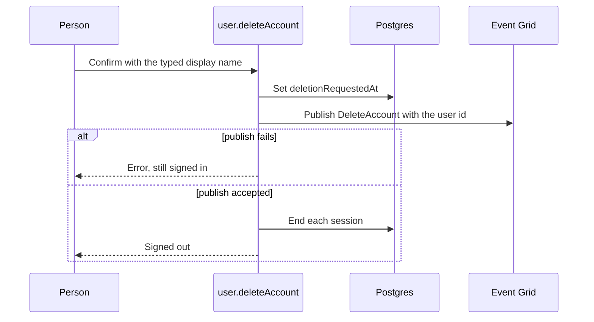
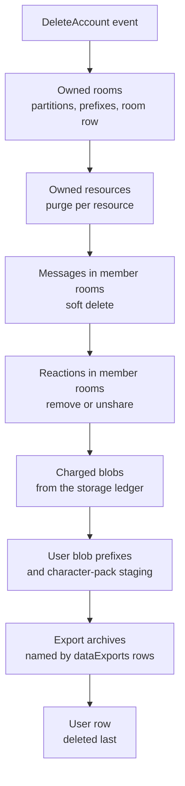

# Account Deletion

The Delete account card in user settings removes one account and the content it owns. A typed confirmation starts the sweep, which walks each store the [user data inventory](../../architecture/user-data-inventory/design.md) lists as keyed to the account. Each row of that inventory names the removal its store gets. The account's row is deleted last, so a sweep that fails partway is replayed from the same event until nothing is left.

## The request

`user.deleteAccount` in `apps/web/server/trpc/routers/user.ts` writes `deletionRequestedAt` on the user row, publishes one `DeleteAccount` event carrying the user id, and then ends every session the account holds. A publish that fails fails the request, and the sessions stay open. `deleteAccountSessions` ends the sessions: it revokes each one by the token it was read with and closes that session's device connections, so the caller is signed out everywhere.

The mutation does not sweep. A sweep across message partitions and blob directories can outlast a request, so the caller is answered once the event is accepted.

The confirmation lives in `apps/web/app/components/User/DeleteAccountCard/Index.vue`, which the settings page mounts for a signed-in person. It opens the shared `apps/web/app/components/Ui/ConfirmDialog.vue`, whose confirm button stays disabled until the typed name matches the person's display name. The dialog lists the three kinds of content the deletion keeps, from `AccountDeletionKeptItems`.

## The sweep

The `DeleteAccount` function (`apps/functions/src/functions/deleteAccount.ts`) passes the user id to `deleteAccountHandler`, which runs the steps below in this order. A step that throws fails the invocation.

The order is the mechanism. The user row goes last because its cascade removes the `dataExports` rows that name the export archives, so the archives must be removed first.

1. **Owned rooms.** Each room the account owns is deleted one at a time, as an owner's departure deletes it: `leaveRoom` deletes the room for everyone when its owner leaves. The step clears the room's partitions in five tables, `Messages`, `MessagesAscending`, `MessagesMetadata`, `ModerationLog` and `ModerationNotes`. It removes the `{roomId}/` prefix in `MessageAssets` and the `rooms/{roomId}/` prefix in `PublicUserAssets`, which holds the room's profile images, and it deletes the room row last, since a replay finds the room by that row. `deleteRoom` publishes the attachment prefix and the profile images as Event Grid work, but it does not clear the partitions, so the sweep runs its own deletes.
2. **Owned resources.** Each resource the account owns goes through `purgeResourceAndBroadcast`, the purge the recycle bin's timer runs: its directory, the partitions its type owns, then its ledger rows, in the order that makes a replay safe.
3. **Messages in member rooms.** The sweep reads the memberships that remain once the owned rooms are gone. In each of those rooms it soft-deletes the account's messages through `softDeleteRoomMessagesByUser`, the same soft delete a moderation ban runs. It passes a no-op for the announcement, so an open room keeps showing the messages until it reloads.
4. **Reactions in member rooms.** In each of those rooms, an emoji row the account reacted to is deleted when the account is its only reactor. Otherwise the account is taken out of its reactor list. Each write is conditional on the row's etag, so a row another member changed meanwhile fails the step, and the replay reads it again. The rule is `checkIsOnlyReactor` and `getUpdatedUserIds` in `packages/shared`, which the emoji router and the client store also use. No announcement goes out, so an open room shows a removed reaction on its next load.
5. **Charged blobs.** `listChargedBlobsByUser` reads the account's rows in the storage ledger, grouped by container. `deleteStorageBlobs` removes each container's blobs through the release a blob deletion runs, which drops their ledger rows and broadcasts the storage usage change. The sweep never lists a directory to find these files.
6. **Blob prefixes.** `deleteUserDirectories` removes everything under `{userId}/` in `GenshinAssets`, `PublicUserAssets`, `PrivateUserAssets`, `ClickerAssets` and `DungeonsAssets`. `deleteCharacterPackStaging` removes `character-packs/staging/{userId}/` in `GenshinAssets`. Each is a prefix delete that lists no names, and an empty prefix counts as done. The clicker and dungeons containers hold each person's `save.json` under the prefix. The shared character-pack files under `character-packs/files/` sit outside both prefixes and are kept.
7. **Export archives.** `deleteAccountDataExportArchives` reads the `blobName` of each `dataExports` row the account owns. It skips a row that names no blob, which is a queued export with no archive yet, and deletes the named blobs in `DataExports` through `deleteBlobs`. The archive is named by its export id and sits under no user prefix, so its row is the only way to find it. An archive an earlier attempt already removed counts as done.
8. **User row.** The `usersInAuth` row is deleted last. Its cascade removes the `accounts` rows, the `dataExports` rows and the other rows that reference the user with a cascade. No step deletes those by hand.

A profile image's write SAS outlives the request that minted it, so an image can land in `PublicUserAssets` after the sweep has passed. `DeleteOrphanedProfileImage` (`apps/functions/src/handlers/deleteOrphanedProfileImageHandler.ts`) deletes that landing when the account row is gone or carries `deletionRequestedAt`, and keeps it for an account in use. It is the one reader of the marker outside the mutation.

Every step treats an already-gone target as done. A 404 from a blob delete counts as done in `deleteBlobs`, an empty prefix is done, and a blob an earlier attempt removed does not fail the rest of its container in `deleteStorageBlobs`. A failed step fails the invocation. Event Grid delivers at least once, and `AzureFunctionIsIdempotentMap` marks `DeleteAccount` idempotent, so a replay runs every step again and finds only what is left.

## Decisions

**The marker is the row, and the user row goes last.** A resource's purge already works this way: the Postgres row is the durable marker, every external sweep treats an already-gone target as success, and the row is deleted last, so a replay after any failure finds the same work. Deleting the user row first would cascade away the rows that still name the work.

**The publish comes before the sessions.** A failed publish fails the request with the person still signed in, and the person can confirm again. The marker is written first, so a failed publish leaves `deletionRequestedAt` set. The sweep does not read the column, since it takes the account from the event, and a retry sets it again.

**Owned rooms are deleted, as an owner's departure deletes them.** Account deletion does what `leaveRoom` already does for an owner, rather than inventing a transfer. Transferring ownership is a feature with its own design, and it is the reason to revisit this.

**Messages leave, and reactions are unshared.** A message is attributed to its author, so the sweep removes the author's content from every room the account is still in. A reaction is one row shared by everyone who reacted with that emoji, so the sweep takes the account out of a shared row and deletes a row it holds alone, as the reaction's own removal does. The soft delete lives in `packages/db`, so the functions app and the web app share one implementation.

**Nothing is announced to open rooms.** A moderation ban publishes each batch it commits, so members watch messages leave. The sweep passes a no-op for that and sends no announcement for reaction removals, so open rooms show both changes on reload. A live announcement was decided against ([rejected](../../../rejected/esbabbler/deleted-account-live-removal/proposal.md)).

**Blob directories are swept by prefix, and the archive by its row.** A user's `{userId}/` prefix holds what they wrote in the containers above, so the sweep lists no names. The export archive sits under no prefix, so the sweep reads its row instead.

**Resources go through the purge that exists.** `purgeResource` already deletes a resource's directory, partitions and ledger rows in a safe order, so each owned resource is passed to it.

**The `accounts` foreign key cascades.** It cascades in the schema, because a non-cascading key would block the user row's deletion. The deletion then declares what it removes, and no step deletes accounts by hand.

**Shared character-pack files stay.** They are keyed by content hash and shared across accounts, and nothing counts their references, so removing one could break another account. The user's staging prefix is removed, and the shared files are not under it.

## Rejected

- **Sweeping inside the mutation.** It makes the caller wait on blob listings and partition scans, and a failure halfway leaves the answer unknown.
- **Anonymising messages instead of deleting them.** It keeps the content, which is what a deletion is for.
- **Transferring owned rooms.** It adds an ownership model the platform does not have.

## Limits the spec states

- Messages a person wrote in a room they have since left stay attributed to them. Membership is the only index from a user to a room.
- Moderation records in other people's rooms that name the user, and resource activity on resources the user does not own, are kept as the platform's audit trail. Whether that retention is lawful is an owner decision.
- The Azure AI Search index may keep message text, so the removal there cannot be verified until the indexer's handling of deleted rows is recorded.
- The shared character-pack files are kept, as above.

## Key files

| Path                                                                                             | Role                                                     |
| :----------------------------------------------------------------------------------------------- | :------------------------------------------------------- |
| `apps/web/server/trpc/routers/user.ts`                                                           | The `deleteAccount` mutation                             |
| `apps/web/server/services/user/deleteAccountSessions.ts`                                         | Ends the account's sessions and their device connections |
| `apps/web/app/components/User/DeleteAccountCard/Index.vue`                                       | The Delete account card and its typed confirmation       |
| `apps/web/app/components/Ui/ConfirmDialog.vue`                                                   | The confirmation dialog that gates on the typed name     |
| `apps/web/app/services/user/settings/AccountDeletionKeptItems.ts`                                | The kept list the confirmation names                     |
| `packages/db-schema/src/schema/auth/usersInAuth.ts`                                              | The `deletionRequestedAt` marker                         |
| `packages/db-schema/src/schema/auth/accountsInAuth.ts`                                           | The `accounts` foreign key, cascading                    |
| `packages/db-schema/src/services/azure/function/AzureFunctionIsIdempotentMap.ts`                 | Marks `DeleteAccount` idempotent                         |
| `apps/functions/src/functions/deleteAccount.ts`                                                  | The event registration                                   |
| `apps/functions/src/handlers/deleteAccountHandler.ts`                                            | The sweep, in order                                      |
| `apps/functions/src/services/account/`                                                           | One service per step                                     |
| `apps/functions/src/handlers/deleteOrphanedProfileImageHandler.ts`                               | Removes a profile image that lands after the sweep       |
| `packages/db/src/services/message/softDeleteRoomMessagesByUser.ts`                               | The message soft delete, shared with moderation          |
| `packages/db/src/services/resource/purgeResource.ts`                                             | The purge each owned resource goes through               |
| `packages/db/src/services/storage/listChargedBlobsByUser.ts`                                     | Reads the account's storage ledger rows                  |
| `packages/db/src/services/storage/deleteStorageBlobs.ts`                                         | Removes charged blobs and releases their charge          |
| `packages/db/src/services/azure/container/deleteUserDirectories.ts`                              | The `{userId}/` prefix sweep                             |
| `packages/db/src/services/azure/container/deleteCharacterPackStaging.ts`                         | The character-pack staging prefix sweep                  |
| `packages/shared/src/services/message/emoji/checkIsOnlyReactor.ts`                               | The reaction rule, shared with the emoji router          |
| `packages/shared/src/services/message/emoji/getUpdatedUserIds.ts`                                | The reaction rule, shared with the emoji router          |
| `apps/web/server/trpc/routers/message/emoji.ts`                                                  | The emoji router, which applies the same reaction rule   |
| `apps/infra/src/azure/resources/Microsoft.EventGrid/eventSubscriptions/devEvgsEsposterAe010.ts`  | The dev subscription for `DeleteAccount`                 |
| `apps/infra/src/azure/resources/Microsoft.EventGrid/eventSubscriptions/prodEvgsEsposterAe010.ts` | The prod subscription for `DeleteAccount`                |
