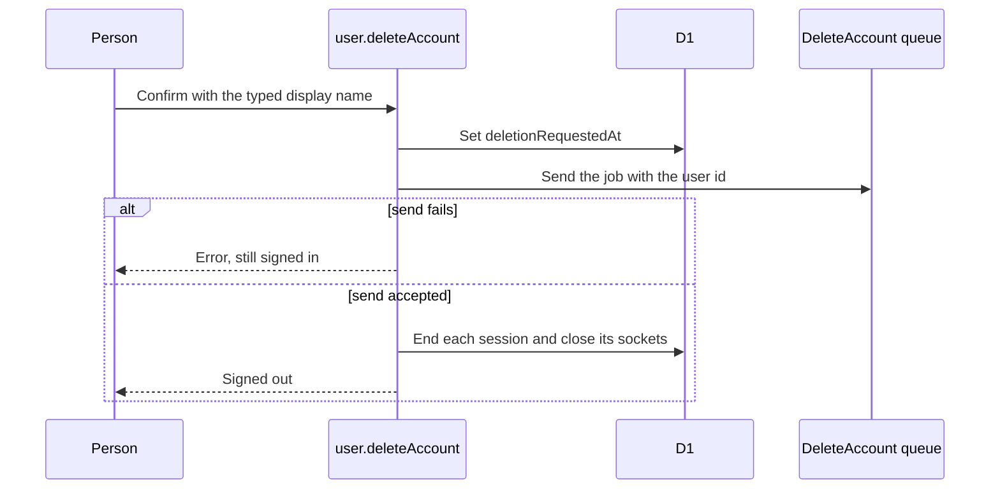
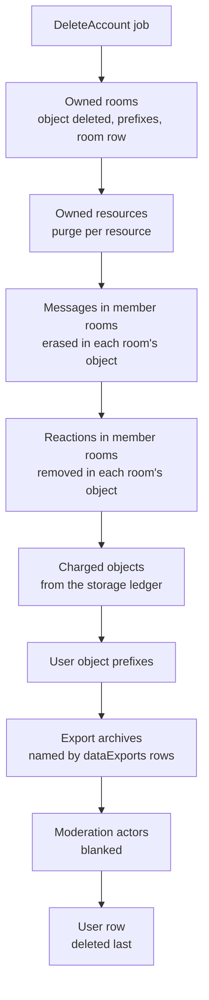

# Account Deletion

The Delete account card in user settings removes one account and the content it owns. A typed confirmation starts the sweep, which walks each store the [user data inventory](../../architecture/user-data-inventory/design.md) lists as keyed to the account. Each row of that inventory names the removal its store gets. The account's row is deleted last, so a sweep that fails partway is replayed from the same job until nothing is left.

## The request

`user.deleteAccount` in `apps/web/server/trpc/routers/user.ts` writes `deletionRequestedAt` on the user row in D1, sends one `DeleteAccount` job carrying the user id to its queue, and then ends every session the account holds. A failed send fails the request, and the sessions stay open. `deleteAccountSessions` ends the sessions: it revokes each one by the token it was read with and closes that session's sockets on the person's user object and on each room and call object the person is connected to, so the caller is signed out everywhere.

The mutation does not sweep. A sweep walks every room the account is in and every object it holds, so it outlasts a request; the caller is answered once the job is accepted.

The confirmation lives in `apps/web/app/components/User/DeleteAccountCard/Index.vue`, which the settings page mounts for a signed-in person. It opens the shared `apps/web/app/components/Ui/ConfirmDialog.vue`, whose confirm button stays disabled until the typed name matches the person's display name. The dialog lists the kinds of content the deletion keeps, from `AccountDeletionKeptItems`.

## The sweep

The functions Worker's queue consumer for the `DeleteAccount` job passes the message to `deleteAccountHandler`, which runs the steps below in this order. A step that throws fails the job, and the queue retries it.

The order is the mechanism. The user row goes last because its cascade removes the `dataExports` rows that name the export archives, so the archives must be removed first.

1. **Owned rooms.** Each room the account owns is deleted one at a time, as an owner's departure deletes it: `leaveRoom` deletes the room for everyone when its owner leaves. The room's object is deleted with `deleteAll`, which takes its messages, reactions, search rows, scheduled messages and alarm with it, and closes its sockets. The step then removes the room's `{roomId}/` prefix in `message-assets` and its `rooms/{roomId}/` prefix in `public-user-assets`, which holds the room's profile images, and deletes the room's row last, since a replay finds the room by that row. The room's moderation log and notes go with that row by cascade.
2. **Owned resources.** Each resource the account owns goes through the purge the recycle bin's timer runs for an expired one: its objects under the resource prefix in `resource-assets`, then its storage ledger rows, then the row, whose cascade removes what the resource owns in the database, in the order that makes a replay safe.
3. **Messages in member rooms.** The sweep reads the memberships that remain once the owned rooms are gone. In each of those rooms the room's object erases the account's messages: their text, files and link previews are cleared and the rows are tombstoned, in the same transaction that updates each message's search row. A moderation ban only tombstones, which hides a message without clearing its text, so the sweep does more than the ban does.
4. **Reactions in member rooms.** In each of those rooms the room's object removes the account's reactions. An emoji row the account reacted to is deleted when the account is its only reactor. Otherwise the account is taken out of its reactor list. The rule is `checkIsOnlyReactor` and `getUpdatedUserIds` in `packages/shared`, which the emoji router also uses. No announcement goes out, so an open room shows a removed reaction on its next load.
5. **Charged objects.** `listChargedBlobsByUser` reads the account's rows in the storage ledger, grouped by bucket. `deleteStorageBlobs` removes each bucket's objects and releases their charge, which sends the storage usage change to the owner's user object. The sweep never lists a prefix to find these files.
6. **User object prefixes.** `deleteUserDirectories` removes everything under `{userId}/` in `genshin-assets`, `public-user-assets`, `user-assets` and `clicker-assets`. It is a prefix delete that lists keys in pages and deletes them in batches of up to a thousand, and an empty prefix counts as done. The clicker and user-assets buckets each hold the person's save under the prefix.
7. **Export archives.** `deleteAccountDataExportArchives` reads the object key of each `dataExports` row the account owns. It skips a row that names no object, which is a queued export with no archive yet, and deletes the named objects in `user-assets` through `deleteBlobs`. The archive is named by its export id under `exports/` and sits under no user prefix, so its row is the only way to find it. An archive an earlier attempt already removed counts as done.
8. **Moderation actors.** `clearAccountModerationActor` sets the account's `actorUserId` to null on every moderation log row it took as a moderator, in every room, so each room keeps the record without the person's name. It is one D1 update served by the actor index, and a replay finds no rows left to blank.
9. **User row.** The `usersInAuth` row is deleted last. Its cascade removes the `accounts` rows, the `dataExports` rows and the other rows that reference the user with a cascade. No step deletes those by hand.

A profile image's presigned upload URL outlives the request that minted it, so an image can land in `public-user-assets` after the sweep has passed. The landing's object-create notification sends it to the `DeleteOrphanedProfileImage` queue, and `deleteOrphanedProfileImageHandler` deletes it when the account row is gone or carries `deletionRequestedAt`, and keeps it for an account in use. It is the one reader of the marker outside the mutation.

Every step treats an already-gone target as done. A missing object's delete counts as done in `deleteBlobs`, an empty prefix is done, and an object an earlier attempt removed does not fail the rest of its bucket in `deleteStorageBlobs`. A failed step fails the job. Queues deliver at least once, and `DeleteAccount` is an idempotent job, so its queue retries it and a replay runs every step again and finds only what is left.

## Decisions

**The marker is the row, and the user row goes last.** A resource's purge already works this way: the D1 row is the durable marker, every external sweep treats an already-gone target as success, and the row is deleted last, so a replay after any failure finds the same work. Deleting the user row first would cascade away the rows that still name the work.

**The send comes before the sessions.** A failed send fails the request with the person still signed in, and the person can confirm again. The marker is written first, so a failed send leaves `deletionRequestedAt` set. The sweep does not read the column, since it takes the account from the job, and a retry sets it again.

**Owned rooms are deleted, as an owner's departure deletes them.** Account deletion does what `leaveRoom` already does for an owner, rather than inventing a transfer. Transferring ownership is a feature with its own design, and it is the reason to revisit this.

**Messages leave, and reactions are unshared.** A message is attributed to its author, so the sweep removes the author's content from every room the account is still in. A reaction is one row shared by everyone who reacted with that emoji, so the sweep takes the account out of a shared row and deletes a row it holds alone, as the reaction's own removal does. Both writes are the room object's own, so a room's text, reactions and search rows change in one place and in one transaction.

**Search needs no sweep.** A room's search rows live in the room's object, so `deleteAll` removes them with the room, and an erased message's row is rewritten in the same transaction as the message.

**Nothing is announced to open rooms.** A moderation ban announces each change it commits, so members watch messages leave. The sweep sends no announcement for its erasures or its reaction removals, so open rooms show both changes on reload. A live announcement was decided against ([rejected](../../../rejected/esbabbler/deleted-account-live-removal/proposal.md)).

**Blob prefixes are swept by prefix, and the archive by its row.** A user's `{userId}/` prefix holds what they wrote in the buckets above, so the sweep lists no keys beyond the prefix. The export archive sits under no prefix, so the sweep reads its row instead.

**Resources go through the purge that exists.** `purgeResource` already deletes a resource's objects and ledger rows, then the row, in a safe order, so each owned resource is passed to it.

**The foreign keys cascade.** Each reference to a user or a room is a foreign key with its cascade, so deleting the row removes what references it, and no step deletes accounts or rooms' dependent rows by hand.

## Rejected

- **Sweeping inside the mutation.** It makes the caller wait on storage listings and every room object, and a failure halfway leaves the answer unknown.
- **Anonymising messages instead of deleting them.** It keeps the content, which is what a deletion is for.
- **Transferring owned rooms.** It adds an ownership model the platform does not have.

## Limits the spec states

- The sweep finds a person's rooms through their memberships, so a message they wrote in a room they have since left stays attributed to them.
- Moderation records in other people's rooms where the user is the moderator, and resource activity on resources the user does not own, are kept as the platform's audit trail, with the moderator's id set to null by the sweep. Moderation records that name the user as target go with the account. Whether that retention is lawful is an owner decision.

## Key files

| Path                                                                 | Role                                                             |
| :------------------------------------------------------------------- | :--------------------------------------------------------------- |
| `apps/web/server/trpc/routers/user.ts`                               | The `deleteAccount` mutation                                     |
| `apps/web/server/services/user/deleteAccountSessions.ts`             | Ends the account's sessions and closes their sockets             |
| `apps/web/app/components/User/DeleteAccountCard/Index.vue`           | The Delete account card and its typed confirmation               |
| `apps/web/app/components/Ui/ConfirmDialog.vue`                       | The confirmation dialog that gates on the typed name             |
| `apps/web/app/services/user/settings/AccountDeletionKeptItems.ts`    | The kept list the confirmation names                             |
| `packages/db-schema/src/schema/auth/usersInAuth.ts`                  | The `deletionRequestedAt` marker                                 |
| `packages/db-schema/src/schema/auth/accountsInAuth.ts`               | The `accounts` foreign key, cascading                            |
| `packages/db-schema/src/models/queue/DeleteAccountQueueMessage.ts`   | The job's message, parsed on receipt                             |
| `packages/db-schema/src/services/queue/QueueJobMaxRetriesMap.ts`     | The retry count per job, `DeleteAccount` among them              |
| `apps/functions/src/handlers/deleteAccountHandler.ts`                | The sweep, in order                                              |
| `apps/functions/src/services/account/`                               | One service per step                                             |
| `apps/functions/src/services/account/clearAccountModerationActor.ts` | Blanks the moderator id on the account's moderation log rows     |
| `apps/functions/src/handlers/deleteOrphanedProfileImageHandler.ts`   | Removes a profile image that lands after the sweep               |
| `apps/functions/src/durableObjects/RoomObject.ts`                    | The room object: `deleteAll`, `deleteUserReactions`, the erasure |
| `packages/db/src/services/storage/listChargedBlobsByUser.ts`         | Reads the account's storage ledger rows                          |
| `packages/db/src/services/storage/deleteStorageBlobs.ts`             | Removes charged objects and releases their charge                |
| `packages/db/src/services/storage/deleteUserDirectories.ts`          | The `{userId}/` prefix sweep                                     |
| `packages/db/src/services/storage/deleteBlobs.ts`                    | Removes named objects, counting a missing one as done            |
| `packages/db/src/services/resource/purgeResource.ts`                 | The purge each owned resource goes through                       |
| `packages/shared/src/services/message/emoji/checkIsOnlyReactor.ts`   | The reaction rule, shared with the emoji router                  |
| `packages/shared/src/services/message/emoji/getUpdatedUserIds.ts`    | The reaction rule, shared with the emoji router                  |
| `apps/web/server/trpc/routers/message/emoji.ts`                      | The emoji router, which applies the same reaction rule           |
