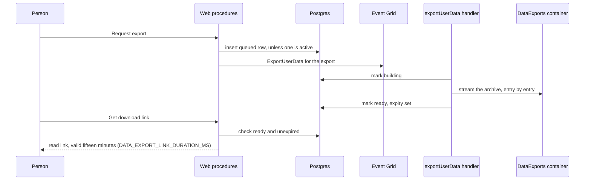

# Data export design

The stores this reads are the ones in the [user data inventory](../../architecture/user-data-inventory/design.md). An export that lists a store the inventory does not is a bug in the inventory, fixed there.

## Decisions

**The request is queued, and the archive is built by a handler.** A large account's archive streams every attachment it owns. The request returns once the row is written and the event published, as the deletion does, and the person checks the row's status from the settings page.

**The archive streams into a blob; nothing holds it whole.** `fflate`'s streaming zip writes each entry as it is read, and the entry's bytes are read from Blob one stream at a time. The output is a block blob uploaded from the same stream. The memory a large export uses is bounded by one attachment, not by the account.

**The archive is one blob per request, named `{exportId}.zip`.** A retry of the same request overwrites its own blob, so a replayed handler cannot leave two archives. The row's status is the only pointer, and it moves to ready only after the upload commits.

**Links are short-lived and owner-only.** The download is a read-only SAS valid for fifteen minutes (`DATA_EXPORT_LINK_DURATION_MS`), minted on request for the owner of a ready, unexpired export. The archive itself is private, so a link is the only way in.

**Expiry is enforced twice.** The row carries an expiry seven days after it is ready (`DATA_EXPORT_RETENTION`), and the private container's lifecycle rule deletes the blob after the same period. A link is refused once the row has expired, even if the blob still exists.

**One export is active per person.** A second request while one is queued or building returns the first one's status. This bounds the work an account can start.

**The archive holds the person's own data, including what their activity left on the platform, and nobody else's.** Access and portability under the GDPR (Articles 15 and 20) cover the personal data concerning the person, which includes data observed from their activity, such as their likes, reactions and friend requests. Article 20(4) provides that the right to portability shall not adversely affect the rights and freedoms of others. So another person's content, counts and records are left out even where they sit beside the person's own, and the exclusions below name each one. A credential is never written, whichever record holds it: a session, an account's token, a webhook's token, a room invite's code, a call's join id, or a program or survey token. A table is read for the person's rows only where a stored user column attributes them to the person; a table with no such column is left out, since its rows cannot be picked out without reading every partition. Program participant and survey response rows are left out by decision, not by their shape: the server stores no user id on them, and adding one would link an anonymous survey answer to a person. Not included names the exclusion and its reversal. A moderation action is the person's own act as moderator or admin, so its type, time and the id it was taken against are written; the target's content is left out under Article 20(4), and the target keeps the record of the action against them in their own `moderation.json`. A link, a publication and a search hold no credential, so each is written as its row stores it.

**A row carries its creation time only where the row records the person's own act.** Every table carries a creation time, so the export takes it per row, and writes it where the row belongs to the person and the time is when they did the thing: the account's creation, their posts, their likes of posts, the friend requests they sent, the rooms they own, their memberships, the calls they started, their thread decisions, their favorites, their first opening of a resource, their searches, a resource's publication, and their blocks and bookmarks. A row two people share carries none: a reaction's time is its first reactor's, and a friendship's is the moment the receiver accepted it. A row the other party made carries none, nor does a row the system writes, nor a row that holds the account's current state. A row the store rewrites as a set carries none either, since its time is the last rewrite. The update and delete times are the store's bookkeeping in every case, and no row carries them.

## What the archive holds

| Entry                                                      | Source                                                                                                                                                                                                                                                                                                                                                                                                                                                                                                                                                                                                                                                                                                                                                                                                                                                                                                                                         |
| :--------------------------------------------------------- | :--------------------------------------------------------------------------------------------------------------------------------------------------------------------------------------------------------------------------------------------------------------------------------------------------------------------------------------------------------------------------------------------------------------------------------------------------------------------------------------------------------------------------------------------------------------------------------------------------------------------------------------------------------------------------------------------------------------------------------------------------------------------------------------------------------------------------------------------------------------------------------------------------------------------------------------------- |
| `account.json`                                             | The user row without secrets, with its creation time. The account's blocks and bookmarks, each with the time it was made. Its notifications, achievements, settings and statuses, without their times: the system writes the first two, and the last two are the account's current state. Sign-in providers by name, never their tokens. Push subscriptions by endpoint, without keys. No row carries its update or delete time.                                                                                                                                                                                                                                                                                                                                                                                                                                                                                                               |
| `friends.json`                                             | Friend requests the person sent and received, and their current friends. Each other party appears by user id and display name only. A request the person sent carries the time it was sent, as `createdAt`. A request they received carries none, since the sender made it, and a friendship carries none, since it is one row for the pair, made when the receiver accepted it.                                                                                                                                                                                                                                                                                                                                                                                                                                                                                                                                                               |
| `posts/{postId}.json`                                      | The person's own posts as their title, description, parent and depth, with the time each was written. Like and comment counts and the ranking are other people's activity on the post, so they are left out. Posts carry no attachments today, so no `posts/{postId}/files/` entry is written; an attachment a post gains is written under that directory, following the messages entry.                                                                                                                                                                                                                                                                                                                                                                                                                                                                                                                                                       |
| `likes.json`                                               | The person's likes and dislikes of posts, each with its post id and value, and their emoji reactions in rooms they are a member of, each with its message id, room and emoji. A post like carries the time it was made, as `createdAt`. A reaction carries none: its row is shared by its reactors, so its time is the first reactor's, not the person's. No counts, and no other person's reactions.                                                                                                                                                                                                                                                                                                                                                                                                                                                                                                                                          |
| `rooms/{roomId}/messages.json` and `rooms/{roomId}/files/` | The person's own messages in rooms they are a member of, and the files those messages attach.                                                                                                                                                                                                                                                                                                                                                                                                                                                                                                                                                                                                                                                                                                                                                                                                                                                  |
| `rooms/{roomId}/room.json`                                 | For each room the person owns, its name, topic, type, settings, and its emoji by id and name. Its members are other people's records, so they are not written. Its creation time is written as `createdAt`, since the owner made the room.                                                                                                                                                                                                                                                                                                                                                                                                                                                                                                                                                                                                                                                                                                     |
| `rooms/{roomId}/images/` and `rooms/{roomId}/emoji/`       | The images and emoji blobs of each room the person owns, as stored under the room's own prefixes.                                                                                                                                                                                                                                                                                                                                                                                                                                                                                                                                                                                                                                                                                                                                                                                                                                              |
| `resources/{resourceId}/`                                  | The resource's record, its working copy and its working assets, for resources the person owns. The record is its name, type, tags, content version and creation time: its hashes, sizes and revision counters are the store's bookkeeping, and are left out. `publications.json` when the resource is published: the time the publication began, as `createdAt`, the time it was last published, which a republish moves, and the draft's content version and the publish version it was taken at. A resource that is not published has no `publications.json`. `links.json` when it links to other resources: each link's source, its target and the use it makes of the target. A link row carries no time, since a resource's links are rewritten as a set whenever the set changes, so the row's time is the last change and not the person's act. Links hold no token, so none is withheld. A resource with no links has no `links.json`. |
| `saves/{game}/save.json`                                   | The person's game saves, from the three game containers.                                                                                                                                                                                                                                                                                                                                                                                                                                                                                                                                                                                                                                                                                                                                                                                                                                                                                       |
| `calls.json`                                               | The calls the person started, each with its room, its thread and the time it started. A call's id is the key a knocker presents to join it, so it is left out. The table records who started a call, not who joined it, so the other participants are not in the archive.                                                                                                                                                                                                                                                                                                                                                                                                                                                                                                                                                                                                                                                                      |
| `follows.json`                                             | The person's own decisions about threads, each with its room and thread, and whether it is an unfollow, which is kept since it is the person's decision. Each carries the time of the person's first decision about the thread, as `createdAt`. Other people's follows are theirs and are left out.                                                                                                                                                                                                                                                                                                                                                                                                                                                                                                                                                                                                                                            |
| `memberships.json`                                         | The person's memberships in rooms they do not own: each room, the person's display name, hidden flag and notification setting there, the time they joined it, as `createdAt`, the time they last read it, and the roles they hold, by id and name. In a direct message the join time is when the conversation was opened, which the other person may have done. Other members are not listed. The mention count is derived from other people's messages, and the slowmode and timeout clocks are operational, so none is written.                                                                                                                                                                                                                                                                                                                                                                                                              |
| `favorites.json`                                           | The resources the person starred, by id, each with the time it was starred.                                                                                                                                                                                                                                                                                                                                                                                                                                                                                                                                                                                                                                                                                                                                                                                                                                                                    |
| `accesses.json`                                            | The resources the person opened, each with the time they first opened it, as `createdAt`, and the time they last opened it, which the row stores.                                                                                                                                                                                                                                                                                                                                                                                                                                                                                                                                                                                                                                                                                                                                                                                              |
| `searches.json`                                            | The person's own search queries across rooms, each with the filters it ran with, the room it searched and the time it ran.                                                                                                                                                                                                                                                                                                                                                                                                                                                                                                                                                                                                                                                                                                                                                                                                                     |
| `images/`                                                  | The profile image and the call backgrounds.                                                                                                                                                                                                                                                                                                                                                                                                                                                                                                                                                                                                                                                                                                                                                                                                                                                                                                    |
| `moderation-actions.json`                                  | The moderation actions the person took as moderator or admin in rooms they own, each with its room, action type, time and the id of the person it was taken against. No content of the target's is written. Records where the person is the target are in `moderation.json`.                                                                                                                                                                                                                                                                                                                                                                                                                                                                                                                                                                                                                                                                   |
| `moderation.json`                                          | The moderation records that name the person as their target. A person has the right to see what was recorded about them.                                                                                                                                                                                                                                                                                                                                                                                                                                                                                                                                                                                                                                                                                                                                                                                                                       |

## Not included

- **Other people's content and counts.** Their messages and data, their posts and comments, the like and comment counts on the person's posts, and the ranking, which orders posts by others' activity. The rooms the person has left, whose messages and reactions are not indexed to them, as [account deletion](../account-deletion/design.md) states.
- **Other people's records.** Another member's membership, roles and permissions in a room the person owns, and another person's reaction on a message the person also reacted to.
- **Resource version history.** Every saved version of a resource beyond its working copy, which is included. The resource's activity logs, which record other people's use of the resource.
- **Derived files.** Thumbnails, which are derived from the original attachment the archive holds.
- **Shared and staging data.** The shared character-pack files and the list of packs, which have no owner to attribute them to, the staging blobs of character packs not yet kept, and the storage ledger, which is accounting rather than the person's data.
- **Moderation notes the person wrote.** A note is a moderator's words about a target, which are the target's content, and a note is not an action. The actions the person took are written in `moderation-actions.json`.
- **Moderation actions in rooms the person does not own.** The room's owner keeps the record of what was done in it, and an action in another person's room is their record, not the person's.
- **Sessions and tokens.** Sessions, API keys, every token in `accounts`, each webhook's token, each room invite's code and each call's join id. Each is a bearer credential, which opens the thing it names to whoever presents it. The deletion removes the sessions, keys and account tokens with the user row, and a webhook, an invite and a call with the room that owns it.
- **Program participants and survey responses (a named exclusion, by decision).** The server stores no user id on these rows: a participant row is keyed by the owner's audience key value and a token, and a response by a participant token or nothing. So the person's own rows cannot be selected without reading every program and survey partition, and that read is not made. Adding a user id would link an anonymous survey answer to a person, which anonymous mode exists to prevent, so the id is not added. The user can reverse this with a data change that stores a user id on new rows; rows already written would need a backfill, which this design does not propose. The tokens are bearer credentials and are never written in either case.
- **Times another person or the system made, and the bookkeeping times.** A reaction's time, which is its first reactor's, and a received friend request's, which is the sender's act. A friendship's time, since one row serves the pair. A notification's and an achievement's, which the system writes. A setting's and a status's, which are the account's current state. A link's, since its set is rewritten on each change. The update and delete times of every row, which are the store's bookkeeping. The rule is in Decisions.

## Rejected

- **Building the archive in the request.** A large account would time out, and a timeout leaves no archive and no answer.
- **One archive per account, replaced on each request.** A download in progress would break when it was replaced.

## Sequence

A failed build marks the row failed with its reason and leaves the blob to the lifecycle rule. A replayed event rebuilds the same export id over its own blob.

## Key files

| Path                                                      | Role                                                            |
| :-------------------------------------------------------- | :-------------------------------------------------------------- |
| `packages/db-schema/src/schema/user/dataExportsInUser.ts` | The export row: status, blob name, ready and expiry times       |
| `apps/web/server/trpc/routers/user.ts`                    | Request, status and link procedures                             |
| `apps/web/server/services/user/getDataExportLink.ts`      | The short-lived read link, owner-only and expiry-checked        |
| `apps/functions/src/handlers/exportUserDataHandler.ts`    | The streamed archive build                                      |
| `apps/functions/src/functions/exportUserData.ts`          | The event registration                                          |
| `apps/infra/src/azure/resources/`                         | The private container, its lifecycle rule and the subscriptions |
| `apps/web/app/pages/user/settings.vue`                    | The Download my data flow                                       |
