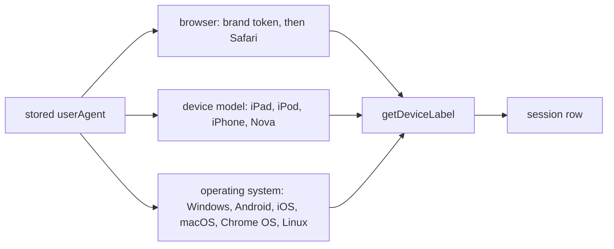

# Device Label

The device a session row names, read from the stored user agent on the server: `Chrome 141 on Windows`, `Safari 18 on iPhone`, or `Unknown device`. [Session device management](../design.md) owns the row and its card. This page owns how the label is read, and the decision to read it ourselves.

The label was bowser 2.15.0's `parse` until this change. It is now a table of our own: `apps/web/server/services/auth/parseUserAgent.ts` (78 lines) reads the browser, model and system from fixed tokens, and `getDeviceLabel.ts` (15 lines) composes them. The library was replaced because its catch-all matcher named browsers the agent never stated, and because it fails the proof rows below. The table names only the browsers, systems and devices it lists.

## How a label is read

- **Browser.** Nine brands are named, each by its own token followed by a slash and a version: Microsoft Edge, Opera, Samsung Internet for Android, Vivaldi, Yandex Browser, UC Browser, Firefox, Chromium and Chrome. They are tried in that order, so a Chromium build names Chromium and not the Chrome token it also carries. A version is one to four digits ending at a non-digit. A longer run fails its brand, so the row never shows a cut-short number or a run of digits the agent chose.
- **Safari.** Named only when the `Safari/` token is present together with a `Version/` token, which gives the version, or the `Mobile/` token iOS sends where it omits the version. A `Safari/` token alone names nothing, because desktop engines and in-app shells carry it too.
- **Operating system.** Windows, Android, iOS, macOS, Chrome OS and Linux, in that order. Windows comes first because a Windows Phone agent carries Android and iPhone tokens too. iOS comes before macOS because an iOS agent says `like Mac OS X`. The iOS-only browser tokens (`CriOS`, `FxiOS`, `EdgiOS`, `OPiOS`) name iOS on their own, so a Mac-framed agent from an iOS browser reads as iOS.
- **Device model.** iPad, iPod and iPhone, matched anywhere except after `like`, so the `like iPhone OS` of a Mac agent names no model. `CAN-L01`, a Huawei handset, reads as `Nova`. A model wins over the operating system wherever the table names one.
- **Composition.** The browser and its major version, then `on` the model or the system. A browser alone, a device alone, or `Unknown device` when neither is named. No operating-system version is shown: Windows 11 still sends `NT 10.0`, and Safari and Chrome both freeze macOS at `10_15_7`, so a version would be confidently wrong rather than absent.
- **The raw agent stays on the server.** The label is built only from the table's own names and numbers of at most four digits, so no text from the agent reaches the row.

## Known limits

A brand outside the nine reads as the engine token its agent carries (Chrome, Safari or Firefox), or as nothing. This is the largest behavioural difference from a broader parser, and it is not fixed here. The upstream reports below describe these brands as read through their engine token, which this table shares. None is verified against this label, and no row pins them.

- Epiphany ([#130](https://github.com/bowser-js/bowser/issues/130)) and Firefox Focus ([#191](https://github.com/bowser-js/bowser/issues/191)).
- Amazon Silk ([#115](https://github.com/bowser-js/bowser/issues/115)), Electron ([#374](https://github.com/bowser-js/bowser/issues/374)) and Brave ([#402](https://github.com/bowser-js/bowser/issues/402), [PR #597](https://github.com/bowser-js/bowser/pull/597)).
- Chromium GOST ([#443](https://github.com/bowser-js/bowser/issues/443), [#477](https://github.com/bowser-js/bowser/issues/477)), Opera Mobile ([#414](https://github.com/bowser-js/bowser/issues/414)), Opera Mini ([#158](https://github.com/bowser-js/bowser/issues/158)) and Yandex apps ([#571](https://github.com/bowser-js/bowser/issues/571)).
- In-app WKWebView ([#418](https://github.com/bowser-js/bowser/issues/418), [#499](https://github.com/bowser-js/bowser/issues/499)).

## Upstream audit

The source is the `bowser-js/bowser` tracker, read at 639 items: 313 issues and 326 pull requests. Each item was read by its title and state. The bodies and comments of the items that touch a browser, a system, a device or robustness were read in full. The rest were classed by title, so the class counts below are a count rather than a verdict on each item.

### Proof rows that fail on bowser 2.15.0

Each row is a case in `getDeviceLabel.test.ts`. The middle column is what the HEAD label produces with bowser 2.15.0, and the right-hand column is this label. All six are fixed here.

| Proof row                                                          | Bowser 2.15.0           | This label               | Upstream                                                                                                                                                                                                         |
| ------------------------------------------------------------------ | ----------------------- | ------------------------ | ---------------------------------------------------------------------------------------------------------------------------------------------------------------------------------------------------------------- |
| UC Browser 13 on Android, `UCBrowser/13.3.0.1305` after `Version/` | UC Browser 4 on Android | UC Browser 13 on Android | [#454](https://github.com/bowser-js/bowser/issues/454) and [#255](https://github.com/bowser-js/bowser/issues/255) closed; fixed upstream after 2.15.0 in [PR #638](https://github.com/bowser-js/bowser/pull/638) |
| UC Browser 15 on Android, `UCMobile/15.0.7.1383`                   | Chrome 123 on Android   | UC Browser 15 on Android | [PR #648](https://github.com/bowser-js/bowser/pull/648), open                                                                                                                                                    |
| Chrome 86 on Android, spaces around the slash                      | Chrome on Android       | Chrome 86 on Android     | [#451](https://github.com/bowser-js/bowser/issues/451), open; [PR #453](https://github.com/bowser-js/bowser/pull/453) closed                                                                                     |
| iPhone in a Cordova webview, no `Safari/` token                    | Safari on iPhone        | iPhone                   | [#365](https://github.com/bowser-js/bowser/issues/365), open                                                                                                                                                     |
| iPad in a Facebook in-app browser                                  | Safari on iPad          | iPad                     | [#222](https://github.com/bowser-js/bowser/issues/222) closed; [#423](https://github.com/bowser-js/bowser/issues/423), open                                                                                      |
| Windows in the Unreal Engine web browser widget                    | Safari on Windows       | Windows                  | [#263](https://github.com/bowser-js/bowser/issues/263), open                                                                                                                                                     |

The Unreal row asks for Chromium in its issue. The agent states no Chromium, so the label names none, and the false Safari claim is what it withholds.

### Deliberate differences

Four cases where bowser's answer is right by its own vocabulary, and this label differs on purpose. Each fails on bowser 2.15.0, and each is a row in the suite.

| Agent                                                | Bowser 2.15.0                         | This label        | Reason                                                                                                                                                                                                                                                                                                                                                                                                                 |
| ---------------------------------------------------- | ------------------------------------- | ----------------- | ---------------------------------------------------------------------------------------------------------------------------------------------------------------------------------------------------------------------------------------------------------------------------------------------------------------------------------------------------------------------------------------------------------------------- |
| Firefox for iOS, Mac-framed agent (`FxiOS/21.0`)     | Firefox 21 on iPad                    | Firefox 21 on iOS | The agent names no device, so an iPad is a guess. The iOS-only token names the system, and no model is claimed. The issues asking for `Firefox on iPad` ([#378](https://github.com/bowser-js/bowser/issues/378), [PR #379](https://github.com/bowser-js/bowser/pull/379), [#401](https://github.com/bowser-js/bowser/issues/401), [PR #415](https://github.com/bowser-js/bowser/pull/415)) are answered here with iOS. |
| Windows Phone (`Windows Phone 8.1`, `IEMobile/11.0`) | Internet Explorer 11 on Windows Phone | Windows           | Internet Explorer and Windows Phone are outside the vocabulary. The agent carries Android and iPhone tokens too, and Windows is the system it names first.                                                                                                                                                                                                                                                             |
| QupZilla (`QupZilla/1.8.6`, `Safari/537.21`)         | QupZilla 1 on Windows                 | Windows           | QupZilla is outside the vocabulary, and its `Safari/` token has no `Version/` or `Mobile/` to name it.                                                                                                                                                                                                                                                                                                                 |
| A version past four digits (`Chrome/123456789`)      | Chrome 123456789 on Windows           | Windows           | The version fails its token rather than being cut short, so no run of digits reaches the row.                                                                                                                                                                                                                                                                                                                          |

### Pins that both pass

These are upstream fixes made before 2.15.0, or behaviour that never broke. They are kept as rows so a regression fails.

- Oreo build strings reading as Opera: [#193](https://github.com/bowser-js/bowser/issues/193), [#199](https://github.com/bowser-js/bowser/issues/199), [#213](https://github.com/bowser-js/bowser/issues/213), [#214](https://github.com/bowser-js/bowser/issues/214), [#215](https://github.com/bowser-js/bowser/issues/215), [#221](https://github.com/bowser-js/bowser/issues/221), [#253](https://github.com/bowser-js/bowser/issues/253).
- Motorola Edge reading as Edge: [#610](https://github.com/bowser-js/bowser/issues/610), [PR #612](https://github.com/bowser-js/bowser/pull/612).
- Edge on iOS and Android: [#201](https://github.com/bowser-js/bowser/issues/201), [PR #202](https://github.com/bowser-js/bowser/pull/202).
- Vivaldi: [#103](https://github.com/bowser-js/bowser/issues/103), [#429](https://github.com/bowser-js/bowser/issues/429). Chromium: [#9](https://github.com/bowser-js/bowser/issues/9), [#142](https://github.com/bowser-js/bowser/issues/142).
- Samsung Internet for Android: [#155](https://github.com/bowser-js/bowser/issues/155), [PR #156](https://github.com/bowser-js/bowser/pull/156).
- Yandex on iPhone: [#308](https://github.com/bowser-js/bowser/issues/308).
- Firefox for iOS: [#99](https://github.com/bowser-js/bowser/issues/99).
- Firefox for Android: [PR #22](https://github.com/bowser-js/bowser/pull/22), [#59](https://github.com/bowser-js/bowser/issues/59).
- iPod: [PR #37](https://github.com/bowser-js/bowser/pull/37). Lowercase `ipad`: [#61](https://github.com/bowser-js/bowser/issues/61).
- Chrome OS: [#286](https://github.com/bowser-js/bowser/issues/286), [PR #287](https://github.com/bowser-js/bowser/pull/287), [#319](https://github.com/bowser-js/bowser/issues/319), [#357](https://github.com/bowser-js/bowser/issues/357). Ubuntu: [#270](https://github.com/bowser-js/bowser/issues/270).
- macOS 11: [PR #457](https://github.com/bowser-js/bowser/pull/457), [PR #580](https://github.com/bowser-js/bowser/pull/580). Opera version with letters: [#513](https://github.com/bowser-js/bowser/issues/513).
- iPad: [#55](https://github.com/bowser-js/bowser/issues/55), [#122](https://github.com/bowser-js/bowser/issues/122), [PR #111](https://github.com/bowser-js/bowser/pull/111).

### Class counts

| Class | Meaning                                                                                                                                                                                        | Items |
| ----- | ---------------------------------------------------------------------------------------------------------------------------------------------------------------------------------------------- | ----- |
| D     | A defect the HEAD label shows on bowser 2.15.0, pinned by a row that fails there                                                                                                               | 10    |
| I     | In scope and already held: the table reads it, or a row pins it                                                                                                                                | 76    |
| O     | Owned outside the library: a vendor's agent or an in-app shell, which no table reaches                                                                                                         | 19    |
| P     | A question or a misreport the tracker settles without a code change, such as [#121](https://github.com/bowser-js/bowser/issues/121) and [#247](https://github.com/bowser-js/bowser/issues/247) | 18    |
| E     | A browser, system or device outside the vocabulary chosen                                                                                                                                      | 97    |
| A     | A field or API the label does not show, such as a full version, a flag or a client hint                                                                                                        | 90    |
| N     | Not about the label: packaging, typings, the build, a framework or a dependency                                                                                                                | 329   |
| Total | The tracker: [bowser-js/bowser issues and pull requests](https://github.com/bowser-js/bowser/issues)                                                                                           | 639   |

## Admission

The stop list's data-tracking clause allows a package that follows a registry, user agents among them, only with its feed replaced by a generator over the registry's own source. Bowser's table is hand-written code over the agent strings browsers send, with no registry to generate from. Its feed is the browsers' own releases, and this page answers that feed by closing the vocabulary: a release outside the nine brands, four models and six systems is not tracked, and reads as the engine its agent carries or as nothing ([Known limits](#known-limits)). Widening the vocabulary is the tracking the clause means, so it reopens this decision.

This is the sliver of use the [dependency admission](../../../architecture/dependency-admission/design.md) page names: a user-agent table read for one device label.

**Ride-along.** `@cloudflare/realtimekit-virtual-background` declares bowser as a peer and inlines its own copy of the class, so pnpm installs bowser 2.15.0 beside it. Nothing of ours imports it. The peer is that kept package's cost under the ride-along clause. Its inlined copy ships wherever that package does, and this change does not alter it.

## Measurements

| Measure                                      | Bowser 2.15.0 (HEAD label)        | This label               |
| -------------------------------------------- | --------------------------------- | ------------------------ |
| Minified server bundle, bowser inlined       | 34,443 bytes, 7,646 gzipped       | 1,686 bytes, 766 gzipped |
| Runtime per call, the 46 agents of the suite | about 159 µs                      | about 6 µs               |
| Source                                       | bowser's `src`, about 3,400 lines | 93 lines (78 and 15)     |

The bundle is the server's, since the parse never runs in the browser. Runtime is a 400-pass loop over the agents after a warm-up, on one development machine, so the order of magnitude is the claim.

## Sources

- [bowser-js/bowser](https://github.com/bowser-js/bowser): the upstream repository. Its tracker is the audit's source, and 2.15.0 is the release the baseline measures.
- [bowser-js/bowser issues](https://github.com/bowser-js/bowser/issues): every issue and pull request above links into it.

## Key files

| File                                                   | Role                                                                     |
| ------------------------------------------------------ | ------------------------------------------------------------------------ |
| `apps/web/server/services/auth/parseUserAgent.ts`      | the token tables, and the browser, model and system a stored agent names |
| `apps/web/server/services/auth/getDeviceLabel.ts`      | composes the label from the reading                                      |
| `apps/web/server/services/auth/getDeviceLabel.test.ts` | the agents, the proof rows and the attacks                               |
| `apps/web/server/trpc/routers/session.ts`              | the one caller: the stored agent in, the `deviceLabel` out               |
