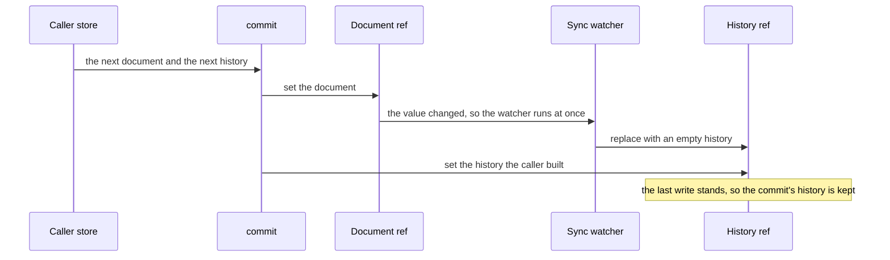

# Editing session

The editing session is the composable `useEditSession` in the block editor package: the state an editor store repeats around one document, its undo history and its selected node, with the commit that sets the document and its history together.

## How it works

The package ships the session beside its functions, in its one entry, so a store imports it from the same place as the commands it calls. It is the package's one Vue abstraction, which is why the package imports Vue and declares it as a peer, and the rule that holds that shape is the [headless package shape](../../architecture/headless-package-shape/spec.md). A store calls the composable inside its own setup and returns the members it needs. Pinia stays in the app.

A store creates a session with three arguments: the document ref it already holds, the history limit its own constant gives, and an optional selection port of two functions that convert between a node id and its pointer. The session owns none of the three. It adds one history, a shallow ref started from [the shared bounded history](../../shared/bounded-history/design.md) with that limit, and one selected id, a string that is empty when nothing is selected. It returns four members:

| Member            | What a store does with it                                                       |
| :---------------- | :------------------------------------------------------------------------------ |
| `commit`          | sets the document and the history from one edit                                 |
| `history`         | reads the undo and redo stacks, from which a store derives whether each is open |
| `load`            | sets a document from outside an edit, with an empty history and no selection    |
| `selectedPointer` | reads and writes the selected node as a pointer                                 |

A commit takes the next document and the next history, and it sets them in that order. The caller builds both: its service applies an edit's operations to the document and steps the history with the shared stack, so the pair arrives already matched, and the session only stores it. The session applies, pushes and undoes nothing itself.

The order is the mechanism. The document ref has a synchronous watcher that replaces the history with an empty one whenever the ref's value changes, so the clear runs during the document's assignment and the commit's own history is set after it.

The same watcher covers every other set of the document. A load of the content read from the server, a whiteboard's read and any other assignment to the ref start a fresh history, so no caller clears one by hand. `load` is the explicit form of that for a whole document: it commits the document with an empty history and clears the selection, since a loaded document has nothing to undo.

The selected node is held by its id, and `selectedPointer` resolves that id through the port against the document as it now stands. The pointer therefore follows the node when an edit moves it, and a node the document no longer holds reads as an empty pointer. Writing the pointer resolves it to an id the same way, and a pointer that names no node stores the empty id. With no port, the session reads and writes nothing selected, which is how a document without addressable nodes uses it.

What the session leaves out is the rest of an editor's state: applying an edit, undo and redo, the preview a gesture shows, and the flags that say whether either direction is open. Each store keeps those. The survey creator's commands apply an edit and record it through the page builder's recorded-history step before they commit. The whiteboard's service applies and undoes its edits through the store's `editState`, a writable computed whose getter reads the session's document and history and whose setter calls `commit`. The page builder keeps one history per open resource in its own history store. The operations a caller applies come from the [editor core](../editor-core/design.md), and the whiteboard's element commands from the [positioned elements](../positioned-elements/design.md).

## Decisions

- **The session is a composable a store calls in its setup, not a store.** A store's id is its path under the app's store folder, which the app's store test holds, so a package cannot own a store of its own, and a package that imported Pinia would force the store library on every consumer. Rejected: a store factory in the package that takes the document type as a parameter, since each instance of it would carry an id that the store test cannot read from the path.
- **The caller owns the document ref.** The session takes the ref the store already holds and never creates one. The whiteboard's document is the ref its content loader returns and saves, so a session that made a ref of its own would split the document in two. Rejected: a session that creates the ref and hands it back for the store to read.
- **The history is a shallow ref.** Its entries are operations and documents that the stack replaces rather than edits, so a shallow ref holds each entry as it was written, with no reactive proxy around it. Rejected: a deep ref, which would wrap every entry a read reaches.
- **The session stores the history a caller built, not an entry to push.** `commit` takes the document and the history together, so the pair is matched before the session sees it. Rejected: a `push` on the session, which would have to hold the apply step, and the apply differs by editor: the survey creator merges an interaction's edits into one entry, while the whiteboard records each edit as its own.
- **A set from outside a commit clears the history, through a synchronous watcher.** The watcher is synchronous because a commit assigns the document before the history, and a watcher that waited for the next flush would run after the commit and erase the history it had just set. Rejected: clearing only in `load`, which would leave every direct set of the content to clear its own history.
- **The selection is the node's id, read as a pointer.** A pointer shifts when a sibling before the node is removed or moved, so the session holds the id and resolves it on every read. Rejected: holding the pointer, which an edit that moves a sibling would leave on a different node.
- **The selection is an optional port.** A document without addressable nodes passes none. The whiteboard's document is a list of elements and its selection is a list of ids in its editor store, so it reads no selected node through the session. Rejected: moving that list into the session, which would change the editor store's API.
- **Apply, undo, redo and preview stay with the caller.** Those steps need the app's entry type and each editor's own schema or service, and the package is generic over the entry for that reason. Rejected: moving them into the session, which would give the package the page builder's entry type.
- **The page builder keeps a history per resource.** Its documents sit in another store, and one session holds one document. Rejected: a keyed session map in the package, which would bring the page builder's document writes into the package for a key that a single-document editor never uses.

## Key files

| File                                                                        | Role                                                                                                 |
| --------------------------------------------------------------------------- | ---------------------------------------------------------------------------------------------------- |
| `packages/vue-block-editor-headless/src/composables/useEditSession.ts`      | the session: the history ref, the synchronous clear, `commit`, `load` and the selected pointer       |
| `packages/vue-block-editor-headless/src/composables/useEditSession.test.ts` | a case for each scenario of the spec: a commit, a load, a move that keeps the selection, a removal   |
| `packages/vue-block-editor-headless/src/models/EditSession.ts`              | the members the session returns                                                                      |
| `packages/vue-block-editor-headless/src/models/EditSessionSelection.ts`     | the selection port a store passes in                                                                 |
| `packages/vue-block-editor-headless/src/index.ts`                           | the one entry, which exports the composable beside the package's functions                           |
| `packages/vue-block-editor-headless/package.json`                           | the package's Vue peer dependency and its dependency on the shared package the history comes from    |
| `packages/shared/src/services/history/createHistory.ts`                     | the empty history the session starts from, bounded by the limit a caller passes                      |
| `packages/shared/src/services/history/pushHistory.ts`                       | the step a caller takes to build the next history it commits                                         |
| `apps/web/app/store/survey/creator.ts`                                      | the survey creator, which passes its document and a selection port over its node helpers             |
| `apps/web/app/store/resource/whiteboard/index.ts`                           | the whiteboard, which passes its content ref and no selection, and wraps `commit` in its `editState` |
| `apps/web/app/store/pageBuilder/history.ts`                                 | the page builder's keyed history, which does not call the session                                    |
| `apps/web/app/store/index.test.ts`                                          | the test that holds each store's id to its path, which the session's store decision rests on         |
| `scripts/src/services/workspace/getHeadlessPackageFailures.ts`              | the shape check that holds the Vue peer and the absence of a Pinia import                            |

## Notes

- **Only an assignment clears the history.** The watcher is not deep, so a change written into a node in place does not reach it. A caller that changes the document without assigning the ref keeps the history, so an edit a session holds goes through `commit`, and a content read assigns the ref.
- **A removed node's id is kept.** The session holds the id while the node is absent, so an undo that brings the node back selects it again. The session's tests cover a removed node reading as nothing selected, not that return.
- **Each caller passes its own limit.** The survey creator passes `MAX_PAGE_BUILDER_HISTORY_SIZE`, declared in `apps/web/app/services/pageBuilder/constants.ts`, and the whiteboard passes `MAX_WHITEBOARD_HISTORY_SIZE`, declared in `apps/web/app/services/resource/whiteboard/constants.ts`.
