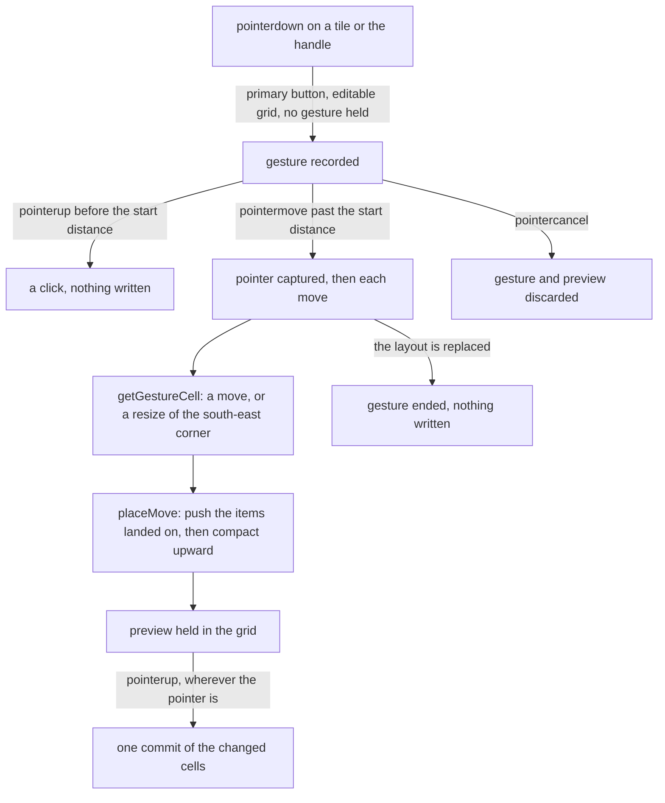

# Grid layout

The grid's placement and its pointer gestures, as `vue-grid-layout-headless` builds them. The package holds the behaviour and no markup: `useGridLayout` returns the state a consumer draws and the handlers it binds, and the pure functions the composable runs on stay internal to the package under `src/placement/`.

## How it works

The consumer binds three things. The grid's root element is the one the pointer's events are listened to on. Each tile's press goes to `startGesture`, and the corner handle's press goes to `startResize`. The consumer draws the returned tiles at their geometry, the placeholder where a drop would land, and the grid's height. The width comes from a `ResizeObserver` on the root, so the column pitch follows the element and not the window. Until the observer reports that width the grid returns no tiles, since a tile's geometry is computed from it, while the grid keeps the height it reserves.

A press becomes a gesture, and the gesture becomes a drag only once the pointer has travelled `dragStartDistance`, so a press that barely moves stays a click, and only the primary button starts a gesture. The drag then captures the pointer on the element that was pressed. Each move turns the pointer's offset into whole cells with `getGestureCell`: a move shifts the item's origin, and a resize pulls its south-east corner. The cell is placed with `placeMove`, which pushes the items it lands on and compacts the result upward, and held as a preview. Nothing is written during a gesture. A gesture ends when the layout it previews is replaced, since its release would otherwise write cells the new layout never had.

On release, the cells the preview changed leave the grid as one `onCommit(changes)`, and a release that changed no cell commits nothing. The drag holds the pointer, so the release arrives at the grid wherever the pointer is, and a drag released beyond the grid's box lands at the cells the grid clamps it to. A grid that is not editable starts no gesture, so it commits nothing.

**Placement is pure.** Everything under `src/placement/` takes a layout and returns a new one. Column and row pitch and cell position and size are arithmetic on the grid's spacing. Pushing the items a move lands on, the bounds correction a narrower column count needs, and the upward compaction are all functions of a layout alone. Compaction also resolves overlaps: an item that starts inside another moves down until it clears, so no placement stacks items on each other.

**Resizing the south-east corner.** A resize moves the item's right and bottom edges by whole cells and keeps its origin in place. The right edge stops at the grid's right side and at the least span, and the bottom edge stops at the least span, so an item never shrinks below one cell or leaves the columns.

**Spacing.** The grid's outer padding is its own option, apart from the gap between items. The padding offsets every cell's position, and the gap shortens each cell's size, so the outer edge of the grid stays apart from the outermost items. The grid's height is its last row's bottom without that row's trailing gap, plus the padding on both sides, so the top and bottom edges stay equally apart from the items.

## Decisions

- **A composable over styled components.** Shipping a `GridLayout` and `GridItem` pair, as the `grid-layout-plus` library does, was rejected. The pair's markup and class names would be the styling contract a consumer must follow, and the library's own defects were in that contract. The composable returns state and handlers, and the consumer renders them with its own tokens.
- **One resize corner.** A resize pulls the south-east corner, the one handle the dashboard draws, and an item's origin stays where it is under a resize. Resizing from the other edges and corners, which moves the origin when the left or top edge is pulled, is [deferred](../../../deferred/vue-grid-layout-headless/every-edge-resize/design.md): no consumer draws those handles.
- **A release commits the grid's own preview.** Handing a release to whichever grid lies under the pointer was rejected for this package, since its one consumer mounts one grid per page and nothing needs the hand-off. [Cross-grid moves](../../../deferred/vue-grid-layout-headless/cross-grid-move/design.md) are deferred for that reason.
- **The package depends on `@esposter/shared` for one helper.** `checkIsNestedControl` refuses a press on a control inside a tile, and the rest of the package is native (`addEventListener`, `ResizeObserver`, `setPointerCapture`). The helper is shared rather than copied, so a press rule has one definition.
- **The drag threshold is an option, not a constant.** The package takes `dragStartDistance` from its consumer. The dashboard keeps its own distance in its UI constants, so a consumer tunes its own feel.

## Notes

- The package draws no handle. The corner handle's press is the consumer's `startResize` binding, and the package resizes from that corner only.
- A grid hosted inside another grid's tile is not supported: a press on the inner tile also reaches the outer tile's handler, so both grids start a gesture. The check that would keep a press with its nearest grid is [deferred](../../../deferred/vue-grid-layout-headless/nested-grids/design.md) with the nesting it serves.
- A press whose release happens outside the grid never reaches the grid's release. A move with no button held ends the gesture, so a press released elsewhere does not start a drag when the pointer comes back.
- The package's main entry is a barrel by design, and its bundle is measured by its size snapshot, which the `build` skill owns.

## Key files

| File                                                                 | Role                                                                                            |
| :------------------------------------------------------------------- | :---------------------------------------------------------------------------------------------- |
| `packages/vue-grid-layout-headless/src/vueGridLayoutHeadless.ts`     | The main entry: `useGridLayout` and the grid's models                                           |
| `packages/vue-grid-layout-headless/src/composables/useGridLayout.ts` | The gesture state, the preview, the commit and the resize observer                              |
| `packages/vue-grid-layout-headless/src/placement/getGestureCell.ts`  | Turns a pointer's offset into the whole cells a move or a south-east resize lands on            |
| `packages/vue-grid-layout-headless/src/placement/placeMove.ts`       | Places a move: pushes the items it lands on, then compacts upward                               |
| `packages/vue-grid-layout-headless/src/placement/moveItem.ts`        | Moves an item onto its cell and pushes the items it lands on, and the items those land on, down |
| `packages/vue-grid-layout-headless/src/placement/compactLayout.ts`   | Rises each item upward and pushes one that starts inside another down until it clears           |
| `packages/vue-grid-layout-headless/src/placement/fitLayout.ts`       | Fits a saved layout to a column count, then compacts it                                         |

## Sources

- [Pointer Events, W3C](https://www.w3.org/TR/pointerevents/): pointer capture and the cancel path a gesture follows.
- [react-grid-layout](https://github.com/react-grid-layout/react-grid-layout): the vocabulary of the grid's options. The grid's outer padding is `spacing.padding`, the option react-grid-layout calls `containerPadding`.
