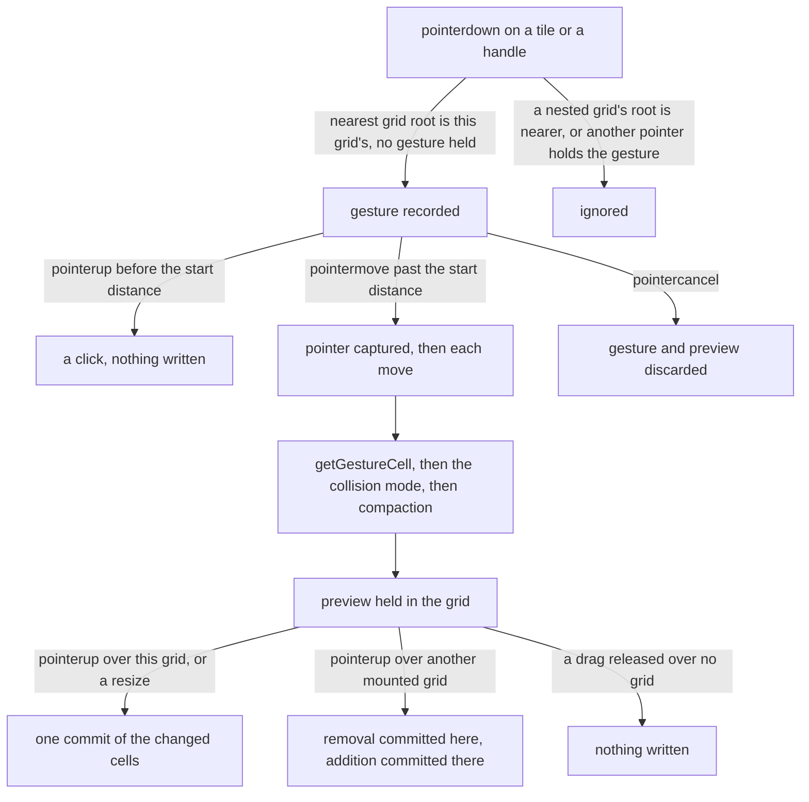

# Grid layout

The grid's placement and its pointer gestures, as `vue-grid-layout-headless` builds them. The package holds the behaviour and no markup: `useGridLayout` returns the state a consumer draws and the handlers it binds, and the `/placement` entry exports the pure functions the composable runs on, so a consumer can place items without a grid.

## How it works

The consumer binds three things. The grid's root element is the one the pointer is followed across. Each tile's press goes to `startGesture`, and each handle's press goes to `startGesture` with the edge it pulls. The consumer draws the returned tiles at their geometry, the placeholder where a drop would land, and the grid's height. The width comes from a `ResizeObserver` on the root, so the column pitch follows the element and not the window.

A press becomes a gesture, and the gesture becomes a drag only once the pointer has travelled `dragStartDistance`, so a press that barely moves stays a click. The drag then captures the pointer on the element that was pressed. Each move turns the pointer's offset into whole cells with `getGestureCell`, resolves the cell under the grid's collision mode, compacts the result under its compact type, and holds it as a preview. Nothing is written during a gesture.

On release, the cells the preview changed leave the grid as one `onCommit({ changes, removed })`. A drag released over another mounted grid is different: this grid commits the removal of the item and the compaction of the rest, and the grid under the pointer commits the addition. A drag released over no grid commits nothing, so the item stays where it was.

**Placement is pure.** Everything under `src/placement/` takes a layout and returns a new one. Column and row pitch, cell position and size, and the span a pixel size covers are arithmetic on the grid's spacing. Collision and the push that moves items aside, the swap that trades places with the one item a drop lands on, the refusal under `prevent`, vertical and horizontal compaction, and the bounds correction a narrower column count needs are all functions of a layout alone.

**Resizing from any edge.** A resize names the edge or corner it pulls. Pulling the left or the top edge moves the origin and changes the span together, so the opposite edge stays where it was, and a resize never shrinks below one cell.

**Auto-height items.** An item marked `isAutoHeight` takes the whole rows that hold the content its consumer reports through `reportContentHeight`. The span is set, the layout compacts, and the changed cells are committed as one commit.

**Spacing.** The grid's outer padding is its own option, apart from the gap between items. The padding offsets every cell's position, and the gap shortens each cell's size, so the outer edge of the grid stays apart from the outermost items.

## Decisions

- **A composable over styled components.** Shipping a `GridLayout` and `GridItem` pair, as the `grid-layout-plus` library does, was rejected. The pair's markup and class names would be the styling contract a consumer must follow, and the library's own defects were in that contract. The composable returns state and handlers, and the consumer renders them with its own tokens.
- **Every edge resizes, and a left or top resize moves the origin.** This overturns the dashboard grid's decision to resize from its corner only, which was made because a dashboard resizes from its corner. A package cannot speak for its consumers' layouts, and the origin move is the same placement logic applied to the other edge, not a second copy of it. The dashboard still draws one corner handle.
- **Crossing between grids through the mounted grids.** Cross-grid moves on the HTML Drag and Drop API were rejected. That API does not fire for touch input, and it would split one gesture across two event models. The pointer stays captured by the source grid, and the composable finds the grid under the pointer among the grids mounted on the page, by the nearest registered root.
- **A drop lands with its top-left under the pointer.** A dropped item from another grid or a palette has no offset from a grab point the target could read, so its cell is the one under the pointer's top-left, offset by the grid's padding. Carrying the grab offset across grids was rejected, since the source's grab point is not meaningful to the target.
- **Nested grids take a press by their nearest root.** Each grid's presses are those whose nearest registered root is its own, so an outer grid never starts a gesture on an inner grid's item. The check is the grid's own root, so a nested grid needs no configuration.
- **The package depends on `@esposter/shared` for one helper.** `checkIsNestedControl` refuses a press on a control inside a tile, and the rest of the package is native (`addEventListener`, `ResizeObserver`, `setPointerCapture`). The helper is shared rather than copied, so a press rule has one definition.
- **The drag threshold is an option, not a constant.** The package takes `dragStartDistance` from its consumer. The dashboard keeps its own distance in its UI constants, so a consumer tunes its own feel.

## Notes

- The package draws no per-edge handles. It builds every edge's resize, and a consumer binds the handles it chooses to draw, so the dashboard binds one.
- A drag over another grid shows no preview in that grid until the release. The source grid's tile follows the pointer, and the target grid commits the addition on release, so the target's cells are not drawn as the item moves across it.
- A release with the pointer outside the browser's viewport hits no element, so it finds no grid and the drag is dropped.
- `startExternalDrag` has no drag threshold, so a click on a palette entry drops it at the click point. A consumer that wants a palette entry to need a drag gives it its own threshold before calling it.
- The package's main entry is a barrel by design, and its bundle is measured by its size snapshot. The `/placement` entry measures only its re-exports, since the shared code it uses is split into a separate chunk.

## Key files

| File                                                                     | Role                                                                                             |
| :----------------------------------------------------------------------- | :----------------------------------------------------------------------------------------------- |
| `packages/vue-grid-layout-headless/src/vueGridLayoutHeadless.ts`         | The main entry: `useGridLayout`, `startExternalDrag`, and the grid's models                      |
| `packages/vue-grid-layout-headless/src/placement.ts`                     | The `/placement` entry: the pure functions, framework-free                                       |
| `packages/vue-grid-layout-headless/src/composables/useGridLayout.ts`     | The gesture state, the preview, the commits and the resize observer                              |
| `packages/vue-grid-layout-headless/src/composables/startExternalDrag.ts` | A drag from outside every grid, such as a palette entry, dropped onto the grid under the pointer |
| `packages/vue-grid-layout-headless/src/services/mountedGrids.ts`         | The grids mounted on the page, keyed by root, and the lookups that find the nearest one          |
| `packages/vue-grid-layout-headless/src/placement/getGestureCell.ts`      | Turns a pointer's offset into the whole cells a move or a resize lands on                        |
| `packages/vue-grid-layout-headless/src/placement/resolveMove.ts`         | Applies the collision mode to a dropped cell: push, swap or refuse                               |
| `packages/vue-grid-layout-headless/src/placement/compactLayout.ts`       | Compacts a layout upward, sideways or not at all                                                 |
| `packages/vue-grid-layout-headless/src/placement/fitLayout.ts`           | Fits a saved layout to a column count, then compacts it                                          |
| `packages/vue-grid-layout-headless/src/models/GridCommit.ts`             | The commit a release writes: the changed or added cells and the removed ids                      |

## Sources

- [Pointer Events, W3C](https://www.w3.org/TR/pointerevents/): pointer capture and the cancel path a gesture follows.
- [react-grid-layout](https://github.com/react-grid-layout/react-grid-layout): the names of `compactType`, `containerPadding` and dropping from outside, which the options follow.
