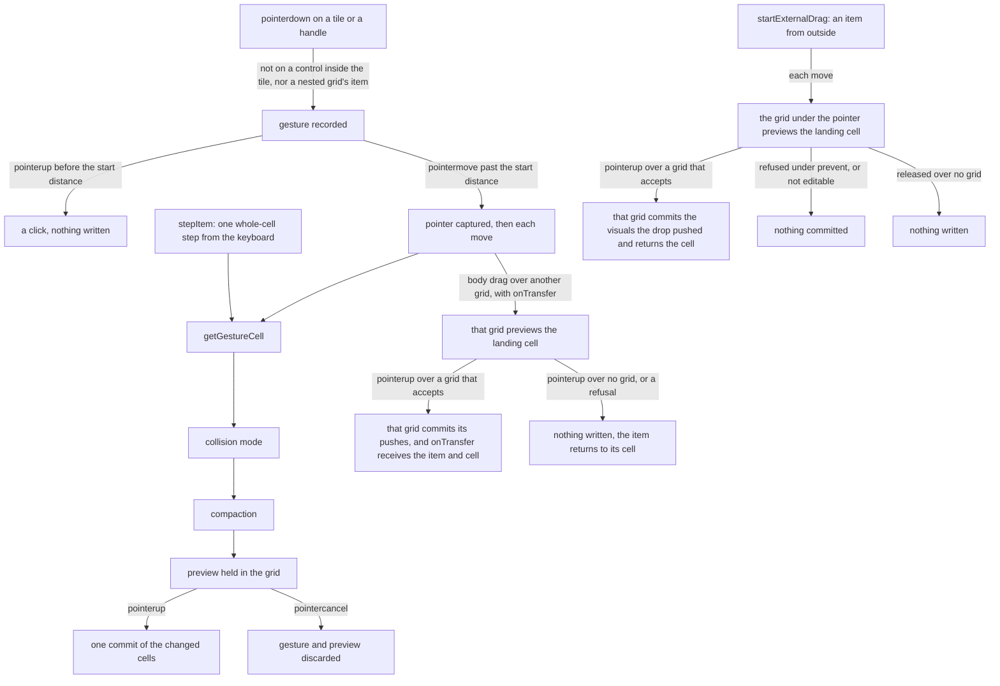

# Grid layout

The grid's placement and its pointer gestures, as `vue-grid-layout-headless` builds them. The package holds the behaviour and no markup: `useGridLayout` returns the state a consumer draws and the handlers it binds, and the pure functions the composable runs on stay internal to the package under `src/placement/`.

## How it works

The consumer binds what the grid returns. The grid's root element is the one the pointer is followed across. Each tile's press goes to `startGesture`, and each handle's press goes to `startGesture` with the edge it pulls. A keyboard step on a tile goes to `stepItem`. The consumer draws the returned tiles at their geometry, the placeholder where a drop would land, and the grid's height. The width comes from a `ResizeObserver` on the root, so the column pitch follows the element and not the window. Until the observer reports that width the grid returns no tiles, since a tile's geometry is computed from it, while the grid keeps the height it reserves.

A press becomes a gesture, and the gesture becomes a drag only once the pointer has travelled `dragStartDistance`, so a press that barely moves stays a click, and only the primary button starts a gesture. A press on a control inside a tile is left to that control, and a press on an item of a nested grid belongs to that grid, so the grid around it takes no gesture from it. A touch never resizes, so a touch press on a handle is a press on the body and moves the item, as a touch on the body does; a press by any other pointer on an edge that pulls an auto-height item's height starts no gesture. The drag then captures the pointer on the element that was pressed. Each move turns the pointer's offset into whole cells with `getGestureCell`, resolves the cell under the grid's collision mode, compacts the result under its compact type, and holds it as a preview. Nothing is written during a gesture. A gesture ends when the layout it previews is replaced, since its release would otherwise write cells the new layout never had.

On release, the cells the preview changed leave the grid as one `onCommit({ changes })`, and a grid that is not editable commits nothing. A drop from outside the grid is a different path. `startExternalDrag` previews the item on the grid under the pointer, and on release asks that grid to `accept` it. The grid commits the visuals the drop pushed, once, and returns the cell the new item lands in, so the caller adds the item there. Under the prevent mode a drop onto another item is refused, and a grid that is not editable refuses every drop: the grid then returns no cell and commits nothing. A drag released over no grid commits nothing.

A body drag over another grid is handed to that grid when the consumer takes a transfer through `onTransfer`. Each move looks up the grid under the pointer with `findGridAt`, skipping the dragged element. Over another grid the drag's own grid draws no placeholder, and that grid previews the item at the cell under the pointer, as a palette drop previews. On release, the grid under the pointer accepts the item as a palette drop is accepted, committing what its landing pushed, and `onTransfer` receives the item, the cell it lands in there and that grid's root element. The source grid commits nothing for the item. A grid that refuses the landing gives no cell, so nothing transfers, and a release over no grid returns the item to its cell. A resize never transfers, and without `onTransfer` a body drag stays in its own grid and commits there as it always has.

A keyboard step places an item as a gesture does and commits its changes once, when the step lands. A step that lands where the item already is, leaves the grid, changes an auto-height item's height, or is refused under prevent changes nothing, and `stepItem` returns false. A grid that is not editable steps nothing.

**Placement is pure.** Everything under `src/placement/` takes a layout and returns a new one. Column and row pitch, cell position and size, and the span a pixel size covers are arithmetic on the grid's spacing. Collision and the push that moves items aside, the swap that trades places with the one item a drop lands on (pushing instead when the trade would run either item past the last column), the refusal under `prevent`, vertical and horizontal compaction, and the clamp that holds a cell in the columns and below the top row are all functions of a layout alone. A layout under no compaction still resolves overlaps: an item left overlapping another moves down until it clears, so no placement stacks items on each other. A horizontal push that would run past the last column moves the item down a row and then rises along that row as far as it can, so no item ends outside the columns. A dropped item wider than the grid is narrowed to its columns before it is placed.

**The first free cell.** `getFirstFreeCell` scans rows from the top and columns from the left, and returns the first cell where a new item of a given span fits without overlapping. The consumer places a new item there; the package keeps no notion of which items a consumer means to add.

**Resizing from any edge.** A resize names the edge or corner it pulls. Pulling the left or the top edge moves the origin and changes the span together, so the opposite edge stays where it was, and a resize never shrinks below one cell.

**Auto-height items.** An item marked `isAutoHeight` takes the whole rows that hold the content its consumer reports through `reportContentHeight`. The span is set, the layout compacts, and the changed cells are committed as one commit.

**Spacing.** The grid's outer padding is its own option, apart from the gap between items. The padding offsets every cell's position, and the gap shortens each cell's size, so the outer edge of the grid stays apart from the outermost items. The grid's height is its last row's bottom without that row's trailing gap, plus the padding on both sides, so the top and bottom edges stay equally apart from the items.

## Decisions

- **A composable over styled components.** Shipping a `GridLayout` and `GridItem` pair, as the `grid-layout-plus` library does, is rejected. The pair's markup and class names would be the styling contract a consumer must follow, and the library's own defects were in that contract. The composable returns state and handlers, and the consumer renders them with its own tokens.
- **Every edge resizes, and a left or top resize moves the origin.** A resize from one edge only is rejected for the package: a package cannot speak for its consumers' layouts, and the origin move is the same placement logic applied to the other edge, not a second copy of it. The dashboard draws handles for every edge over it.
- **A drop from outside finds its grid through the mounted grids.** Drops on the HTML Drag and Drop API are rejected: that API does not fire for touch input, and it would split one gesture across two event models. The pointer stays with the palette press, and the composable finds the grid under the pointer among the grids mounted on the page. The lookup takes the hit list the browser reports at the pointer, skips the dragged element that is drawn under the pointer, and takes the nearest registered root of the first hit that remains, so an inner grid takes a drop over an outer one.
- **A palette drop lands with its top-left under the pointer.** A palette entry has no grab point a grid could read, so its cell is the one under the pointer's top-left, offset by the grid's padding.
- **A press on a nested grid's item belongs to that grid.** The grid around it refuses a press whose nearest registered root is not its own, so the inner grid's own tile starts the gesture. The rule reads the same mounted-grid registry the palette drop uses, so a consumer writes no routing. Stopping the press at the inner tile is rejected, since every consumer would then have to remember to do it. A press on a control inside a tile is still left to that control.
- **A body drag hands its item over through `onTransfer`, and the package never moves an item between two lists.** The package owns no data: a consumer's items are arrays it reads and the commit writes back, so it cannot take an item out of one array and put it in another. The package moving the item itself is rejected for that reason, since it would have to know the consumer's lists and the groups they stand for. The callback names the item, the cell it lands in and the target's root element, and the consumer reads its own `data-` attribute from that element to know which group it is. A landing the target refuses is never handed over, so a collision mode is not bypassed by a callback that adds the item anyway. Without `onTransfer` a body drag stays in its grid, so a single-grid consumer sees no change.
- **The package depends on `@esposter/shared` for one helper.** `checkIsNestedControl` refuses a press on a control inside a tile, and the rest of the package is native (`addEventListener`, `ResizeObserver`, `setPointerCapture`). The helper is shared rather than copied, so a press rule has one definition.
- **The drag threshold is an option, not a constant.** The package takes `dragStartDistance` from its consumer. The dashboard keeps its own distance in its UI constants, so a consumer tunes its own feel.

## Notes

- The package draws no handles. It builds every edge's resize, and a consumer binds the handles it chooses to draw.
- A release with the pointer outside the browser's viewport hits no element, so it finds no grid. With `onTransfer` the item returns to its cell; without it the grid commits the cells its own preview holds, as it does for any release.
- A press whose release happens outside the grid never reaches the grid's release. A move with no button held ends the gesture, so a press released elsewhere does not start a drag when the pointer comes back.
- `startExternalDrag` has no drag threshold, so a click on a palette entry drops it at the click point. A consumer that wants a palette entry to need a drag gives it its own threshold before calling it.
- `startExternalDrag` ends its listeners on either a release or a cancel of its pointer. A cancelled press is discarded without accepting, and the next press's release is the one that drops the entry.
- The package's main entry is a barrel by design, and its bundle is measured by its size snapshot, which the `build` skill owns.

## Key files

| File                                                                  | Role                                                                                                          |
| :-------------------------------------------------------------------- | :------------------------------------------------------------------------------------------------------------ |
| `packages/vue-grid-layout-headless/src/vueGridLayoutHeadless.ts`      | The main entry: `useGridLayout`, `startExternalDrag`, and the grid's models                                   |
| `packages/vue-grid-layout-headless/src/composables/useGridLayout.ts`  | The gesture state, the preview, the commits, the keyboard step and the resize observer                        |
| `packages/vue-grid-layout-headless/src/services/startExternalDrag.ts` | A drag from outside every grid, such as a palette entry, dropped onto the grid under the pointer              |
| `packages/vue-grid-layout-headless/src/services/mountedGrids.ts`      | The grids mounted on the page, keyed by root                                                                  |
| `packages/vue-grid-layout-headless/src/services/findGridRoot.ts`      | The nearest mounted grid root at or above an element, so an inner grid's root wins for a press and for a drop |
| `packages/vue-grid-layout-headless/src/services/findGridAt.ts`        | The grid under a point: the first hit outside the dragged element, then its nearest root                      |
| `packages/vue-grid-layout-headless/src/placement/getGestureCell.ts`   | Turns a pointer's offset into the whole cells a move or a resize lands on                                     |
| `packages/vue-grid-layout-headless/src/placement/resolveMove.ts`      | Applies the collision mode to a dropped cell: push, swap or refuse                                            |
| `packages/vue-grid-layout-headless/src/placement/placeMove.ts`        | Places a move: applies the collision mode, then compacts under the grid's columns and type                    |
| `packages/vue-grid-layout-headless/src/placement/compactLayout.ts`    | Compacts a layout upward, sideways or not at all, resolves overlaps, and bounds a horizontal push             |
| `packages/vue-grid-layout-headless/src/placement/fitLayout.ts`        | Fits a saved layout to a column count, then compacts it                                                       |
| `packages/vue-grid-layout-headless/src/placement/getFirstFreeCell.ts` | The first cell a new item's span fits in, scanning rows from the top                                          |
| `packages/vue-grid-layout-headless/src/models/GridTransfer.ts`        | The hand-over a body drag released over another grid makes: the item, its cell and that grid's root           |
| `packages/vue-grid-layout-headless/src/models/GridCommit.ts`          | The commit a release writes: the changed cells                                                                |

## Sources

- [Pointer Events, W3C](https://www.w3.org/TR/pointerevents/): pointer capture and the cancel path a gesture follows.
- [react-grid-layout](https://github.com/react-grid-layout/react-grid-layout): the names of `compactType` and dropping from outside, which the options follow. The grid's outer padding is `spacing.padding`, the option react-grid-layout calls `containerPadding`.
