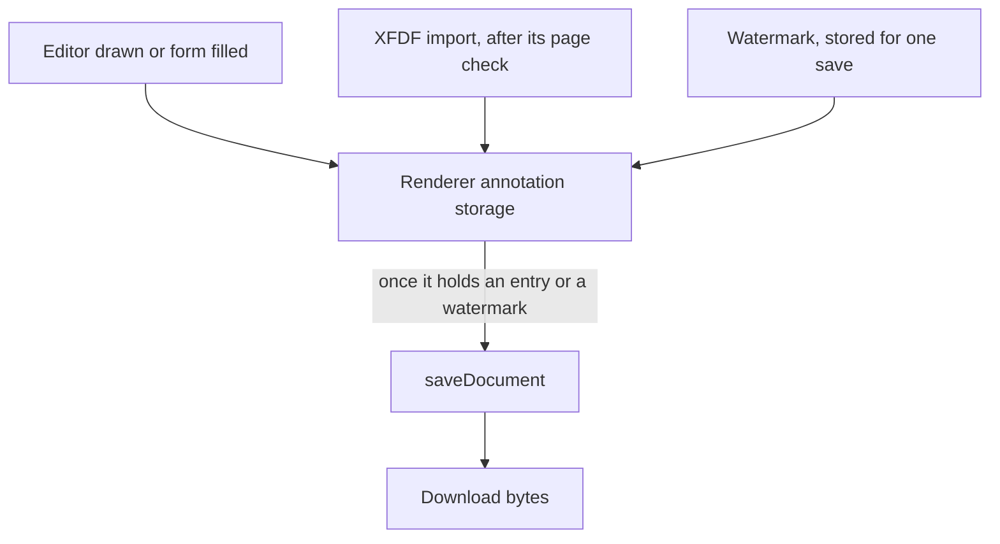

# PDF annotations in the headless package

[`vue-pdfjs-headless`](../README.md) gains what a document holds besides its pages: forms, free texts and comments. The renderer's annotation storage holds the first two as they are filled or drawn, and one save writes that storage into the bytes a download carries. The requirements are in [spec.md](spec.md).

## Built

- **`usePdfAnnotations`** takes the viewer and the document `usePdfViewer` and `usePdfDocument` return. It sets the editor mode, reports each drawn annotation, lists comments, and imports and exports XFDF free texts through the storage.
- **XFDF** is read and written by `readXfdf` and `writeXfdf`, which the package exports from its barrel, framework-free and renderer-free. It carries free texts only.
- **The download** `usePdfViewer` returns saves through the renderer once the storage holds an entry or a watermark is given for the download. The watermark is stored for that save alone.



The app's PDF viewer is the composable's consumer: its toolbar sets the editor mode and imports and exports the XFDF file, and its sidebar's Comments tab asks for the comments, as the [pdf-viewer design](../../architecture/pdf-viewer/design.md) states.

## What the renderer saves

These are pdf.js behaviours at the version the workspace catalog pins, probed in Node with its legacy build, because the storage's rules belong to the renderer and not to the package:

| Entry                          | Storage key                          | Result on save and reload                                                                                                                                                                                                                                                 |
| :----------------------------- | :----------------------------------- | :------------------------------------------------------------------------------------------------------------------------------------------------------------------------------------------------------------------------------------------------------------------------ |
| A text field's value           | the widget's raw id, e.g. `4R`       | Kept as the field's value in the saved bytes, with or without `/NeedAppearances`. With an appearance stream and without the flag, the save draws the value into the stream; with the flag, the stream still draws the old text and a reader regenerates it from the value |
| A free text                    | `pdfjs_internal_editor_` plus the id | Kept as a `FreeText` annotation                                                                                                                                                                                                                                           |
| A text annotation (a comment)  | the same prefix, `annotationType` 1  | Dropped: the worker's save has no branch that writes one                                                                                                                                                                                                                  |
| Several free texts in one save | as above                             | Kept, every one reloads, but pdf.js logs `Object already resolved` as an unhandled rejection, one page or many                                                                                                                                                            |

An untouched document's storage is empty, so "the storage has changed" is its size being above zero.

## Decisions

- **Comments are listed, not added.** The renderer's save drops text annotations. Writing them with a second PDF library was rejected, for the reason XFDF was not given one: the renderer's storage is the model, and a comment written outside it would not reach the download. Adding a comment is therefore not offered, and the package's spec says so.
- **No subpath for XFDF.** No package imports XFDF alone, and a second build entry would bundle `readXfdf` and `writeXfdf` a second time. The functions ship from the package's barrel.
- **The change event names a drawing, and only a drawing.** pdf.js calls its storage hook with the mode of an editor it has just stored, and gives no page. The page comes from the newest storage entry, which is that editor. Removing an editor and filling a form report no event, though a download still carries both.
- **XFDF carries free texts.** Ink, highlight, stamp and comments are not written or read. XFDF does not name the colour or size of a free text, so an imported one takes the renderer's defaults.
- **An import is stored, not drawn on the open page.** The import writes the free texts into the renderer's storage, which the download reads, so they are saved; the page's editor layer is built when the page renders, and an import does not draw into a page already rendered. Drawing them at import would reach into the renderer's page layers, which the package does not do.
- **Imports are keyed apart from drawn editors, and a page past the end is refused.** pdf.js numbers its editors from zero, so an imported free text named `0` would replace the first drawn annotation; imports are stored under their own key namespace instead. A free text on a page that does not exist makes the renderer's save fail for the whole download, so the import checks the page count before it stores anything. A drawn editor has no element id until a page saves it, so the export takes its id from the key the renderer stores it under.
- **An imported free text keeps its name as its id only while the name is free.** XFDF names are optional and may repeat, and an import is stored under its id, so an unnamed free text, or one named as an id the document already holds, takes a generated id instead. Without it the second free text would replace the first under one key. The export writes the id back as the name.
- **Comments are read when wanted, once for each document.** `usePdfAnnotations` reads a document's text annotations the first time its `isCommentsWanted` is true for that document, so a document nobody reads comments of reads none. `comments` is undefined until the read settles, as the outline is, so a list shows loading rather than an empty list; a read that fails is an empty list, so its tab says so rather than loading for ever. A page's proxy is released once its annotations are read, since the document keeps the proxies it hands out for its life.
- **Reading XFDF returns a `Result`.** A file that is not well-formed, or a free text with no valid page or rectangle, returns an error that names the problem and imports nothing.
- **The watermark is written at save, not drawn on screen.** Drawing it into the page canvas was rejected: the mark would never reach the downloaded file, which is where a watermark is for. It is stored on every page before the save and removed after it, so the pages on screen never hold it. It is laid across the middle of the page's unturned box, so the band crosses a page turned a quarter as well.
- **The editor mode is the renderer's, applied once the renderer reports its editor manager.** The renderer makes that manager after a document's first page is read and replaces it with each document, and it throws on a mode set before one exists. A throw inside the viewer's update stops every later render of it, so the mode the reader chose is set on each manager as it is reported, and a mode chosen while a document loads waits for that report.
- **The renderer's annotation icons come from the consumer's folder.** pdf.js asks for a text annotation's icon by name beside `imageResourcesPath`, which the renderer leaves empty, so an icon is requested from the page's root. The consumer names the folder the icons are served from, which the app sets to `/pdfjs/images/`; serving that folder from the install is the roadmap's work.
- **The package does not set `/NeedAppearances`.** Setting it would rewrite the saved catalog, which the renderer's save does not do and the package has no writer for. A reader's draw of a typed value is left to the field's appearance, as the spec says, and the probe table shows what the saved bytes carry with and without the flag.

## Key files

The package's annotation files:

```text
packages/vue-pdfjs-headless/src/composables/usePdfAnnotations.ts  editor mode, change events, comments, XFDF import and export
packages/vue-pdfjs-headless/src/xfdf/                             readXfdf and writeXfdf, framework-free
packages/vue-pdfjs-headless/src/services/getDownloadBytes.ts      original bytes, or the saved bytes with a watermark stored for the save
packages/vue-pdfjs-headless/src/services/getPdfPages.ts           every page of a document, for the reads that take them all
packages/vue-pdfjs-headless/src/services/createFreeTextEntry.ts   the storage entry the renderer saves as a free text
packages/vue-pdfjs-headless/src/models/                           PdfAnnotationChange, PdfAnnotationsState, PdfComment, PdfEditorMode, PdfFreeText, PdfFreeTextEntry
```

| File                                                            | Role                                                                                 |
| :-------------------------------------------------------------- | :----------------------------------------------------------------------------------- |
| `packages/vue-pdfjs-headless/src/composables/usePdfViewer.ts`   | the editor mode applied to the renderer, and the download through `getDownloadBytes` |
| `packages/vue-pdfjs-headless/src/composables/usePdfDocument.ts` | the document whose annotation storage `usePdfAnnotations` reads and writes           |
| `packages/vue-pdfjs-headless/package.json`                      | the `neverthrow` dependency for the XFDF results                                     |
| `openspec/specs/architecture/pdf-viewer/design.md`              | The app's PDF viewer, which mounts these controls                                    |

## Sources

- [pdf.js API](https://github.com/mozilla/pdf.js/blob/master/src/display/api.js): the document's `annotationStorage` and `saveDocument`.
- [pdf.js viewer](https://github.com/mozilla/pdf.js/blob/master/web/pdf_viewer.js): the viewer's annotation mode, forms included, and its annotation editor modes.
- [ISO 19444-1, XML Forms Data Format](https://www.iso.org/standard/74272.html): the XML format for a PDF's annotations and form data.
