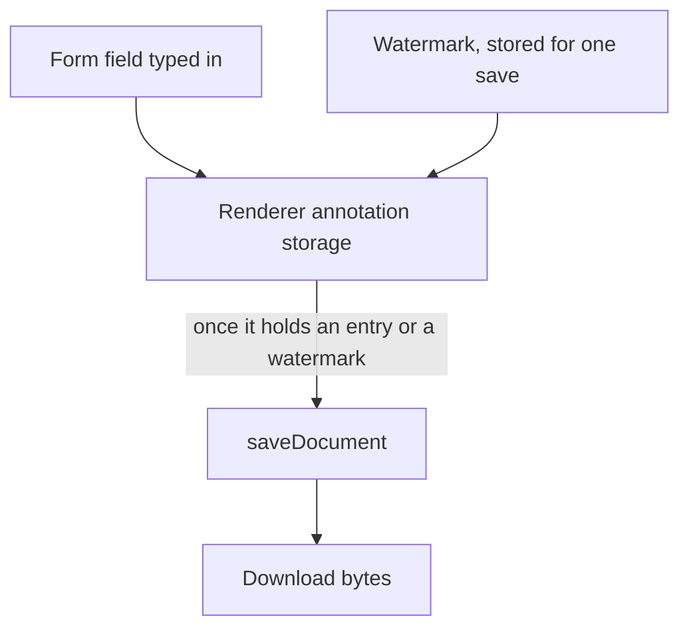

# PDF form values and the watermark in the headless package

[`vue-pdfjs-headless`](../README.md) keeps what a reader types into a document's form fields, and a watermark, in the renderer's annotation storage, and one save writes that storage into the bytes a download carries. Drawing annotations, listing comments and exchanging XFDF are not built: they are the [annotation UI](../../../deferred/vue-pdfjs-headless/annotation-ui/design.md) idea. The requirements are in [spec.md](spec.md).

## Built

- **The download** `usePdfViewer` returns saves through the renderer once the storage holds an entry or a watermark is set. The watermark is stored for that save alone.
- **Form values** typed into the renderer's form fields are stored by the renderer under the widget's id, and the download carries them.

## What the renderer saves

These are pdf.js behaviours at the version the workspace catalog pins, probed in Node with its legacy build, because the storage's rules belong to the renderer and not to the package:

| Entry                          | Storage key                          | Result on save and reload                                                                                          |
| :----------------------------- | :----------------------------------- | :----------------------------------------------------------------------------------------------------------------- |
| A form value                   | the widget's raw id, e.g. `4R`       | Kept, but only when the field carries `/NeedAppearances`; without it the worker returns before it writes the field |
| A free text                    | `pdfjs_internal_editor_` plus the id | Kept as a `FreeText` annotation                                                                                    |
| A text annotation (a comment)  | the same prefix, `annotationType` 1  | Dropped: the worker's save has no branch that writes one                                                           |
| Several free texts in one save | as above                             | Kept, every one reloads, but pdf.js logs `Object already resolved` as an unhandled rejection, one page or many     |

An untouched document's storage is empty, so "the storage has changed" is its size being above zero.

## Decisions

- **The watermark is written at save, not drawn on screen.** Drawing it into the page canvas was rejected: the mark would never reach the downloaded file, which is where a watermark is for. It is stored on every page before the save and removed after it, so the pages on screen never hold it.

## Known limits

- **A form value survives a download only when the field carries `/NeedAppearances`.** The spec's forms requirement promises every typed value is kept, but the renderer's save returns before it writes a field without that flag (see the probe table). The test `#268 Filling a form and downloading it` mocks `saveDocument`, so it passes whether or not the value survives, and it never sets the flag. Resume: a decision between two paths. Either the package sets `/NeedAppearances` on the document's form before the save, which changes the saved bytes of every form, or the spec's requirement is narrowed to the fields that carry the flag. Then the test either checks the saved value against a real document or the requirement's wording changes with it.
- **Several free texts in one save log a pdf.js error.** The watermark stores one free text on every page, so a long document's download hits this. The saved bytes reload with every free text, but pdf.js logs `Object already resolved` as an unhandled rejection. Resume: the user files it upstream by hand, with a reproduction (two free texts in one `saveDocument` call on pdf.js 6.4.299, run with the legacy build in Node), and the issue is linked here.
- **The watermark's browser check is open.** The watermark's grey has not been seen in a browser; the stamp was checked against pdf.js's source and a stub, not a run. Resume: a harness page that mounts `usePdfViewer` with a watermark, saves the download and reads the stamped free text's colour back with pdf.js.
- **The upstream rows are not re-judged.** The annotation issues on both trackers have not been read against this capability. Resume: `gh issue view` each annotation issue on the two trackers, judge it against this change, and update the package page's Upstream table.

## Key files

| File                                                              | Role                                                                                |
| :---------------------------------------------------------------- | :---------------------------------------------------------------------------------- |
| `packages/vue-pdfjs-headless/src/composables/usePdfViewer.ts`     | the download, which saves through `getDownloadBytes` with the watermark it is given |
| `packages/vue-pdfjs-headless/src/services/getDownloadBytes.ts`    | original bytes, or the saved bytes with a watermark stored for the save             |
| `packages/vue-pdfjs-headless/src/services/createFreeTextEntry.ts` | the storage entry the renderer saves as a free text                                 |
| `packages/vue-pdfjs-headless/src/models/PdfFreeTextEntry.ts`      | the storage entry's shape                                                           |
| `packages/vue-pdfjs-headless/src/models/PdfEditorMode.ts`         | the annotation type a free text is stored under                                     |
| `openspec/specs/architecture/pdf-viewer/design.md`                | The app's PDF viewer, which draws no annotation controls                            |

## Sources

- [pdf.js API](https://github.com/mozilla/pdf.js/blob/master/src/display/api.js): the document's `annotationStorage` and `saveDocument`.
- [pdf.js viewer](https://github.com/mozilla/pdf.js/blob/master/web/pdf_viewer.js): the viewer's annotation mode, forms included.
