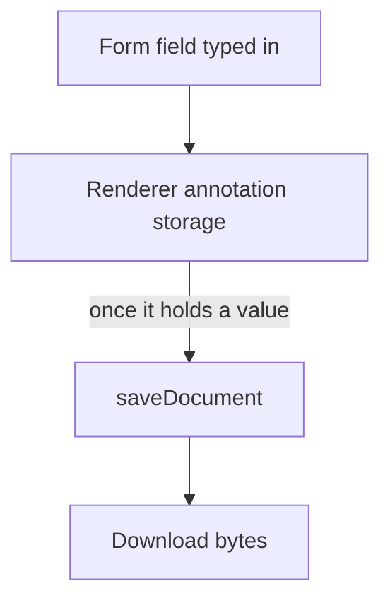

# PDF form values in the headless package

[`vue-pdfjs-headless`](../README.md) keeps what a reader types into a document's form fields in the renderer's annotation storage, and one save writes that storage into the bytes a download carries. Drawn annotations, comments and XFDF are not built: they are the [annotation UI](../../../deferred/vue-pdfjs-headless/annotation-ui/design.md) idea. A stamp on the download is the [watermark](../../../deferred/vue-pdfjs-headless/watermark/design.md) idea. The requirements are in [spec.md](spec.md).

## Built

- **The download** `usePdfViewer` returns saves through the renderer once the storage holds a form value. Until then it carries the original bytes.

## What the renderer saves

These are pdf.js behaviours at the version the workspace catalog pins, probed in Node with its legacy build, because the storage's rules belong to the renderer and not to the package:

| Entry        | Storage key                    | Result on save and reload                                                                                          |
| :----------- | :----------------------------- | :----------------------------------------------------------------------------------------------------------------- |
| A form value | the widget's raw id, e.g. `4R` | Kept, but only when the field carries `/NeedAppearances`; without it the worker returns before it writes the field |

An untouched document's storage is empty, so "the storage has changed" is its size being above zero.

## Known limits

- **A form value survives a download only when the field carries `/NeedAppearances`.** The spec's forms requirement promises every typed value is kept, but the renderer's save returns before it writes a field without that flag (see the probe table). The test `#268 Filling a form and downloading it` mocks `saveDocument`, so it passes whether or not the value survives, and it never sets the flag. Resume: a decision between two paths. Either the package sets `/NeedAppearances` on the document's form before the save, which changes the saved bytes of every form, or the spec's requirement is narrowed to the fields that carry the flag. Then the test either checks the saved value against a real document or the requirement's wording changes with it.
- **The upstream rows are not re-judged.** The annotation issues on both trackers have not been read against this capability. Resume: `gh issue view` each annotation issue on the two trackers, judge it against this change, and update the package page's Upstream table.

## Key files

| File                                                           | Role                                                                                  |
| :------------------------------------------------------------- | :------------------------------------------------------------------------------------ |
| `packages/vue-pdfjs-headless/src/composables/usePdfViewer.ts`  | The download, which saves through `getDownloadBytes`                                  |
| `packages/vue-pdfjs-headless/src/services/getDownloadBytes.ts` | The original bytes, or the renderer's saved bytes once the storage holds a form value |
| `openspec/specs/architecture/pdf-viewer/design.md`             | The app's PDF viewer, which draws no annotation controls                              |

## Sources

- [pdf.js API](https://github.com/mozilla/pdf.js/blob/master/src/display/api.js): the document's `annotationStorage` and `saveDocument`.
- [pdf.js viewer](https://github.com/mozilla/pdf.js/blob/master/web/pdf_viewer.js): the viewer's annotation mode, forms included.
