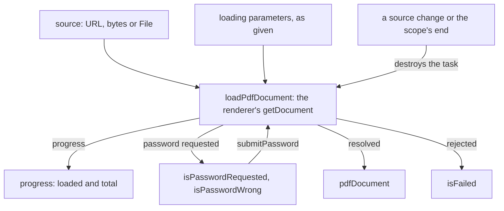

# Document

The package opens a source through whichever renderer the consumer hands it, and keeps the load's progress, its password prompt and its failure as state. Its behaviour is pinned by the requirements in [spec.md](spec.md), which sits next to this page.

## How it works

`usePdfDocument` watches the renderer and the source as one pair. A change to either, and the end of the owning scope, releases the load already running: its loading task is destroyed, the document is cleared, and anything that load reports later is discarded.

- **The renderer's own loader.** `loadPdfDocument` points the renderer's worker at the URL the consumer gives, then calls the renderer's `getDocument` with the consumer's data folders, the consumer's loading parameters, and the source.
- **Sources become URLs or byte arrays.** A URL is handed over as `url`. A `File` is read into bytes first, and a byte array is copied before it goes in as `data`, because the renderer takes ownership of whatever buffer it receives.
- **Progress is a ref.** Each progress report from the loading task replaces `progress`, which holds the bytes loaded so far and the total.
- **A protected file pauses the load.** When the renderer asks for a password, the package records the request and whether the previous attempt was rejected. `submitPassword` hands the answer back and the same task keeps going.
- **A failed load is recorded and logged.** A rejection that is not caused by a release sets `isFailed` and writes the error to the console. A rejection caused by a release is ignored, because the newer load has replaced it.

## Decisions

- **The renderer comes in from the consumer.** A consumer that must support an older browser passes that renderer's legacy build instead, and the built package contains no renderer code. Bundling `pdfjs-dist` inside the package would decide the build for every consumer and tie the package to one major version.
- **Loading parameters are forwarded untouched.** Range requests, streaming and automatic fetching are options the renderer already has, so the package neither adds to them nor removes any the consumer set.
- **A superseded load is torn down, never reported.** Sharing loaded documents between readers through a cache keyed by source was rejected, because it would need a reference count before any document could be destroyed safely.
- **The password prompt lives in state.** The consumer draws the prompt and calls `submitPassword`. Closing a dialog that shows the document leaves the prompt in place, and only the consumer's unmount releases the load.

## Key files

| File                                                              | Role                                                                                         |
| :---------------------------------------------------------------- | :------------------------------------------------------------------------------------------- |
| `packages/vue-pdfjs-headless/src/composables/usePdfDocument.ts`   | The load, its progress, its password prompt and its failure, released on a change or unmount |
| `packages/vue-pdfjs-headless/src/services/loadPdfDocument.ts`     | The renderer's `getDocument` with its data folders and the consumer's parameters             |
| `packages/vue-pdfjs-headless/src/services/getSourceParameters.ts` | A source as the loader's `url` or `data`                                                     |
| `packages/vue-pdfjs-headless/src/services/destroyLoadingTask.ts`  | Destroys a loading task that is no longer wanted                                             |
| `packages/vue-pdfjs-headless/src/models/PdfRenderer.ts`           | The renderer the consumer passes: its API, data folders and worker                           |

## Sources

- [PDF.js API](https://mozilla.github.io/pdf.js/api/draft/module-pdfjsLib.html): the parameters of `getDocument`, with range requests, streaming and automatic fetching among its options.
- [mozilla/pdf.js, `src/display/api.js`](https://github.com/mozilla/pdf.js/blob/master/src/display/api.js): where the loading task's `onPassword` and `onProgress` are defined, which the API page leaves out.
