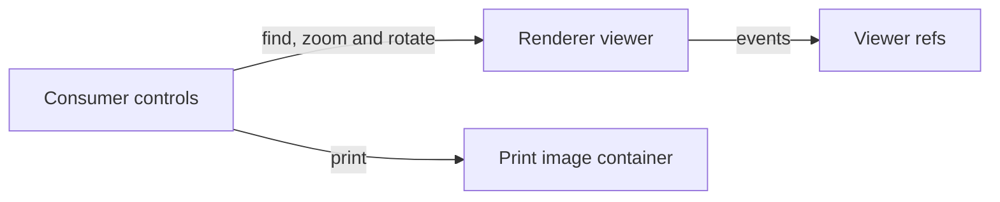

# Viewer

The viewer wraps the renderer's `PDFViewer`, together with its link service and find controller, and exposes them as refs and functions for the consumer's own container and elements. The package draws no chrome of its own: the pages and every control around them are the consumer's, which read the viewer's state. Requirements live in [spec.md](spec.md), next to this page.

## How it works

`usePdfViewer` creates the renderer's components on the consumer's container as soon as the container, the viewer's element and the renderer's viewer module exist, then applies whichever document is loaded. Events from the renderer are copied into refs, and the consumer's controls call plain functions.

- **Events update refs.** A page change writes `currentPageNumber`, a scale change writes the scale the zoom-in control reads, and the find events write `matchesCount` and `isNotFound`.
- **Searching hands the query to the find controller.** Case and whole-word options come from refs. Terms supplied with the document are passed as a list, so every match of each term is highlighted when the document arrives.
- **Zoom is clamped and anchored.** Scale moves between the renderer's limits, and fit-to-width, fit-to-page and actual-size are separate actions. Two pointers on the container drive pinch zoom, and Ctrl with the wheel drives the same scaling, both listened to by `usePdfZoomGesture`. In both cases the scroll is recomputed by `getZoomedScroll` so the content under the pointer stays where it was. A loaded document opens fitted to the container, once its pages exist, and a fit is written again when the container changes width.
- **Rotation turns the renderer's pages.** `rotate` steps the renderer's own rotation a quarter turn, and the package keeps no rotation state of its own.
- **Canvases are sized for the screen.** `usePdfPage` renders at the canvas's on-screen width multiplied by the device pixel ratio, lowered if the area would exceed the device cap. A new width starts a new draw and the draw in flight is superseded.
- **Printing uses rendered images.** Each page is rendered to an image at the capped size, in batches, into a container that is hidden on screen and shown by print styles only. Every image stays in that container until `afterprint`, and the container is removed then, or when the owning scope ends during a print still in progress.
- **Download saves the original bytes, or the saved ones once there is something to save.** The download goes through the shared `downloadFile` under the caller's file name. Its bytes are the original ones, or the renderer's saved bytes once the storage holds a form value or a watermark is set, as the [annotations](../annotations/design.md) page describes. The object URL is revoked on a zero-delay timer, so the download has a chance to start first.
- **A new document starts from the first page.** The renderer resets its page without an event, so `usePdfViewer` resets the page with the match state when a document is applied.
- **Disposing ends the viewer's listeners.** The renderer gets one abort signal per viewer, and the viewer's own listeners share it. Disposing clears the document, then aborts the signal.

## Decisions

- **State and actions instead of components.** A styled viewer inside the package was rejected, because a toolbar with the package's own markup would have to be overridden by every consumer.
- **The scroll under a pointer is computed here.** The renderer's own zoom keeps the current page in view and ignores the pointer, so the scroll is set by hand after the scale changes.
- **Search waits for the viewer's hand-off.** The renderer gives each document to its find controller itself once its first page draws. A search typed before that waits for it, and a cleared viewer has nothing to search.
- **Print renders every page to an image.** Printing the live page elements would only print the pages currently on screen, which is why each page is rendered separately.

## Key files

| File                                                               | Role                                                                                      |
| :----------------------------------------------------------------- | :---------------------------------------------------------------------------------------- |
| `packages/vue-pdfjs-headless/src/composables/usePdfViewer.ts`      | The viewer's events as refs, and its search, zoom, rotation, download and print           |
| `packages/vue-pdfjs-headless/src/composables/usePdfZoomGesture.ts` | Pinch and Ctrl-wheel zoom about the pointer, with its listeners under a signal of its own |
| `packages/vue-pdfjs-headless/src/composables/usePdfPage.ts`        | One page drawn into a canvas at its width, with the newest draw winning                   |
| `packages/vue-pdfjs-headless/src/services/getZoomedScroll.ts`      | The scroll that keeps a point's content in place as the scale changes                     |
| `packages/vue-pdfjs-headless/src/services/renderPrintSheets.ts`    | Every page rendered for print, in batches, into a print-only container                    |

## Sources

- [pdf.js viewer](https://github.com/mozilla/pdf.js/blob/master/web/pdf_viewer.js): where the renderer's page container and its event bus are defined.
- [PDF.js API](https://mozilla.github.io/pdf.js/api/draft/module-pdfjsLib.html): the page viewport and its point conversion.
