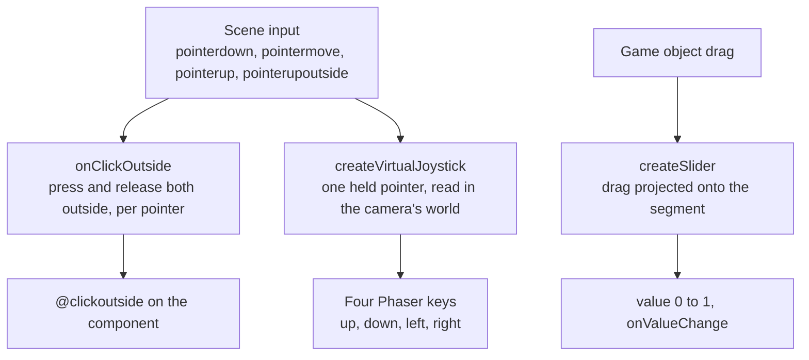

# Input

Three pointer helpers in `vue-phaserjs`, replacing the three plugins the dungeons took from `phaser4-rex-plugins`: `onClickOutside`, which backs the `@clickoutside` event every game object component emits, `createSlider` for the settings scene's volume thumb, and `createVirtualJoystick` for the mobile joystick. Each is a function over the scene's own input and a game object the consumer already owns, so nothing is registered as a Phaser plugin, nothing reads a `Phaser` global, and no helper ever destroys a game object a component created.

## How a pointer reaches them

- **Click outside.** A press and its release both outside the game object's hit area, through every camera under the pointer, is one click. Each pointer is followed on its own, a new press always decides afresh, and a game object hidden by itself or any container holding it is never clicked outside of.
- **Slider.** The drag point is projected onto the segment from start to end, so the slider runs in any direction. A drag reports its value through `onValueChange`; a value set through the slider moves the thumb and reports nothing, so a store that sets it is never called back.
- **Virtual joystick.** A pointer pressed within the radius of the base, or slid onto it while down, holds the joystick until it is released, on the canvas or off it. The thumb follows it, held within the radius, and the axis it is further along presses one of four `Input.Keyboard.Key`s, driven by real keyboard events so each key keeps its press time and duration. Inside the dead zone no key is down.

## Decisions

- **Functions over the scene's input, not plugins.** The upstream plugins were registered on the game's configuration and reached through the scene; a function takes the scene or the game object it works on and returns what stops it, so the consumer's own lifecycle ends it.
- **A four-way joystick.** The dungeons move in four directions only ([diagonal movement](../../../rejected/dungeons/diagonal-movement/design.md)), and the upstream default of eight directions pressed two keys on a diagonal, which the game's controls resolved by reading order. The joystick presses the dominant axis, the one a directional pad would.
- **Positions in the camera's world.** The joystick reads the pointer through `getWorldPoint` and the base by its position, so a zoom, a scroll and a scaled base image are read where they are drawn. The upstream hit area was a circle in the base's local space, which a scaled base shrank.
- **Game objects stay the consumer's.** The upstream joystick destroyed its base and thumb, which the `<Image>` components already own; here `destroy` only stops listening and lets the keys go.

## Key files

| File                                                                | Role                                                       |
| ------------------------------------------------------------------- | ---------------------------------------------------------- |
| `packages/vue-phaserjs/src/services/emit/onClickOutside.ts`         | the click outside, used by `useInitializeGameObjectEvents` |
| `packages/vue-phaserjs/src/services/input/createSlider.ts`          | the slider                                                 |
| `packages/vue-phaserjs/src/services/input/createVirtualJoystick.ts` | the joystick                                               |
| `packages/vue-phaserjs/src/models/input/`                           | the `Slider` and `VirtualJoystick` they return             |
| `apps/web/app/components/Dungeons/MobileJoystick/Index.vue`         | the joystick's consumer                                    |
| `apps/web/app/components/Dungeons/Settings/Menu/VolumeSlider.vue`   | the slider's consumer                                      |

## Upstream

The tracker of `rexrainbow/phaser3-rex-notes` holds 542 issues and pull requests for the whole plugin pack. Each was read; the 44 that name or discuss the click-outside, slider, virtual joystick or touch cursor plugins, or the dependency the override held, are listed below. The other 498 are about other plugins of the pack, out of scope since only these three were absorbed. The in-scope tests are in the suites beside each file; they were run once against the upstream plugins through a throwaway adapter, and the result is the Upstream column.

| Upstream                                                                                                         | Verdict                                                                                                                                        | Proof                                                                                       |
| ---------------------------------------------------------------------------------------------------------------- | ---------------------------------------------------------------------------------------------------------------------------------------------- | ------------------------------------------------------------------------------------------- |
| [#3](https://github.com/rexrainbow/phaser3-rex-notes/issues/3) Phaser 3 virtual joystick                         | false positive: usage question                                                                                                                 | answered with the docs link                                                                 |
| [#8](https://github.com/rexrainbow/phaser3-rex-notes/issues/8) Virtual joystick demo with sprites                | in scope, defect: a sprite base answered only in its top-left                                                                                  | `#8 holds a pointer anywhere within the radius of a scaled base`                            |
| [#11](https://github.com/rexrainbow/phaser3-rex-notes/issues/11) rexUI.gridTable error                           | out of scope: rexUI grid table                                                                                                                 | —                                                                                           |
| [#19](https://github.com/rexrainbow/phaser3-rex-notes/issues/19) Can I use it without importing?                 | false positive: usage question                                                                                                                 | answered with `load.plugin`                                                                 |
| [#32](https://github.com/rexrainbow/phaser3-rex-notes/issues/32) Unable to get rexVirtualJoyStick                | false positive: usage question, plugin key mismatch                                                                                            | no plugin is registered here                                                                |
| [#43](https://github.com/rexrainbow/phaser3-rex-notes/issues/43) Update listener while holding the thumb         | false positive: usage question                                                                                                                 | a key stays down while held: `presses the arrow key of the axis the thumb is further along` |
| [#102](https://github.com/rexrainbow/phaser3-rex-notes/issues/102) VirtualJoystick does not work with zoom       | in scope, defect                                                                                                                               | `#102 reads a zoomed camera's world`                                                        |
| [#105](https://github.com/rexrainbow/phaser3-rex-notes/issues/105) Changing position doesn't move the thumb      | not built: the joystick is placed once, by its base                                                                                            | —                                                                                           |
| [#106](https://github.com/rexrainbow/phaser3-rex-notes/pull/106) Fix virtual joystick set position issue         | not built: as #105                                                                                                                             | —                                                                                           |
| [#117](https://github.com/rexrainbow/phaser3-rex-notes/issues/117) ScrollablePanel with slider on the left       | out of scope: rexUI scrollable panel                                                                                                           | —                                                                                           |
| [#156](https://github.com/rexrainbow/phaser3-rex-notes/issues/156) Touch at the window's edge throws             | in scope, defect: the camera is never read from the pointer, and a release off the canvas lets go                                              | `#156 lets go when released off the canvas`                                                 |
| [#160](https://github.com/rexrainbow/phaser3-rex-notes/issues/160) Virtual Joystick Duration                     | in scope, defect                                                                                                                               | `#160 a released key holds how long it was down`                                            |
| [#163](https://github.com/rexrainbow/phaser3-rex-notes/issues/163) How to use with typescript?                   | false positive: the helpers are TypeScript                                                                                                     | —                                                                                           |
| [#178](https://github.com/rexrainbow/phaser3-rex-notes/issues/178) Virtual Joystick Keycode Undefined            | in scope, feature                                                                                                                              | `#178 holds the arrow keys' own key codes`                                                  |
| [#180](https://github.com/rexrainbow/phaser3-rex-notes/issues/180) Fails when switching scenes                   | in scope, defect                                                                                                                               | `#180 lets go of its keys when destroyed after its scene shut down`                         |
| [#181](https://github.com/rexrainbow/phaser3-rex-notes/pull/181) Update CursorKeys.js                            | in scope: the fix for #180                                                                                                                     | as #180                                                                                     |
| [#190](https://github.com/rexrainbow/phaser3-rex-notes/issues/190) Mouse wheel on scroll                         | out of scope: rexUI                                                                                                                            | —                                                                                           |
| [#202](https://github.com/rexrainbow/phaser3-rex-notes/issues/202) timeDown, timeUp and timeStamp not matching   | in scope, defect: real keyboard events carry the time                                                                                          | `#160 a released key holds how long it was down`                                            |
| [#208](https://github.com/rexrainbow/phaser3-rex-notes/issues/208) Virtual JoyStick out of control               | in scope, defect: a zoomed main camera; the ignored layer is Phaser's ([phaserjs/phaser#5883](https://github.com/phaserjs/phaser/issues/5883)) | `#102 reads a zoomed camera's world`                                                        |
| [#213](https://github.com/rexrainbow/phaser3-rex-notes/issues/213) Touching joystick and button at the same time | false positive: usage question, multi-touch                                                                                                    | `keeps a held joystick from a second pointer`; the game sets `activePointers`               |
| [#222](https://github.com/rexrainbow/phaser3-rex-notes/issues/222) scrollablePanel Angular compilation error     | out of scope: rexUI types                                                                                                                      | —                                                                                           |
| [#231](https://github.com/rexrainbow/phaser3-rex-notes/issues/231) Text position in a scrollable panel           | out of scope: rexUI                                                                                                                            | —                                                                                           |
| [#234](https://github.com/rexrainbow/phaser3-rex-notes/issues/234) The `nokey` property is undefined             | not built: no such property                                                                                                                    | —                                                                                           |
| [#235](https://github.com/rexrainbow/phaser3-rex-notes/issues/235) Percent is not defined                        | not built: the slider has no easing                                                                                                            | —                                                                                           |
| [#246](https://github.com/rexrainbow/phaser3-rex-notes/issues/246) Text area bounds in a container               | out of scope: rexUI                                                                                                                            | —                                                                                           |
| [#251](https://github.com/rexrainbow/phaser3-rex-notes/issues/251) Text area starting at the bottom              | out of scope: rexUI                                                                                                                            | —                                                                                           |
| [#257](https://github.com/rexrainbow/phaser3-rex-notes/issues/257) Thumb height based on content                 | out of scope: rexUI scroll bar                                                                                                                 | —                                                                                           |
| [#271](https://github.com/rexrainbow/phaser3-rex-notes/issues/271) Mini container ordering                       | out of scope: rexUI                                                                                                                            | —                                                                                           |
| [#277](https://github.com/rexrainbow/phaser3-rex-notes/issues/277) PointToCellIndex table is null                | out of scope: rexUI                                                                                                                            | —                                                                                           |
| [#288](https://github.com/rexrainbow/phaser3-rex-notes/issues/288) Can VirtualJoystick and Button coexist?       | false positive: usage question, multi-touch                                                                                                    | as #213                                                                                     |
| [#351](https://github.com/rexrainbow/phaser3-rex-notes/issues/351) Sizers broken after a change                  | out of scope: rexUI, a version mismatch                                                                                                        | —                                                                                           |
| [#359](https://github.com/rexrainbow/phaser3-rex-notes/issues/359) Fixed elements in a scrollable container      | out of scope: rexUI                                                                                                                            | —                                                                                           |
| [#369](https://github.com/rexrainbow/phaser3-rex-notes/issues/369) Prevent snapping back to 0                    | false positive: usage question, the dead zone                                                                                                  | `deadZone` is a required option                                                             |
| [#375](https://github.com/rexrainbow/phaser3-rex-notes/issues/375) Lock joystick on horizontal axis              | not built: a four-way pad is the one mode                                                                                                      | —                                                                                           |
| [#399](https://github.com/rexrainbow/phaser3-rex-notes/issues/399) Wrong touch using the camera                  | in scope, defect                                                                                                                               | `#399 reads a scrolled camera's world`                                                      |
| [#413](https://github.com/rexrainbow/phaser3-rex-notes/issues/413) Dialog cover under camera zoom                | out of scope: rexUI                                                                                                                            | —                                                                                           |
| [#438](https://github.com/rexrainbow/phaser3-rex-notes/issues/438) Blur input inside a modal                     | in scope, defect: a cover blocked the click outside                                                                                            | `#438 counts a click on another game object covering the pointer`                           |
| [#440](https://github.com/rexrainbow/phaser3-rex-notes/issues/440) Scrollable panel doesn't scroll horizontally  | out of scope: rexUI                                                                                                                            | —                                                                                           |
| [#471](https://github.com/rexrainbow/phaser3-rex-notes/issues/471) ui-gridtable bug                              | out of scope: rexUI                                                                                                                            | —                                                                                           |
| [#526](https://github.com/rexrainbow/phaser3-rex-notes/issues/526) Max force when centred                        | in scope, defect                                                                                                                               | `#526 a pointer held at the centre presses no key`                                          |
| [#551](https://github.com/rexrainbow/phaser3-rex-notes/issues/551) A version for Phaser 4                        | in scope, defect: `Phaser is not defined`                                                                                                      | the suite runs with no `Phaser` global stub                                                 |
| [#552](https://github.com/rexrainbow/phaser3-rex-notes/pull/552) Bump i18next-http-backend to 3.0.5              | out of scope: the pack's own dependency, gone with it                                                                                          | —                                                                                           |
| [#596](https://github.com/rexrainbow/phaser3-rex-notes/pull/596) Bump i18next-http-backend to 4.0.2              | out of scope: as #552                                                                                                                          | —                                                                                           |
| [#603](https://github.com/rexrainbow/phaser3-rex-notes/pull/603) Bump i18next-http-backend to 4.0.4              | out of scope: as #552; the override it held, for GHSA-xvq9-wjp8-hwqf, is deleted                                                               | —                                                                                           |

Counts: 13 in scope, 5 not built, 8 false positives, 18 out of scope listed above, and 498 out of scope as other plugins — 542.

Defects found reading the upstream source, each failing against it:

| Defect                                                                             | Proof                                                                              |
| ---------------------------------------------------------------------------------- | ---------------------------------------------------------------------------------- |
| The slider ran backwards when its end was before its start                         | `runs from start to end when the end is before the start`                          |
| A slider kept its drag listener after `destroy`, and the next drag threw           | `ignores a drag once destroyed`                                                    |
| Click outside fired for a game object inside a hidden container                    | `ignores a game object whose container is hidden`                                  |
| A press released off the canvas stayed held and turned the next press into a click | `does not carry a press whose release never reached the scene into the next click` |
| Click outside followed one pointer, so a second finger's click was lost            | `follows each pointer on its own`                                                  |

The joystick's issue-named tests drive the scene's input, while the upstream joystick listened on its base game object, so against it they record no comparison; their threads record each fix upstream, and the tests stay as pins.

## Sources

- [rexrainbow/phaser3-rex-notes](https://github.com/rexrainbow/phaser3-rex-notes) — the upstream repository, `plugins/input/clickoutside`, `plugins/input/slider`, `plugins/input/virtualjoystick` and `plugins/input/touchcursor` at 4.2.0.
- Phaser 4 — `Input.InputManager#hitTest`, `Cameras.Scene2D.Camera#getWorldPoint`, `Input.Keyboard.Key#onDown` and `#onUp`.
