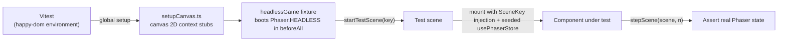

# Testing

All vue-phaserjs tests run against a real headless Phaser game (`type: Phaser.HEADLESS`) rather than mocks. Testing SetterMaps or stores in isolation with mock objects provides little signal — the real signal comes from mounting a component against an actual scene and asserting that Phaser state changed correctly. SetterMap behaviour is covered once, generically, in the `useInitializeGameObject` tests ("applies the initial configuration via the SetterMap to the game object on init", "calls the Phaser setter and reflects the new value when a configuration property changes"); it is not repeated per setter.

## How it works

happy-dom does not provide enough DOM API for Phaser out of the box, so a global setup file stubs the missing canvas 2D context methods. Phaser's `Text` game object needs a fuller stub than the rest (`scale`, `rotate`, `translate`, `measureText`, and friends) — all are covered in `setupCanvas.ts`. The same file sets a data-URL image's `src` on a task, as a browser's load is: happy-dom fires that load synchronously, so a game's READY came before its texture stamp existed and the next frame after a `destroy` threw. A game therefore becomes ready after its constructor, and the fixture waits for READY before it parks the loop. `game.step()` is unusable in headless mode because the renderer is null, so a `stepScene(scene, n)` helper calls the registered lifecycle listeners directly, letting `onUpdate` / `onNextTick` handlers fire a deterministic number of times.

The fixture boots one game per suite (`beforeAll`) and destroys it in `afterAll`. `startTestScene(key)` adds a scene without auto-start so ready/shutdown listeners are in place before the scene boots, then hands back the live scene for mounting components inside the injection context the library expects.

## What is covered

Every suite mounts its components inside the real headless scene the fixture boots, so an assertion reads Phaser's own state, not a mock of it. `Sprite` has no suite of its own; the `Container` and `useInitializeGameObject` suites mount it, so it is covered indirectly.

## Key files

| File                                                                    | Role                                                                  |
| ----------------------------------------------------------------------- | --------------------------------------------------------------------- |
| `packages/vue-phaserjs/vitest.config.ts`                                | happy-dom environment + global setup wiring                           |
| `packages/vue-phaserjs/src/test/setupCanvas.ts`                         | Stubs the canvas 2D context methods Phaser needs under happy-dom      |
| `packages/vue-phaserjs/src/test/fixtures/headlessGame.test.ts`          | Boots/destroys the headless game; `startTestScene` helper             |
| `packages/vue-phaserjs/src/composables/useInitializeGameObject.test.ts` | Generic SetterMap + lifecycle coverage for all game object components |

## Notes

- Asset loading (`onPreload` / `scene.load.*`) fails in headless mode without real files, so preload tests either skip asset assertions or stub the textures they need ([testing spec](spec.md)).
